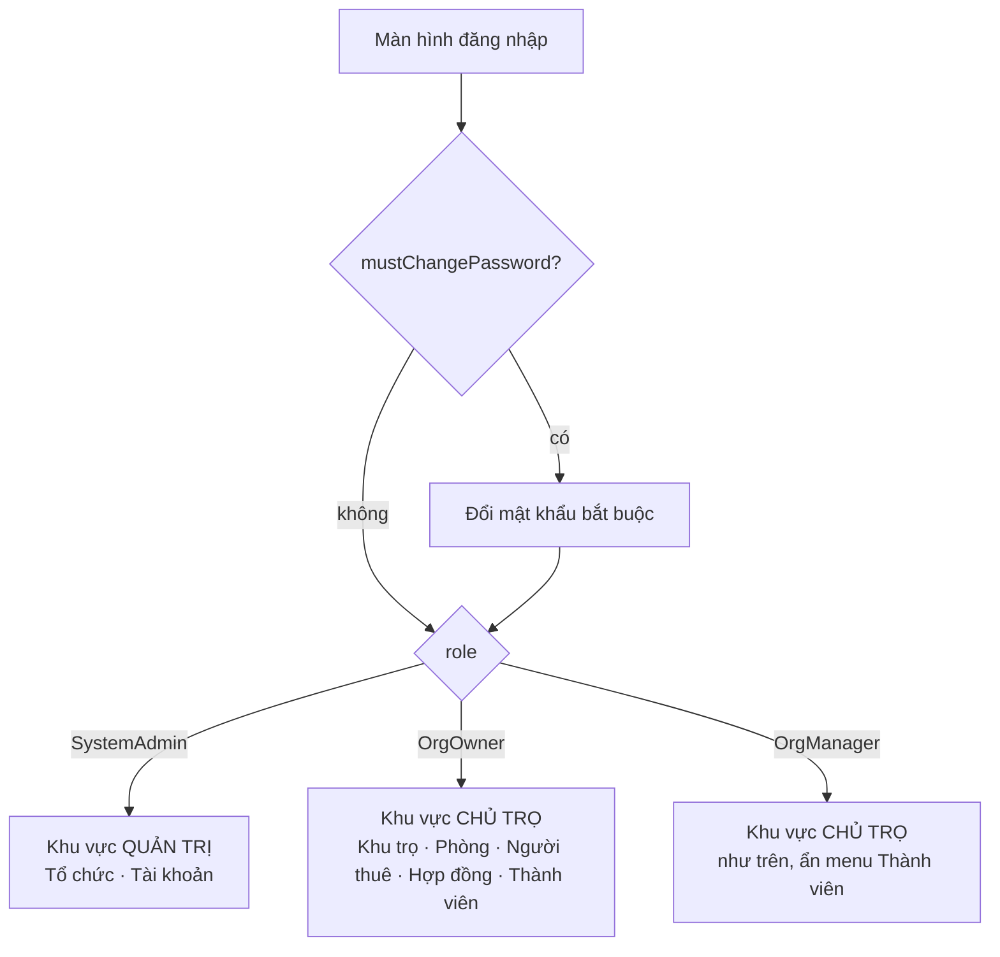
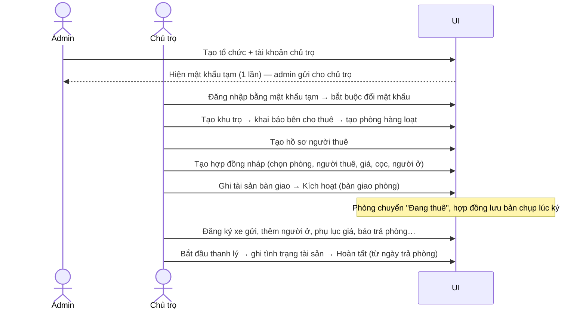
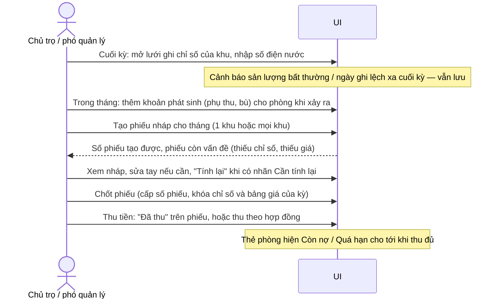

# Tài liệu API cho UI — Phần mềm quản lý nhà trọ

> Dành cho **người làm giao diện** (web / mobile): hiểu từng chức năng nghiệp vụ, cần những màn hình nào,
> gọi endpoint nào, gửi gì – nhận gì, xử lý lỗi ra sao, nút nào bật/tắt theo trạng thái.
>
> Ví dụ JSON trong thư mục này lấy từ **response thật** của API (cập nhật tới 17/10/2026).
>
> **Đổi 17/10/2026 (UI cần sửa):** chuyển phòng luôn từ hôm nay — bỏ `date`, bỏ `POST …/transfer-room/cancel`, chuyển nhầm thì chuyển lại về
> phòng cũ trong ngày ([contracts.md](contracts.md#chuyển-phòng)); điện nước phòng cũ cộng vào dòng điện của phiếu, không còn khoản chốt; tạo phiếu
> thiếu chỉ số ⇒ bỏ qua `MISSING_READING` (không tạo nháp), hóa đơn trả phòng khu thu trước tách 2 dòng điện ([invoices.md](invoices.md));
> thay / tháo công tơ lùi vào kỳ đã chốt ⇒ `METER_PERIOD_LOCKED` ([meters.md](meters.md)).
>
> **Thêm 18/10/2026:** thực thu tách khỏi bỏ nợ — hiện "Đã thu" bằng `collectedAmount`, thêm "Đã bỏ nợ" `writtenOffAmount` ([invoices.md](invoices.md),
> [payments.md](payments.md)); `segments` có `roomCode` / ngày để hiện từng phòng dưới dòng Điện; **điều chỉnh chỉ số đã chốt**
> `POST /meter-readings/{id}/adjust` tự tạo khoản bù / phụ thu ([meters.md](meters.md#điều-chỉnh-chỉ-số-đã-chốt-18102026--mt-uc-09)).
> **Đổi 20/10/2026 — Lượt 2 (UI cần sửa):** màn thanh lý gom tất cả + hoàn tất một lần (`refund`, `pendingCharges`, `deposit` trong body;
> `REFUND_PENDING` không còn là blocker — [contracts.md](contracts.md#thanh-lý)); kỳ cuối `finalPeriodCharge` **Thu trọn kỳ (mặc định)** / Theo ngày ở / Không thu (áp cả dịch vụ), màn thanh lý hiện số tiền 3 cách; kỳ ảo ⇒
> "Coi như trả phòng từ `lastBilledEnd`"; không còn gì để thu ⇒ không cần hóa đơn trả phòng (`finalInvoiceRequired`); sửa tay hóa đơn trả phòng bắt buộc
> lý do; `RENT_OVERPAID` có `amount` / `ref` (nút "Thêm hoàn trả"); chi tiết hóa đơn trả phòng có `finalPeriod`;
> cọc "Không trả cọc" (`Forfeited`); báo trả phòng ⇒ bỏ qua hóa đơn tháng (`MOVE_OUT_NOTICED`), nhãn `moveOutDate`, rút báo trả phòng; khoản tạo được sau
> khi chốt hóa đơn trả phòng; điều chỉnh số cuối sau thanh lý (`handling: AfterEnd`, `POST /room-charges/{id}/waive`), người mới nhập số nhỏ hơn
> (`HANDOVER_BELOW_PREVIOUS_FINAL`, `correctPreviousFinal`); điều chỉnh làm hóa đơn tháng âm ⇒ `ADJUSTMENT_NEGATIVE_TOTAL` ([meters.md](meters.md)).
> [`openapi.json`](openapi.json): danh sách endpoint và kiểu **request** đầy đủ; **hầu hết endpoint chưa khai kiểu response** —
> cấu trúc dữ liệu trả về lấy từ ví dụ JSON trong các file `.md` này, không sinh kiểu response từ `openapi.json`.

## Mục lục

| File | Nội dung | Ai dùng |
|------|----------|---------|
| [conventions.md](conventions.md) | Quy ước chung: xác thực, token, phân trang, version, Idempotency-Key, lỗi, enum, ngày giờ, tiền | **Đọc trước** |
| [auth.md](auth.md) | Đăng nhập, đổi mật khẩu lần đầu, làm mới token, đăng xuất, hồ sơ | Mọi người |
| [admin.md](admin.md) | Quản trị nền tảng: tổ chức chủ trọ, cấp lại mật khẩu, khóa tài khoản | SystemAdmin |
| [members.md](members.md) | Chủ trọ quản lý phó quản lý | Chủ trọ |
| [audit.md](audit.md) | Nhật ký thao tác: ai đã làm gì, với đối tượng nào, lúc nào | Chủ trọ |
| [properties.md](properties.md) | Khu trọ, bên cho thuê, tài khoản ngân hàng, nội quy | Chủ trọ, phó quản lý |
| [rooms.md](rooms.md) | Phòng, trạng thái phòng, bảo trì, nhóm phòng | Chủ trọ, phó quản lý |
| [renters.md](renters.md) | Hồ sơ người thuê / người ở | Chủ trọ, phó quản lý |
| [fees.md](fees.md) | Khoản thu của khu: điện nước theo công tơ; dịch vụ theo phòng / đầu người / số gói (mạng, nước theo người, giữ xe); bảng giá (một giá) | Chủ trọ, phó quản lý |
| [meters.md](meters.md) | Công tơ điện nước của phòng: lắp, thay (phiên bản), tháo, lịch sử, sửa chỉ số; lưới ghi chỉ số hằng tháng | Chủ trọ, phó quản lý |
| [invoices.md](invoices.md) | Phiếu tiền phòng: tạo nháp theo tháng, sửa tay, phụ thu, tính lại, chốt, hủy | Chủ trọ, phó quản lý |
| [room-charges.md](room-charges.md) | Khoản phát sinh theo phòng: phụ thu / bù tạo ngay lúc xảy ra, đã thanh toán hay chưa, tự vào phiếu cuối tháng | Chủ trọ, phó quản lý |
| [payments.md](payments.md) | Thu tiền ("Đã thu"), phiếu thu, đảo phiếu thu, còn nợ | Chủ trọ, phó quản lý |
| [contract-templates.md](contract-templates.md) | Mẫu hợp đồng theo loại (thuê phòng trọ / thuê nhà): tiêu đề, điều khoản, trường tùy biến | Chủ trọ, phó quản lý |
| [contracts.md](contracts.md) | Hợp đồng: tạo, kích hoạt, người ở, phụ lục, báo trả phòng, thanh lý, tài sản, xe | Chủ trọ, phó quản lý |
| [imports.md](imports.md) | Nhập từ Excel: phòng; người thuê + lượt thuê đang ở (xem trước → xác nhận) | Chủ trọ |
| [exports.md](exports.md) | Xuất Excel danh sách người thuê theo khu / tầng / nhóm phòng / phòng / khoảng ngày | Chủ trọ, phó quản lý |
| [errors.md](errors.md) | Bảng mã lỗi → câu thông báo / hành động UI | Mọi người |
| [openapi.json](openapi.json) | Đặc tả OpenAPI 3 | Sinh code |

## Vai trò & khu vực giao diện



| Vai trò (`role`) | Thấy gì | Không được |
|------------------|---------|-----------|
| `SystemAdmin` | Danh sách tổ chức, tài khoản | **Không** xem dữ liệu trọ (khu, phòng, người thuê, hợp đồng) — API trả 403 |
| `OrgOwner` (chủ trọ) | Toàn bộ dữ liệu tổ chức mình + quản lý phó quản lý | Dữ liệu tổ chức khác (API trả 404) |
| `OrgManager` (phó quản lý) | Như chủ trọ | Thêm / sửa / khóa / gỡ thành viên, nhật ký đăng nhập, sửa thông tin tổ chức, **tự sửa hồ sơ** (API trả 403). **Bỏ nợ** và **xem số giấy tờ đầy đủ** chỉ khi chủ trọ cấp riêng — đọc `canWriteOff`, `canViewSensitiveData` |

Đọc `role`, `canWriteOff`, `canViewSensitiveData` từ `GET /api/v1/me` sau khi đăng nhập để dựng menu và bật / tắt nút ([auth.md](auth.md#quyền-theo-từng-người--đọc-từ-get-me-bổ-sung-13102026)).

## Sơ đồ màn hình đề xuất (khu vực chủ trọ)

Mỗi dòng ghi endpoint chính và file mô tả chi tiết.

```
├── Tổng quan                                  (chưa có API — xem cuối trang)
├── Khu trọ                                    properties.md
│   ├── Danh sách / tạo / sửa khu              GET, POST /properties · PUT /properties/{id}
│   └── Chi tiết khu (tab)
│       ├── Thông tin chung + cài đặt thu      PUT /properties/{id}/billing
│       ├── Bên cho thuê ⚠ cần trước khi ký HĐ PUT /properties/{id}/lessor
│       ├── Tài khoản ngân hàng · Nội quy      PUT …/bank-account · …/house-rules
│       ├── Khoản thu + bảng giá               GET /properties/{id}/fee-types            fees.md
│       ├── Phòng (lưới theo tầng) · Nhóm phòng GET /rooms?propertyId= · …/room-groups    rooms.md
│       ├── Công tơ: lắp / thay hàng loạt      …/meters/install-sheet · /bulk · /replace-sheet · /bulk-replace   meters.md
│       ├── Sản lượng phòng trống              GET …/meters/vacant-usage                  meters.md
│       └── Nhập Excel (phòng, người đang ở)   …/rooms/import · …/tenancies/import        imports.md
├── Phòng                                      rooms.md
│   ├── Danh sách / lọc trạng thái, còn nợ     GET /rooms
│   ├── Tạo phòng / tạo hàng loạt              POST /properties/{id}/rooms[/bulk]
│   └── Chi tiết phòng (tab)
│       ├── Hợp đồng hiện hành                 GET /rooms/{id}
│       ├── Công tơ + lịch sử chỉ số           GET /rooms/{id}/meters · /meters/{id}/readings   meters.md
│       ├── Phiếu của phòng                    GET /rooms/{id}/invoices                   invoices.md
│       ├── Khoản phát sinh                    GET /rooms/{id}/charges                    room-charges.md
│       └── Lịch sử thuê                       GET /rooms/{id}/tenancy-history
├── Người thuê                                 renters.md
│   ├── Tìm kiếm (theo khu, đang ở, đã ẩn)     GET /renters · POST /renters/search
│   ├── Tạo / sửa hồ sơ · ẩn / hiện lại        POST, PUT /renters · …/archive · …/restore
│   ├── Ghi nhận đồng ý xử lý dữ liệu          GET, POST /renters/{id}/consents
│   ├── Tìm "ai đã ở phòng nào"                GET /tenancy-history?search=               rooms.md
│   └── Xuất Excel danh sách người thuê        POST /exports/renters                      exports.md
├── Hợp đồng                                   contracts.md
│   ├── Mẫu hợp đồng                           GET /contract-templates                    contract-templates.md
│   ├── Danh sách (lọc: sắp hết hạn, cần xử lý) GET /contracts
│   ├── Tạo hợp đồng (wizard) → kích hoạt      POST /contracts · …/activate
│   └── Chi tiết hợp đồng (tab + nút theo trạng thái)
│       ├── Người ở, đồng thuê, đổi người đứng tên, chuyển người
│       ├── Giá thuê, dịch vụ, xe, tài sản, cọc
│       ├── Gia hạn · Ở tiếp · Chuyển phòng (chuyển nhầm ⇒ chuyển lại trong ngày)
│       └── Thanh lý: xem trước → hóa đơn trả phòng → hoàn tất   GET …/liquidation/preview
├── Hằng tháng
│   ├── Ghi chỉ số điện nước                   GET …/meter-reading-sheet · PUT …/meter-readings   meters.md
│   ├── Phiếu tiền phòng                       POST /invoices/generate[-bulk] · GET /invoices · /invoices/totals   invoices.md
│   ├── Khoản phát sinh (phụ thu / bù)         GET /room-charges                          room-charges.md
│   └── Thu tiền                               GET /contracts/{id}/balance · POST /contracts/{id}/payments · GET /payments   payments.md
├── Thành viên (chỉ chủ trọ thao tác)          /org/members                               members.md
│   ├── Phó quản lý: thêm, sửa, khóa, quyền bỏ nợ, quyền xem giấy tờ
│   ├── Nhật ký đăng nhập                      GET /org/login-events
│   └── Thông tin tổ chức · thời gian giữ dữ liệu   GET, PUT /org
├── Nhật ký thao tác                           GET /audit-logs                            audit.md
└── Hồ sơ của tôi · đổi mật khẩu               GET, PUT /me · POST /auth/change-password   auth.md
```

## Luồng sử dụng điển hình



## Vòng làm việc hằng tháng



## Chưa có trong API (đừng làm UI)

Cập nhật 13/10/2026. Công tơ & ghi chỉ số, phiếu tiền phòng, thu tiền, khoản phát sinh **đã có API** (xem các file tương ứng). Những phần sau **chưa có
endpoint**:

- **Trang Tổng quan / dashboard, báo cáo doanh thu, công nợ** và các file Excel khác ngoài danh sách người thuê (M10).
- **Tải lên / tải xuống file**: ảnh giấy tờ, ảnh công tơ, bản hợp đồng đã ký (M09). Hiện chỉ có cờ "đã có bản ký" trên hợp đồng.
- **Danh mục tỉnh / xã**: địa chỉ đang nhập chữ tự do.
- **In / gửi phiếu** (PDF, Zalo, mã QR chuyển khoản), in phụ lục / biên bản bàn giao. Hiện chỉ tải được văn bản hợp đồng `.docx`.
- **Quên mật khẩu**: chủ trọ / quản trị cấp lại mật khẩu tạm.
- **Thủ tục cư trú** (tạm trú, tạm vắng, nhắc việc).
- Thanh toán online, đối soát ngân hàng, người thuê tự đăng nhập.
