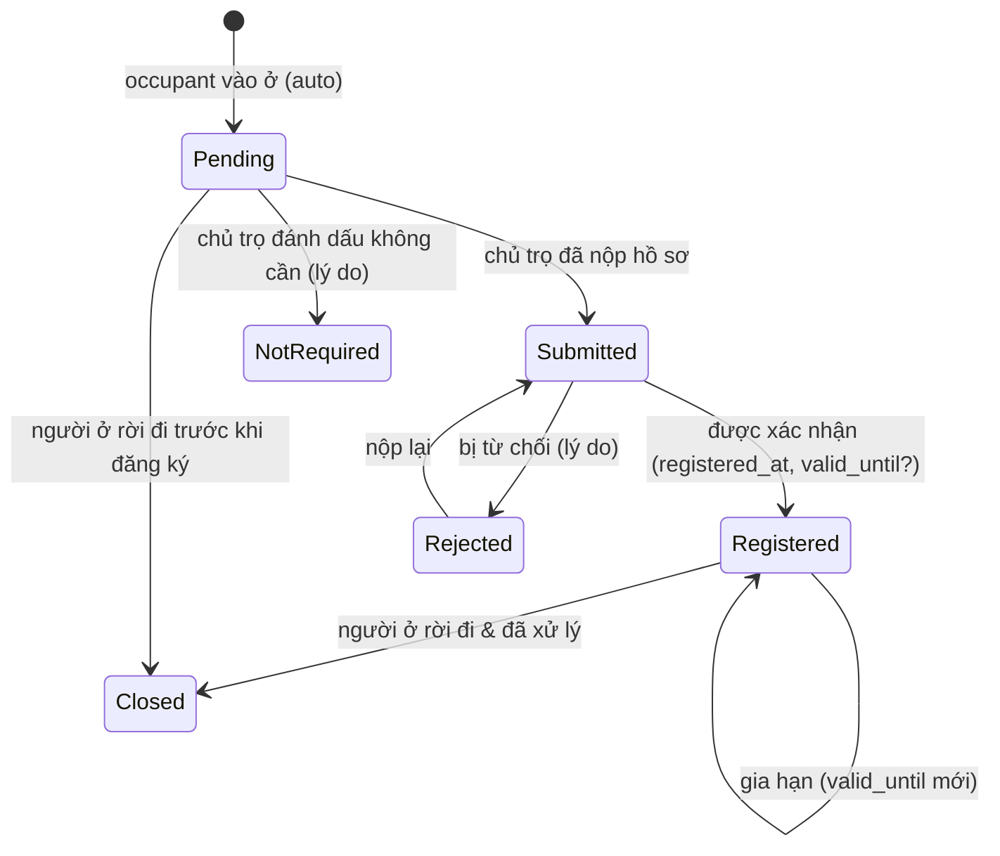

# M03 — Renter & Residence (Người thuê, Cư trú, Tạm vắng)

> Theo khuôn [_TEMPLATE.md](_TEMPLATE.md). Pháp lý: L5–L8, L11, L14 trong [00-legal-basis.md](00-legal-basis.md).

## 1. Mục tiêu & phạm vi

**Mục tiêu**: Lưu **hồ sơ người thuê / người ở** (renter) rõ ràng, chính xác, bảo vệ dữ liệu cá nhân.

> **Đổi phạm vi (chốt 04/10/2026) — phần cư trú để sau**: thông tin cư trú **chính là hồ sơ người thuê + người ở trong phòng**
> (thêm người vào phòng đã lưu đủ thông tin — M05 `contract_occupants`, kèm quan hệ với chủ hộ CT-BR-28..30). Làm giấy tờ tạm trú
> (khoảng 1 lần / năm), bản ghi thủ tục, tạm vắng, nhắc việc, sự kiện domain: **xử lý sau** — các mục đánh dấu ⏸ bên dưới.

**Trong phạm vi (P1)**: CRUD hồ sơ, tìm kiếm, chống trùng theo số giấy tờ; ghi nhận đồng ý xử lý dữ liệu; ẩn danh hóa theo yêu cầu.
Người ở / chuyển đi: M05. ⏸ P2: bản ghi cư trú + trạng thái + file xác nhận; tạm vắng.

**Ngoài phạm vi**: nộp hồ sơ lên VNeID/Cổng DVC; xác thực CCCD với CSDL quốc gia; OCR CCCD (P3).

**Phase**: P1 (hồ sơ người thuê); P2 (theo dõi thủ tục tạm trú, nhắc việc tự động, tạm vắng).

**Trạng thái (10/10/2026)**: ✅ đã code — tạo / sửa / tìm hồ sơ, chống trùng số giấy tờ, xem số đầy đủ (audit), ẩn danh tự động + bằng tay,
nhập người đang ở từ Excel. **12/10/2026 — đã code thêm**: lịch sử thuê theo phòng (RT-UC-04), ghi nhận đồng ý xử lý dữ liệu (RT-UC-05), ẩn / hiện lại hồ sơ (RT-BR-05), lọc người thuê theo khu / đang ở. **Chưa code**: ảnh giấy tờ (chờ M09), toàn bộ phần cư trú ⏸ P2 (các bảng `residence_records`, `absence_records` chưa tồn tại).

## 2. Thuật ngữ

| Thuật ngữ | Code | Định nghĩa |
|-----------|------|-----------|
| Người thuê | `Renter` | Một con người (hồ sơ). Có thể là người đại diện ký HĐ và/hoặc người ở (occupant) — vai trò nằm ở M05 |
| Giấy tờ | `IdDocument` | `CitizenId` (CCCD/thẻ căn cước 12 số), `LegacyId` (CMND 9 số – chỉ để lưu lịch sử), `Passport` |
| Bản ghi cư trú | `ResidenceRecord` | Theo dõi thủ tục cư trú của 1 người ở tại 1 hợp đồng |
| Loại cư trú | `ResidenceType` | `TemporaryResidence` (tạm trú ≥30 ngày), `StayNotice` (lưu trú <30 ngày). Người nước ngoài: ngoài phạm vi (L7) |
| Tạm vắng | `AbsenceRecord` | Khoảng thời gian người ở vắng mặt (ghi nhận thông tin) |
| Đồng ý | `Consent` | Ghi nhận người thuê đồng ý cho chủ trọ thu thập/xử lý dữ liệu (L11) |

## 3. Nghiệp vụ

### 3.1 Use case

| ID | Mô tả |
|----|-------|
| RT-UC-01 ✅ | Tạo hồ sơ người thuê. Ảnh CCCD mặt trước/sau, ảnh chân dung: chưa code (chờ M09) |
| RT-UC-02 ✅ | Tìm người thuê theo tên, SĐT (`GET /renters?q=`), **số giấy tờ khớp chính xác** (`POST /renters/search` — không để số giấy tờ trên URL); gợi ý hồ sơ cũ khi nhập trùng số giấy tờ |
| RT-UC-10 ✅ | **Import người thuê đang ở từ Excel** (chốt 09/10/2026, thiết kế lại 09/10; **11/10/2026**: một phòng có **nhiều dòng "Đứng tên"** ⇒ dòng đầu là người đứng tên, các dòng sau nhập là **đồng thuê** (M05 CT-BR-49 — phải ở trong phòng và có giấy tờ; cảnh báo `IMPORTED_AS_CO_TENANT`), giá thuê / cọc chỉ đọc ở dòng đầu; "Đứng tên (không ở)" thứ hai vẫn lỗi `REPRESENTATIVE_COUNT`; **11/10/2026**: xem trước báo `ROOM_PERIOD_OVERLAP` khi phòng còn HĐ khác — đã kết thúc / đã chuyển đi — ở tới sau ngày vào ở khai trong file) — chỉ để **tạo mới hàng loạt khi chuyển từ sổ sang phần mềm**. Mẫu `GET /properties/{id}/tenancies/import-template`: **1 sheet, mỗi dòng 1 người**: mã phòng*, **vai trò*** (`Đứng tên` · `Đứng tên (không ở)` · `Ở cùng`), họ tên*, ngày sinh*, giới tính*, SĐT, loại + số giấy tờ (bắt buộc nếu ≥ 14 tuổi hoặc đứng tên — RT-BR-01), quốc tịch, quê quán, nghề nghiệp, quan hệ với người đứng tên, ngày vào ở* (≤ hôm nay), giá thuê* + tiền cọc (chỉ đọc ở dòng đứng tên). Các dòng cùng mã phòng = 1 HĐ; **đơn vị lưu = phòng** (1 người lỗi ⇒ cả phòng bỏ qua, không tạo hồ sơ cho người chỉ thuộc phòng lỗi). Lưu mỗi phòng: dùng lại / tạo người thuê → HĐ (ngày bắt đầu = ngày vào ở sớm nhất; **tính tiền từ** đầu kỳ hiện tại của khu, vào ở giữa kỳ ⇒ từ ngày vào ở; thiếu bản ký) → kích hoạt (chỉ số nhận phòng = số mới nhất của công tơ). **Không** có chỉ số công tơ, dịch vụ, xe — dịch vụ thêm sau qua FE-UC-08 (khoản "tự gắn" vẫn tự gắn), xe qua màn phương tiện. **Hỗ trợ**: gia đình / ở ghép vào phòng trống; người đứng tên không ở; **1 người đứng tên nhiều phòng** (ở thật tối đa 1 phòng); trẻ < 14 tuổi không giấy tờ (chỉ `Ở cùng`); người đã có hồ sơ mà không đang ở HĐ mở ⇒ dùng lại, **không sửa** (khác thông tin ⇒ cảnh báo chênh lệch); người nước ngoài (hộ chiếu); quan hệ chưa khai / chưa hợp lý, người đứng tên < 18 ⇒ cảnh báo (CT-BR-46); import lại cùng file không nhân đôi. **Chặn**: phòng đã có HĐ nháp / đang ở / đang thanh lý (kể cả để thêm người — dùng màn HĐ); phòng không có / ngừng dùng; ngày vào ở sau hôm nay; một người **ở** 2 phòng (trong file hoặc đang ở phòng khác); ≥ 14 tuổi hoặc đứng tên mà thiếu giấy tờ; phòng không có / có 2 người đứng tên, không có ai ở; cùng số giấy tờ khác họ tên / ngày sinh; quan hệ sai danh mục. Không nhập: người đã rời đi (lịch sử), nợ cũ, cọc đã thu (để sau). Chỉ số công tơ ghi lần cuối trước kỳ tính tiền > 31 ngày ⇒ cảnh báo cập nhật chỉ số. Luồng chung (chốt lại 09/10/2026): **xem trước** `POST …/import/preview` (multipart `file`) đọc file, trả từng dòng + lỗi theo ô — **server không giữ gì** (đóng màn là mất); người dùng sửa thẳng ô sai trên màn hình hoặc sửa file tải lại; **lưu** `POST …/import` (JSON các dòng, bắt buộc `Idempotency-Key`) ⇒ server **kiểm lại toàn bộ** theo dữ liệu lúc đó, **lưu phần hợp lệ** (mỗi đơn vị 1 transaction), trả kết quả từng đơn vị (đã lưu / bỏ qua + lý do). Import **chỉ tạo mới** — không sửa / ghi đè / kết thúc dữ liệu đang có; server bỏ qua mọi id do client gửi (tra theo mã phòng, số giấy tờ). Giới hạn: `.xlsx` ≤ 2 MB (chặn ở web server), giải nén ≤ 20 MB (chống zip bomb), ≤ 500 dòng, chỉ đọc sheet / cột của mẫu, ô công thức ⇒ lỗi (RP-BR-02), ≤ 10 lần xem trước / phút / người, chỉ chủ trọ; audit 1 dòng `Import`. |
| RT-UC-03 ✅ | Sửa hồ sơ |
| RT-UC-04 ✅ | **Lịch sử thuê theo phòng** (đổi 11/10/2026 — **không** làm lịch sử theo người: người thuê ít di chuyển, chỉ cần biết ai đã từng ở phòng nào): `GET /rooms/{id}/tenancy-history` — mỗi lần một HĐ ở phòng (kể cả lần ở trước khi chuyển phòng): số HĐ, từ – đến, người đứng tên, từng người ở với vai trò (đứng tên / đồng thuê / người ở) và khoảng ngày ở trong lần đó; mới nhất trước. **Tìm theo tên** (VD công an hỏi): `GET /tenancy-history?search=&propertyId=` → người khớp tên đã ở phòng nào, HĐ nào, từ – đến (≥ 2 ký tự, tối đa 200 dòng). Chỉ trả họ tên — hồ sơ hết thời gian giữ vẫn còn tên (RT-BR-06) nên vẫn tra được |
| RT-UC-05 ✅ | **Ghi nhận đồng ý xử lý dữ liệu** (12/10/2026): `GET/POST /renters/{id}/consents` — mục đích (VD `contract_management`, `residence_registration`), phương thức (`PaperSigned` ký giấy / `ContractClause` điều khoản trong HĐ / `Verbal` xác nhận miệng), ngày đồng ý, ghi chú; **rút lại** `POST /renters/{id}/consents/{consentId}/withdraw` `{ withdrawnOn }` (giữ dòng, ghi ngày rút). Hồ sơ đã ẩn danh ⇒ không ghi thêm (422 `RENTER_ANONYMIZED`). Chỉ là **ghi nhận** — không chặn nghiệp vụ nào; file chứng cứ chờ M09 |
| RT-UC-06 ⏸ P2 | Xem / cập nhật bản ghi cư trú: trạng thái, ngày nộp, ngày được xác nhận, hạn tạm trú, số tham chiếu, ảnh xác nhận |
| RT-UC-07 ⏸ P2 | Ghi nhận tạm vắng (từ ngày – đến ngày, lý do, đã khai báo hay chưa) |
| RT-UC-08 ⏸ P2 | Danh sách "cần xử lý cư trú": người ở chưa đăng ký / sắp hết hạn tạm trú / đã rời đi chưa xử lý |
| RT-UC-09 ✅ | Ẩn danh hóa hồ sơ: tự động theo thời gian giữ + bằng tay theo yêu cầu (RT-BR-06) |
| RT-UC-12 ✅ | Xem số giấy tờ đầy đủ (có audit, giới hạn tần suất) |
| RT-UC-11 ⏸ P2 | Chuẩn bị thông tin tờ khai tạm trú (CT01) cho người ở: quan hệ với chủ hộ, đồng ý của cha mẹ / người giám hộ (người < 18 tuổi) — lấy từ người ở của HĐ (M05 CT-BR-28, 30); xuất danh sách E1 (M10) để đối chiếu |

### 3.2 Quy tắc nghiệp vụ

| Mã | Quy tắc | Nơi kiểm tra |
|----|---------|-------------|
| RT-BR-01 ✅ | Bắt buộc: họ tên, ngày sinh, giới tính, quốc tịch. **Loại + số giấy tờ bắt buộc khi ≥ 14 tuổi** (tuổi được cấp CCCD — đổi 09/10/2026); trẻ < 14 tuổi được để trống. **Người đứng tên HĐ phải có giấy tờ** (422 `REPRESENTATIVE_ID_REQUIRED` — M05); người ở ≥ 14 tuổi chưa có giấy tờ (VD vừa qua 14 tuổi) ⇒ cảnh báo `OCCUPANT_ID_MISSING` trên HĐ. Người không giấy tờ không tự nhận ra trùng hồ sơ. SĐT không bắt buộc (người đứng tên thiếu SĐT ⇒ cảnh báo — CT-BR-46) | Validator / M05 |
| RT-BR-02 ✅ | Số giấy tờ unique **trong tổ chức** theo `(id_type, id_number_hash)`. Trùng → 409 `RENTER_ID_NUMBER_EXISTS` kèm `existingRenterId` để dùng lại hồ sơ (không tạo bản sao). Một hồ sơ được **đứng tên nhiều phòng** (CT-BR-10); là **người ở** thì chỉ ở 1 phòng tại một thời điểm (CT-BR-31) | DB unique + Application |
| RT-BR-03 ✅ | Số giấy tờ có thể **sửa** (nhập sai) nhưng mọi thay đổi được audit; không cho sửa khi hồ sơ đã ẩn danh | Domain |
| RT-BR-05 ✅ | Không xóa vật lý hồ sơ (không có endpoint xóa). **Ẩn hồ sơ** (12/10/2026): `POST /renters/{id}/archive` ⇒ không còn trong danh sách / tìm kiếm mặc định (`includeArchived=true` mới thấy), `POST /renters/{id}/restore` hiện lại. Người đang có HĐ nháp / hiệu lực / thanh lý → 422 `RENTER_HAS_ACTIVE_CONTRACT`. Hồ sơ đã ẩn vẫn nguyên trong HĐ, phiếu, lịch sử phòng | Domain + Application |
| RT-BR-06 ✅ | **Ẩn danh** (chốt + code 08/10/2026), không đảo ngược. **Đổi 11/10/2026 — hai mức**: (a) **tự động khi hết thời gian giữ**: **giữ họ tên** (để còn tra "ai từng ở phòng nào" trong lịch sử phòng, phiếu cũ), xóa ngày sinh, giấy tờ, SĐT, email, địa chỉ, nghề nghiệp, ghi chú; tên trên phiếu / phiếu thu giữ nguyên; (b) **bằng tay theo yêu cầu của người thuê**: xóa cả họ tên như trước (hồ sơ, bản chụp HĐ, phiếu — kể cả phiếu thời họ từng đứng tên, phiếu thu). Việc giữ họ tên sau thời hạn lưu cần chủ trọ xác nhận lại với tư vấn pháp lý trước khi dùng thật. **Tự động**: job nền mỗi ngày ẩn danh hồ sơ đủ điều kiện theo **cài đặt của tổ chức** — thời gian giữ `personal_data_retention_months` (mặc định **36**, chọn 36–120; tối thiểu 36 = thời hiệu khởi kiện tranh chấp hợp đồng 3 năm, BLDS Điều 429) và `auto_anonymize_enabled` (chủ trọ **tắt được** ⇒ cảnh báo `AUTO_ANONYMIZE_DISABLED`, tự chịu trách nhiệm lưu giữ; audit ghi ai tắt). Điều kiện tự động: (1) không còn HĐ `Draft/Active/Liquidating` có người này (đứng tên / ở cùng); (2) lần cuối gắn với HĐ — ngày trả phòng HĐ đã kết thúc, ngày hủy HĐ nháp, hoặc ngày tạo hồ sơ nếu chưa từng có HĐ — đã quá thời gian giữ; (3) HĐ người này đứng tên không còn phiếu nợ / chờ hoàn. **Bằng tay**: `POST /renters/{id}/anonymize { reason }` — **chỉ chủ trọ**, lý do bắt buộc (ghi audit), dùng khi người thuê yêu cầu xóa dữ liệu hoặc muốn xóa sớm; không cần đủ thời gian giữ nhưng vẫn chặn (1) → 422 `RENTER_HAS_ACTIVE_CONTRACT`, (3) → 422 `RENTER_HAS_UNSETTLED_INVOICES`. Làm gì: họ tên = "Đã ẩn danh #xxxx" (4 ký tự cuối id); xóa ngày sinh, SĐT, email, giấy tờ (bản mã hóa; hash thay bằng giá trị riêng ⇒ cùng CCCD thuê lại là hồ sơ mới; 4 số cuối `****`), nơi cấp, địa chỉ, nghề nghiệp, nơi làm việc, liên hệ khẩn cấp, ghi chú; giữ id, giới tính, quốc tịch. Thay tên trên phiếu báo (`snapshot_representative_name`), xóa `payer_name` phiếu thu, xóa bên thuê trong bản chụp lúc ký — ngoại lệ duy nhất cho bất biến C-06; **xóa biển số (và hiệu – màu) các xe đã kết thúc** của HĐ người đó đứng tên hoặc xe người đó là chủ (chốt + code 09/10/2026 — biển số nhận diện được người; cả giá trị trong `audit_logs`); xóa giá trị cá nhân trong `audit_logs` (dòng của hồ sơ; tên trên dòng của phiếu / phiếu thu) cùng transaction; ghi audit `Anonymized` (tự động / bằng tay + lý do). Hồ sơ đã ẩn danh: không sửa, không xem số giấy tờ (422 `RENTER_ANONYMIZED`), không đứng tên / ở trong HĐ mới, ẩn khỏi tìm kiếm. Tối đa 200 hồ sơ / tổ chức / lượt job. File giấy tờ (M09): xóa hẳn khi M09 có code | Domain `Renter.Anonymize` + `RenterAnonymizer` + `RenterAnonymizationService` |
| RT-BR-07 ⏸ P2 | **Bản ghi cư trú tự sinh** khi occupant được thêm vào HĐ và HĐ ở trạng thái Active (hoặc khi kích hoạt HĐ): loại theo LEG-03 (dự kiến ở ≥ 30 ngày → `TemporaryResidence`; < 30 → `StayNotice`), trạng thái `Pending` | Domain event từ M05, xử lý trong cùng transaction |
| RT-BR-08 ⏸ P2 | Mỗi (occupant stay của HĐ, loại) có tối đa 1 bản ghi cư trú chưa đóng (`Pending/Submitted/Registered`) | DB partial unique |
| RT-BR-09 ⏸ P2 | `Registered` yêu cầu `registered_at`; `valid_until` (nếu có) > `registered_at` | Domain + CHECK |
| RT-BR-10 ⏸ P2 | Occupant rời đi (M05) ⇒ bản ghi cư trú đang mở chuyển cờ `needs_deregistration = true` (nhắc chủ trọ); chủ trọ xác nhận → `Closed` | Domain event |
| RT-BR-11 ⏸ P2 | Tạm vắng: `from_date ≤ to_date`; không chồng lấn với tạm vắng khác của cùng người trong cùng HĐ; phải nằm trong thời gian ở của occupant | Domain + EXCLUDE |
| RT-BR-12 ⏸ P2 | Tạm vắng **không** tự động giảm tiền (chủ trọ dùng điều chỉnh thủ công M07 nếu muốn) | Thiết kế |
| RT-BR-13 ✅ | Tuổi: ngày sinh ≤ hôm nay và ≥ 1900-01-01 | Validator |
| RT-BR-14 ✅ | Trẻ em chưa có thẻ căn cước: dùng **số định danh cá nhân** 12 số (giấy khai sinh / VNeID) với loại `CitizenId`; ngày cấp, nơi cấp để trống (Luật Căn cước 2023) | Validator (12 số) |
| RT-BR-15 ⏸ P2 | Bản ghi cư trú (P1) lấy "quan hệ với chủ hộ" từ `contract_occupants.relationship_type` và cờ `guardian_consent`; người ở < 18 tuổi thiếu đồng ý ⇒ không chuyển được sang `Submitted` | Application (khi làm phần cư trú) |

### 3.3 Vòng đời bản ghi cư trú (⏸ P2 — chưa code)



## 4. Dữ liệu

### 4.1 Bảng

**`renters`**

| Cột | Kiểu | Null | Ghi chú |
|-----|------|------|--------|
| id, organization_id | uuid | N | UNIQUE (organization_id, id) |
| full_name | varchar(200) | N | |
| full_name_search | varchar(200) | N | bỏ dấu + lowercase (tìm kiếm không dấu); index trigram (`pg_trgm`) |
| date_of_birth | date | N | đã ẩn danh ⇒ `0001-01-01` (giá trị rỗng quy ước; xem `anonymized_at`) |
| anonymized_at | timestamptz | Y | thời điểm ẩn danh (RT-BR-06) — khác NULL ⇒ hồ sơ không còn dữ liệu cá nhân |
| gender | varchar(8) | N | `Male`,`Female`,`Other` |
| phone_normalized | varchar(15) | Y | |
| email | varchar(254) | Y | |
| nationality | char(2) | N | ISO 3166-1 alpha-2, mặc định `VN` |
| id_type | varchar(16) | Y | `CitizenId`,`LegacyId`,`Passport`; NULL = chưa có giấy tờ (< 14 tuổi) |
| id_number_encrypted | bytea | Y | AES-GCM (C-11) |
| id_number_hash | char(64) | Y | HMAC-SHA256(org_id + normalized number) — unique, tìm chính xác |
| id_number_last4 | varchar(4) | Y | hiển thị dạng `********1234` |
| id_issue_date | date | Y | |
| id_issue_place | varchar(200) | Y | |
| permanent_address | varchar(500) | Y | địa chỉ thường trú nguyên văn trên giấy tờ (có thể 3 cấp cũ) — một ô chữ, không tách tỉnh / xã |
| occupation / workplace | varchar(200) | Y | |
| emergency_contact_name / emergency_contact_phone | varchar | Y | |
| note | text | Y | |
| archived_at | timestamptz | Y | |
| audit cols, xmin | | | |

CHECK: `(id_type IS NULL) = (id_number_hash IS NULL)` — có loại thì có số; bắt buộc theo tuổi kiểm ở Application (tuổi thay đổi theo thời gian).

**`renter_consents`** (chưa code): id, organization_id, renter_id, purpose varchar(100) (VD `contract_management`, `residence_registration`),
method varchar(20) (`PaperSigned`,`ContractClause`,`Verbal`), given_at date, withdrawn_at date null, attachment_id null (M09), note, audit.

**`residence_records`** (⏸ P2 — chưa code)

| Cột | Kiểu | Null | Ghi chú |
|-----|------|------|--------|
| id, organization_id | uuid | N | |
| renter_id | uuid | N | FK composite |
| contract_id | uuid | N | FK composite (M05) |
| occupancy_id | uuid | N | FK composite → contract_occupants (M05) |
| property_id | uuid | N | denormalized để lọc nhanh; phải = khu của HĐ (kiểm ở domain khi tạo) |
| type | varchar(24) | N | `TemporaryResidence`,`StayNotice` |
| status | varchar(16) | N | `Pending`,`Submitted`,`Registered`,`Rejected`,`NotRequired`,`Closed` |
| submitted_at | date | Y | |
| registered_at | date | Y | |
| valid_until | date | Y | hạn tạm trú (nếu có) |
| reference_no | varchar(50) | Y | số tiếp nhận/xác nhận |
| status_reason | varchar(500) | Y | bắt buộc khi Rejected/NotRequired |
| needs_deregistration | bool | N | false |
| closed_at | date | Y | |
| audit cols, xmin | | | |

- CHECK `status <> 'Registered' OR registered_at IS NOT NULL`; CHECK `valid_until IS NULL OR registered_at IS NULL OR valid_until > registered_at`.
- UNIQUE `(occupancy_id, type) WHERE status IN ('Pending','Submitted','Registered','Rejected')` (RT-BR-08).
- Ảnh/file xác nhận → M09 owner_type `ResidenceRecord`.

**`absence_records`** (⏸ P2 — chưa code): id, organization_id, renter_id, occupancy_id, from_date date, to_date date, reason varchar(500),
declared bool, declared_at date null, audit, xmin.
- CHECK `from_date <= to_date`.
- `EXCLUDE USING gist (occupancy_id WITH =, daterange(from_date, to_date, '[]') WITH &&)` (cần `btree_gist`).

### 4.2 Index
- `UNIQUE (organization_id, id_type, id_number_hash) WHERE id_number_hash IS NOT NULL`.
- `INDEX renters (organization_id, phone_normalized)`; GIN trigram trên `full_name_search`.
- (P2) `INDEX residence_records (organization_id, property_id, status)`.

### 4.3 Dẫn xuất
- `IsCurrentlyStaying` (từ M05 occupancies).
- Danh sách RT-UC-08: query `residence_records` status `Pending/Rejected` hoặc `Registered` có `valid_until` ≤ hôm nay + 30 ngày, hoặc `needs_deregistration`.

## 5. Domain model

```
Renter (aggregate root)
  + Create(orgId, RenterProfile, IdDocument?, now)
  + Update(...), ChangeIdDocument(IdDocument)
  + Anonymize(now)                                    // RT-BR-06
IdDocument (VO): Type, Number(normalized) — validate theo type
// Phần dưới: P2, chưa code
ResidenceRecord (aggregate root)
  + CreateForOccupancy(occupancy, renter, expectedStayDays)  // chọn type
  + Submit(date, ref?), Register(date, validUntil?, ref?), Reject(reason), MarkNotRequired(reason)
  + Extend(newValidUntil), FlagDeregistration(), Close(date)
AbsenceRecord (entity, aggregate riêng): Create(...), Update(...)
```
Mã hóa/giải mã số giấy tờ qua `IPersonalDataProtector` (Application interface, Infrastructure hiện thực, khóa xoay vòng có `key_id`).

## 6. Application — Commands / Queries

| Use case | Loại | Lỗi nghiệp vụ |
|----------|------|---------------|
| `CreateRenterCommand` | Cmd | `RENTER_ID_NUMBER_EXISTS` (kèm `existingRenterId`) |
| `UpdateRenterCommand` | Cmd | `RENTER_ID_NUMBER_EXISTS`, `RENTER_ANONYMIZED`, `CONCURRENCY_CONFLICT` |
| `SearchRentersQuery` | Qry | `q` (tên không dấu/SĐT), `idNumber` + `idType` (khớp chính xác qua hash). ✅ 12/10/2026 lọc `propertyId` (người từng đứng tên / ở HĐ của khu đó), `staying` (`true` = đang ở trong HĐ hiệu lực / thanh lý; `false` = không còn ở), `includeArchived` |
| `GetRenterQuery` | Qry | số giấy tờ đã che |
| `RevealRenterIdNumberQuery` | Qry | ghi audit "read sensitive" |
| `AnonymizeExpiredRentersCommand` (job) / `AnonymizeRenterCommand` (bằng tay) / `Get/UpdateDataRetention` | Cmd | `RENTER_ANONYMIZED`, `RENTER_HAS_ACTIVE_CONTRACT`, `RENTER_HAS_UNSETTLED_INVOICES` |
| **Chưa code** | | |
| `GetRenterRentalHistoryQuery`, `ArchiveRenterCommand` | | |
| `AddConsentCommand` / `WithdrawConsentCommand` | Cmd | |
| `ListResidenceRecordsQuery` (P2) | Qry | filter propertyIds, status, type, needsAction |
| (P2) `SubmitResidenceCommand` / `RegisterResidenceCommand` / `RejectResidenceCommand` / `MarkResidenceNotRequiredCommand` / `ExtendResidenceCommand` / `CloseResidenceCommand` | Cmd | `INVALID_RESIDENCE_TRANSITION` |
| (P2) `CreateAbsenceCommand` / `UpdateAbsenceCommand` / `DeleteAbsenceCommand` | Cmd | `ABSENCE_OVERLAP`, `ABSENCE_OUTSIDE_STAY` |

## 7. API

| Method | Route | Mã lỗi |
|--------|-------|--------|
| GET | `/renters?q=&page=` | |
| POST | `/renters/search` `{ q?, idNumber?, idType? }` | tìm theo số giấy tờ (POST để số không nằm trên URL / log) |
| POST | `/renters` | 409 `RENTER_ID_NUMBER_EXISTS` |
| GET / PUT | `/renters/{id}` | 404, 409, 422 `RENTER_ANONYMIZED` |
| POST | `/renters/{id}/reveal-id-number` | (POST để không bị cache/prefetch; audit) |
| POST | `/renters/{id}/anonymize` `{ reason }` | chỉ chủ trọ; 422 `RENTER_HAS_ACTIVE_CONTRACT`, `RENTER_HAS_UNSETTLED_INVOICES` |
| GET · PUT | `/org/data-retention` | thời gian giữ + bật / tắt tự ẩn danh |
| GET · POST | `/properties/{id}/tenancies/import-template` · `/import/preview` · `/import` | RT-UC-10 |
| **Chưa code** | | |
| GET | `/renters/{id}/rental-history` | |
| POST | `/renters/{id}/archive` | |
| GET/POST | `/renters/{id}/consents`; POST `/consents/{id}/withdraw` | |
| GET | (P2) `/residence-records?propertyIds=&status=&needsAction=true` | |
| POST | (P2) `/residence-records/{id}/submit` · `/register` · `/reject` · `/not-required` · `/extend` · `/close` | 422 `INVALID_RESIDENCE_TRANSITION` |
| GET/POST | (P2) `/occupancies/{occupancyId}/absences`; PUT/DELETE `/absences/{id}` | 409 `ABSENCE_OVERLAP` |

**Ví dụ — tạo người thuê**
```json
POST /api/v1/renters
{
  "fullName": "Trần Thị Lan", "dateOfBirth": "2002-04-15", "gender": "Female",
  "phone": "0987654321", "nationality": "VN",
  "idType": "CitizenId", "idNumber": "001302012345", "idIssueDate": "2021-06-01", "idIssuePlace": "Cục CS QLHC về TTXH",
  "permanentAddress": "Số 5 ngõ 10, P. Trúc Bạch, Q. Ba Đình, Hà Nội",
  "occupation": "Sinh viên"
}
→ 201 { "id": "...", "idNumberMasked": "********2345", ... }
→ 409 { "code": "RENTER_ID_NUMBER_EXISTS", "existingRenterId": "..." }
```

## 8. Validation

| Field | Quy tắc | Mã lỗi |
|-------|---------|--------|
| fullName | 1–200, chữ cái (kể cả tiếng Việt), khoảng trắng, `'.-` | `INVALID_NAME` |
| dateOfBirth | 1900-01-01 ≤ d ≤ hôm nay (C-04) | `INVALID_DATE_OF_BIRTH` |
| idNumber — CitizenId | đúng 12 chữ số. Chưa code: kiểm 3 số đầu là mã tỉnh, chữ số thứ 4 khớp giới tính / thế kỷ sinh (cảnh báo) | `INVALID_ID_NUMBER` |
| — LegacyId | đúng 9 chữ số | |
| — Passport | `^[A-Z0-9]{6,20}$` (uppercase) | |
| idDocument.issueDate | ≤ hôm nay, ≥ dateOfBirth | |
| nationality | ISO alpha-2 có trong danh mục | |
| phone | như M01 (VN) | `INVALID_PHONE` |
| email | định dạng | |
| (P2) absence | from ≤ to; khoảng ≤ 366 ngày | |
| (P2) residence.validUntil | > registeredAt | |

## 9. Phân quyền
P1: chủ trọ và phó quản lý toàn quyền nghiệp vụ (M01 §3.3); reveal số giấy tờ (`POST /renters/{id}/reveal-id-number`): dữ liệu nhạy cảm (số giấy tờ đầy đủ) chỉ chủ trọ hoặc phó quản lý được chủ trọ cấp quyền (ID-BR-22), không có quyền → 403 `SENSITIVE_DATA_FORBIDDEN`. P3: theo khu được gán. SystemAdmin: không.

## 10. Toàn vẹn dữ liệu & concurrency

| Kịch bản | Giải pháp |
|----------|-----------|
| 2 người dùng tạo cùng renter (cùng số CCCD) song song | Unique `(org, id_type, id_number_hash)` → 1 bản ghi; request còn lại 409 + id cũ |
| Hash phụ thuộc chuẩn hóa: "001 302 012 345" vs "001302012345" | Chuẩn hóa (bỏ ký tự không phải chữ/số, upper-case) **trước** khi hash — một hàm duy nhất `IdNumberNormalizer` |
| Đổi khóa HMAC làm mất khả năng tìm | Khóa HMAC cố định theo môi trường, không xoay (khóa mã hóa AES thì xoay được nhờ `key_id`) |
| (P2) Bản ghi cư trú tạo 2 lần khi kích hoạt HĐ bị retry | Partial unique (RT-BR-08) + idempotency key ở lệnh kích hoạt (M05) |
| (P2) `property_id` denormalized lệch HĐ | Chỉ set khi tạo từ occupancy; HĐ chỉ chuyển phòng **trong cùng khu** (M05 CT-BR-14) ⇒ khu không đổi, không thể lệch |
| Ẩn danh hóa khi đang tạo HĐ mới cho người đó | Khóa hàng renter `FOR UPDATE` trong cả 2 lệnh |

## 11. Audit & bảo mật
- Audit mọi tạo/sửa (giá trị số giấy tờ ghi `[redacted]`), reveal, ẩn danh.
- (Chờ M09) Ảnh CCCD: category `IdCardFront/IdCardBack` → chỉ tải qua API có audit, không public URL.
- Export (M10) che số giấy tờ mặc định (LEG-06).

## 12. Kế hoạch test
- Unit: `IdDocument` các định dạng; chuẩn hóa số giấy tờ; `Anonymize` xóa đúng trường.
- Integration: trùng CCCD (có/không khoảng trắng) → 409 + existingRenterId; tìm "tran thi lan" ra "Trần Thị Lan";
  ẩn danh khi còn HĐ Active → 422; job ẩn danh theo thời gian giữ; **C-01** hash cùng CCCD ở 2 tổ chức khác nhau không xung đột và không tìm thấy chéo.
- (P2) cư trú: kích hoạt HĐ 2 occupant → 2 residence records `Pending`; occupant rời đi → `needs_deregistration`; tạm vắng chồng lấn → 409.

## 13. Phụ thuộc
- Dùng: M01; M09 (ảnh giấy tờ — chưa làm).
- Bị dùng: M05 (occupant, người đại diện), M10 (export E1).
- (P2) Nhận domain event từ M05: `OccupancyStarted`, `OccupancyEnded`.

## 15. Câu hỏi mở

| # | Câu hỏi | Đề xuất |
|---|---------|---------|
| Q1 ✅ | Thời hạn lưu giữ dữ liệu sau khi người thuê rời đi? | Mặc định **36 tháng**, chủ trọ chọn 36–120 hoặc tắt (có cảnh báo); ẩn danh tự động hằng ngày + bằng tay (chốt 08/10/2026 — RT-BR-06) |
| Q2 | Có lưu ảnh chân dung? | Cho phép (category `Portrait`) nhưng không bắt buộc — giảm dữ liệu nhạy cảm |
| Q3 | Ngày dự kiến ở dùng để chọn tạm trú/lưu trú lấy từ đâu? | `occupancy.expected_end_date` hoặc HĐ `end_date`; HĐ không thời hạn → coi như ≥ 30 ngày |
