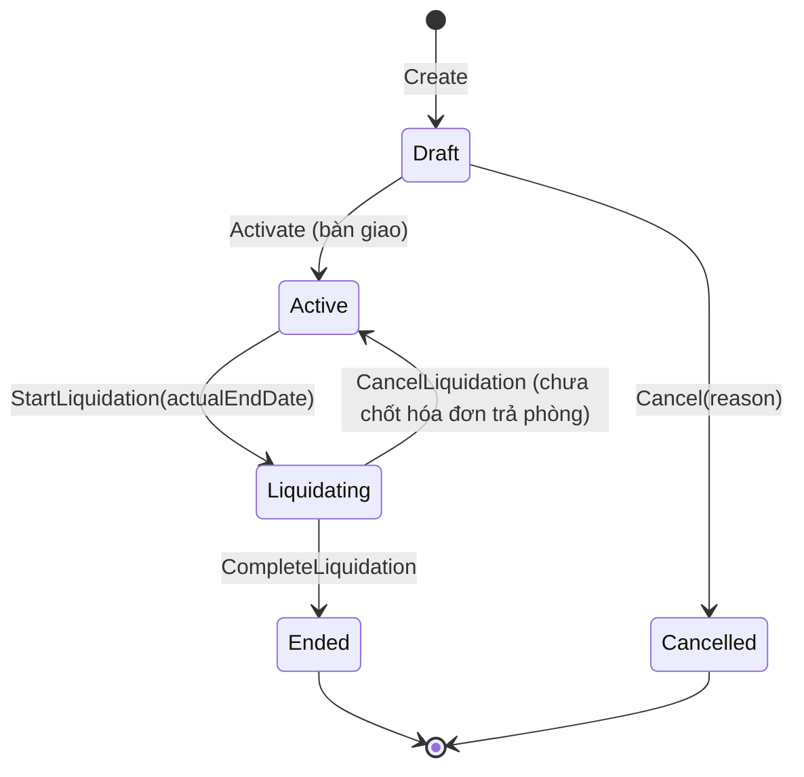

# M05 — Contract (Hợp đồng, Người ở, Phụ lục, Thanh lý)

> Theo khuôn [_TEMPLATE.md](_TEMPLATE.md). Pháp lý: L1, L2, L4, LEG-01. Kỳ thu: C-05.

## 1. Mục tiêu & phạm vi

**Mục tiêu**: Lưu trữ **thông tin hợp đồng thuê** giữa chủ trọ và người thuê cho **một phòng**, là nguồn sự thật cho:
phòng đang có người (M02), ai đang ở (M03), giá thuê theo thời gian, khoản thu đăng ký, cài đặt kỳ thu (M07), tiền cọc thỏa thuận (M08).

**Trong phạm vi**: tạo nháp, kích hoạt (bàn giao), người ở cùng vào/ra, đổi giá & gia hạn, đăng ký khoản dịch vụ,
báo trả phòng, thanh lý, hủy nháp, **chuyển phòng**, **ký lại**, tài sản bàn giao, phương tiện, theo dõi cọc (M08);
**mẫu hợp đồng** theo loại (thuê phòng trọ / thuê nhà nguyên căn) gồm tiêu đề, điều khoản, trường tùy biến; **hợp đồng không cọc**;
**quan hệ người ở với người đứng tên / chủ hộ**, đồng ý của cha mẹ / người giám hộ cho người chưa thành niên; chặn một người ở 2 phòng cùng lúc;
in hợp đồng ra .docx.

**Ngoài phạm vi**: in PDF, phụ lục, biên bản bàn giao riêng (P2); ký điện tử.

**Phase**: P1.

**Trạng thái (10/10/2026)**: ✅ đã code toàn bộ, **trừ**: đính kèm file scan (CT-UC-11 — chờ M09; hiện chỉ có cờ "đã có bản ký"),
đổi tiền cọc thỏa thuận khi HĐ đã kích hoạt, in PDF / phụ lục / biên bản bàn giao (để sau cùng phần in ấn), ảnh tài sản (M09), domain event (P2).
**12/10/2026 — đã code**: xem trước thanh lý (`GET /contracts/{id}/liquidation/preview`).
**11/10/2026 — đã code**: HĐ quá hạn vận hành như không thời hạn (CT-BR-37), chuyển phòng chốt điện nước thành khoản phát sinh + chuyển về phòng cũ (CT-BR-47), hủy chuyển phòng (CT-BR-14), giá thuê / dịch vụ khi chuyển phòng (CT-BR-48). Đồng thuê (CT-BR-49), chặn người đứng tên đang là người ở phòng khác (CT-BR-50), đổi người đứng tên trên cùng HĐ (CT-BR-51), chuyển người (CT-BR-52).

**17/10/2026 — đổi theo quyết định chủ trọ**: ngày chuyển phòng luôn là **hôm nay**; bỏ lệnh hủy chuyển phòng — chuyển nhầm thì **chuyển lại về phòng cũ trong ngày** (hệ thống xóa lần chuyển) (CT-BR-14); điện nước phòng cũ không còn thành khoản tiền mà **lưu sản lượng, cộng vào dòng điện nước của kỳ** (CT-BR-47); ngày trả phòng không trước ngày vào phòng hiện tại (CT-BR-11); ký lại kết thúc xe ở HĐ cũ (CT-UC-21).

## 2. Thuật ngữ

| Thuật ngữ | Code | Định nghĩa |
|-----------|------|-----------|
| Hợp đồng | `Contract` | Thỏa thuận thuê 1 phòng trong một khoảng thời gian |
| Bên thuê (đại diện) | `RepresentativeRenter` | Người đứng tên ký HĐ — có thể **không** ở (VD phụ huynh ký cho con) |
| Người ở | `Occupant` / `contract_occupants` | Người thực tế ở phòng, có ngày vào/ra riêng |
| Điều khoản giá | `RentTerm` | Giá thuê tháng hiệu lực từ đầu một kỳ |
| Đăng ký khoản thu | `ContractFee` | Khoản thu (M04) áp cho HĐ, có số lượng/giá riêng, hiệu lực theo kỳ |
| Ngày kết thúc thỏa thuận | `end_date` | Hạn HĐ ghi trên giấy (NULL = không thời hạn) |
| Ngày kết thúc thực tế | `actual_end_date` | **Ngày cuối cùng tính tiền** (bao gồm), đặt khi thanh lý |
| Thanh lý | `Liquidation` | Quy trình kết thúc: chỉ số cuối, hóa đơn trả phòng, thu nợ / bỏ nợ. Hoàn cọc ghi riêng (M08) |
| Loại hợp đồng | `ContractType` | `RoomRental` (thuê phòng trọ) · `WholeHouseRental` (thuê nhà nguyên căn — khai báo là 1 khu có 1 phòng) |
| Mẫu hợp đồng | `ContractTemplate` / `contract_templates` | Của tổ chức: tên, loại, tiêu đề, điều khoản, định nghĩa trường tùy biến, chính sách cọc |
| Điều khoản | `ContractClause` | Một mục văn bản `{heading, body}` (VD "Trách nhiệm của bên A") |
| Trường tùy biến | `CustomFieldDefinition` | Ô nhập thêm theo mẫu: `key`, `label`, `type` (Text/LongText/Number/Money/Date/Boolean/Select), `required`, `options`, `unit`, `hint` |
| Hợp đồng không cọc | `no_deposit` | Mẫu có cờ này ⇒ `deposit_amount = 0`. "Nhóm không cọc" = mọi HĐ có `deposit_amount = 0` |
| Quan hệ với người đứng tên | `OccupantRelationship` | Quan hệ của người ở với người ký HĐ — dùng làm "quan hệ với chủ hộ" khi đăng ký tạm trú chung hộ |
| Đồng ý của người giám hộ | `guardian_consent` | Người ở < 18 tuổi đã có ý kiến đồng ý của cha, mẹ hoặc người giám hộ (Luật Cư trú Điều 28) |

## 3. Nghiệp vụ

### 3.1 Use case

| ID | Mô tả |
|----|-------|
| CT-UC-01 ✅ | Tạo HĐ nháp: chọn phòng, người đại diện, người ở, ngày bắt đầu, "tính tiền từ ngày", thời hạn (bỏ trống = không thời hạn), giá thuê, tiền cọc thỏa thuận, khoản **dịch vụ** (auto-attach từ M04, chỉnh được — điện nước theo công tơ đi theo phòng, FE-BR-17), điều khoản. Kỳ thu theo khu — không chọn riêng |
| CT-UC-02 ✅ | Sửa HĐ nháp (mọi trường) / hủy nháp |
| CT-UC-03 ✅ | **Kích hoạt** (bàn giao phòng): nhập chỉ số bàn giao cho các công tơ (M06) |
| CT-UC-04 ✅ | Thêm người ở (ngày vào, **quan hệ với người đứng tên**, đồng ý của người giám hộ nếu < 18 tuổi) / ghi nhận người ở rời đi (ngày ra) |
| CT-UC-05 ✅ | **Sửa giá thuê / dịch vụ trực tiếp trên HĐ** (chốt 09/10/2026) — không nhập ngày: hệ thống tự áp từ **kỳ chưa chốt đầu tiên** và giữ lịch sử phía sau (`contract_rent_terms`, `contract_fees` theo khoảng hiệu lực) ⇒ hủy / lập lại phiếu tháng cũ vẫn ra giá cũ. Gia hạn `end_date`. **Chưa code**: đổi tiền cọc thỏa thuận khi HĐ đã kích hoạt (hiện chỉ sửa được ở nháp). Sửa **giá niêm yết** của phòng (PR-UC-04) → UI hỏi "Áp giá mới cho người đang thuê?" ⇒ `POST /rooms/{id}/apply-listed-rent` đổi giá HĐ đang ở từ kỳ chưa chốt đầu tiên (không tự đổi — giá thỏa thuận có thể khác giá niêm yết) |
| CT-UC-06 ✅ | Đổi đăng ký khoản thu từ kỳ X (thêm/bỏ khoản, đổi số lượng xe, giá riêng) — nháp qua `fees[]`, đang hiệu lực qua `PUT/DELETE /contracts/{id}/fees/{feeTypeId}` |
| CT-UC-07 ✅ | Báo trả phòng: ghi nhận ngày báo, ngày dự kiến trả; cảnh báo nếu < `notice_days` |
| CT-UC-08 ✅ | **Trả phòng**: (1) bắt đầu thanh lý — đặt `actual_end_date` (báo trước đủ 1 tháng hoặc trả ngay); (2) ghi tình trạng tài sản; (3) **lập hóa đơn trả phòng** — nhập chỉ số cuối công tơ, nháp sửa được, bồi thường thêm làm phụ thu (M07 BL-UC-11); (4) chốt hóa đơn trả phòng; (5) **hoàn tất** theo CT-BR-12; (6) khi trả lại cọc ⇒ bấm "Đã hoàn trả cọc" (M08 PM-BR-33 — không bắt buộc trước khi hoàn tất) |
| CT-UC-09 ✅ | Hủy thanh lý (quay về Active) khi chưa chốt hóa đơn trả phòng |
| CT-UC-10 ✅ | Danh sách HĐ: lọc khu, phòng, trạng thái, sắp hết hạn (≤ 30 ngày), quá hạn, người thuê, có / không cọc, thiếu bản ký, chưa hoàn cọc |
| CT-UC-11 (chưa code — chờ M09) | Đính kèm file scan HĐ, phụ lục, biên bản bàn giao. Tạm thời: cờ "đã có bản ký" (CT-UC-23) |
| CT-UC-12 ✅ | **Chuyển phòng**: HĐ **đi theo người thuê** — giữ nguyên số HĐ, người ở, xe, dịch vụ, cọc, kỳ thu; chỉ đổi phòng **từ hôm nay** (ngày chủ trọ bấm chuyển — không chọn ngày khác) sang **phòng trống cùng khu** (HĐ thường không ghi cụ thể mã phòng). Trong 1 thao tác: chỉ số cuối các công tơ phòng cũ hôm nay (bắt buộc), chỉ số nhận phòng các công tơ phòng mới hôm nay (bỏ trống = số mới nhất), sản lượng phòng cũ được lưu để cộng vào dòng điện nước của kỳ (CT-BR-47), giá thuê mới theo quy tắc nửa kỳ + bỏ dịch vụ không dùng ở phòng mới (CT-BR-48). Chuyển nhầm ⇒ chuyển lại về phòng cũ ngay trong ngày (CT-BR-14). Khác khu ⇒ thanh lý + HĐ mới |
| CT-UC-13 ✅ | Ghi **tài sản bàn giao** (điều hòa, giường, chìa khóa…) và tình trạng; khi trả phòng ghi tình trạng lúc trả — bồi thường (nếu có) là phụ thu trên hóa đơn trả phòng (CT-BR-23) |
| CT-UC-14 ✅ | **Phương tiện của phòng** (chốt 09/10/2026): loại (xe máy / xe đạp / xe điện / ô tô), hiệu – màu, biển số, chủ xe (tùy chọn) — quản lý theo phòng (gắn với lượt thuê đang ở của phòng nên người đi thì xe kết thúc theo). Đối chiếu số xe với số gói phí giữ xe (CT-BR-22, cảnh báo) |
| CT-UC-15 ✅ | In hợp đồng ra **.docx** (`GET /contracts/{id}/document`) từ bản chụp lúc ký + mẫu + khoản thu + tiền bằng chữ; nháp có dòng "BẢN NHÁP". Còn lại P2: PDF, phụ lục, biên bản bàn giao riêng |
| CT-UC-16 ✅ | Quản lý **mẫu hợp đồng**: tạo từ mẫu gợi ý (thuê trọ / thuê trọ không cọc / thuê nhà nguyên căn), sửa tiêu đề, điều khoản, trường tùy biến, ngừng dùng / khôi phục |
| CT-UC-17 ✅ | Tạo / sửa HĐ nháp **theo mẫu**: chép tiêu đề, điều khoản, định nghĩa trường vào HĐ; nhập giá trị trường tùy biến (VD cách tính điện, tiền nước/người, wifi); ghi đè tiêu đề / điều khoản cho riêng HĐ |
| CT-UC-18 ✅ | Lọc **nhóm hợp đồng không cọc / có cọc** trong danh sách HĐ |
| CT-UC-20 ✅ | **Dữ liệu cần xem lại** (`GET /contracts/data-review`): quan hệ người ở không còn hợp lý, người đứng tên < 18 tuổi tại ngày ký, một người ở 2 phòng, khoản thu chưa có giá |
| CT-UC-19 ✅ | Khai **quan hệ người ở với người đứng tên** (vợ, chồng, con, cha mẹ, cùng ở thuê…) — dữ liệu để lập tờ khai tạm trú chung hộ và xuất danh sách (M10 E1) |
| CT-UC-21 ✅ | **Ký lại cho người còn ở** — `POST /contracts/{id}/re-sign` `{ handoverDate, representativeRenterId, endDate? }`: trong 1 transaction (1) HĐ cũ bắt đầu thanh lý tại `handoverDate` = X (lý do `MutualAgreement`, ghi chú "Ký lại cho người còn ở — HĐ mới …"); (2) tạo **HĐ nháp mới** từ X+1, `previous_contract_id` = HĐ cũ, chép: giá thuê hiện hành, cài đặt kỳ thu, ngày báo trước, phương thức thanh toán, cọc thỏa thuận + điều khoản cọc, mẫu / tiêu đề / điều khoản / trường tùy biến, khoản dịch vụ đang áp tại X+1, **người ở còn ở sau X** (vào ở X+1; giữ quan hệ nếu chủ hộ còn ở, ngược lại xóa quan hệ để khai lại so với người đứng tên mới), xe đang đăng ký của người đứng tên mới / người ở được chép — bản đăng ký trên HĐ cũ **kết thúc tại X** trong cùng transaction (một biển số chỉ đăng ký ở một nơi; 17/10/2026). **Ký lại không thành** (18/10/2026, ✅ code 20/10/2026): hủy HĐ nháp mới hoặc hủy thanh lý HĐ cũ ⇒ các xe đã kết thúc trên HĐ cũ **lúc ký lại** được **mở lại** (bỏ ngày kết thúc) — như cọc tự về "Đang giữ" (M08 PM-BR-34); lần ký lại ghi lại danh sách xe nó đã kết thúc để biết mở lại xe nào (xe kết thúc vì lý do khác không bị đụng). Thứ tự trong cùng transaction: kết thúc xe trên HĐ nháp trước (nhả biển số) rồi mở lại xe trên HĐ cũ. Biển số lúc đó đã đăng ký ở HĐ khác ⇒ không mở lại xe đó, trả cảnh báo `VEHICLE_NOT_RESTORED` (kèm biển số) để chủ trọ xử lý tay. Chi tiết (20/10/2026): xe kết thúc lúc ký lại lưu `resigned_to_contract_id` = HĐ nháp mới; mở lại ⇒ xóa dấu này (cả xe không mở lại được), nên lần hủy sau không đụng lại. Hủy nháp ký lại khi HĐ cũ **đã kết thúc** (hoàn tất thanh lý) ⇒ không mở lại xe (người ở đã rời theo HĐ cũ). Hủy thanh lý khi nháp ký lại vẫn còn ⇒ xe đang đăng ký trên nháp **cùng biển số** kết thúc trước (nhả biển số); nháp giữ nguyên, chủ trọ tự hủy nếu không dùng. VD Bình (ở cùng, xe 29B1-12345) ký lại thay An rồi đổi ý ⇒ hủy HĐ nháp của Bình ⇒ xe 29B1-12345 đăng ký lại trên HĐ cũ, phí giữ xe tính đúng. `endDate` bỏ trống = không thời hạn. Người đứng tên mới phải là một người còn ở (422 `RESIGN_REPRESENTATIVE_NOT_OCCUPANT`); không còn ai ở sau X → 422 `RESIGN_NO_OCCUPANT_LEFT`; lỗi thanh lý như CT-BR-11. → 201 `{ id: <HĐ nháp mới>, warnings }`. Chủ trọ xem lại nháp rồi kích hoạt như bình thường; body thêm `transferDeposit` (mặc định `true`) — có ⇒ cọc của HĐ cũ ghi **"Đã chuyển sang HĐ mới"** (M08 PM-BR-34); `false` ⇒ HĐ cũ vẫn "Đang giữ cọc" để hoàn sau |
| CT-UC-23 ✅ | **Bản HĐ đã ký** (chốt 09/10/2026): `PUT /contracts/{id}/signed-document` `{ hasSignedDocument, note }` — đánh dấu đã có bản ký (giấy / ảnh / PDF) + ghi nơi cất; chưa có ⇒ cờ **"Thiếu tài liệu"** (`MissingSignedDocument`, CT-BR-46). Lọc `GET /contracts?missingSignedDocument=true`. HĐ import mặc định **thiếu**. Khi có M09 (upload file) tải bản scan lên sẽ tự đánh dấu |
| CT-UC-22 ✅ | **Quyết định khi HĐ hết hạn mà người thuê vẫn ở** (CT-BR-45): (1) Gia hạn / ký phụ lục — `POST /contracts/{id}/extend` (xóa trạng thái ở tiếp); (2) **Ở tiếp, chưa ký lại** — `POST /contracts/{id}/holdover` `{ note? }` → 204; HĐ chưa quá hạn → 422 `CONTRACT_NOT_EXPIRED`, đã ghi nhận → 409 `HOLDOVER_ALREADY`; (3) **Không cho thuê tiếp** → `POST /contracts/{id}/liquidation/start` |
| CT-UC-24 ✅ | **Đồng thuê** (11/10/2026): người ở có vai trò `Resident` (người ở) hoặc `CoTenant` (đồng thuê — có tên trên HĐ cùng người đứng tên); đặt khi tạo / sửa nháp, khi thêm người ở, hoặc đổi sau bằng `PUT /contracts/{id}/occupants/{occupantId}/role` (CT-BR-49) |
| CT-UC-25 ✅ | **Đổi người đứng tên trên cùng HĐ** (11/10/2026) — `POST /contracts/{id}/representative`: người thuê tự thỏa thuận đổi người đứng tên, HĐ giữ nguyên (số HĐ, nợ, cọc, khoản phát sinh, chuỗi chỉ số) — CT-BR-51. Có tranh chấp phải thanh lý ⇒ ký lại (CT-UC-21) |
| CT-UC-26 ✅ | **Chuyển người** sang phòng khác đang có HĐ (11/10/2026) — `POST /contracts/{id}/occupants/{occupantId}/move`: người đi, HĐ ở lại — CT-BR-52. Cả HĐ chuyển phòng ⇒ CT-UC-12 |

### 3.2 Quy tắc nghiệp vụ

| Mã | Quy tắc | Nơi kiểm tra |
|----|---------|-------------|
| CT-BR-01 ✅ | Một phòng **không thể có 2 HĐ chồng lấn thời gian** trong các trạng thái `Active/Liquidating/Ended`. Khoảng chiếm phòng hiện tại = `[room_since, COALESCE(actual_end_date, 'infinity')]` (`room_since` = ngày bắt đầu, hoặc ngày chuyển tới phòng); các phòng đã ở trước đó chiếm theo `contract_room_moves [from_date, to_date]` | **DB EXCLUDE constraint** (btree_gist) trên `contracts` và `contract_room_moves` + kiểm chéo ở Application |
| CT-BR-02 ✅ | Kích hoạt yêu cầu (chỉ phần **thu tiền**): phòng không archive/bảo trì; ≥ 1 người ở; giá thuê > 0; `start_date` ≤ hôm nay + 1 (kích hoạt = bàn giao thực tế; cho phép lùi ngày khi nhập HĐ cũ). Màn hình kích hoạt **nhập chỉ số nhận phòng** cho từng công tơ đang hoạt động của phòng tại ngày tính tiền — "Dùng số mới nhất" (chỉ số cuối của HĐ trước / chỉ số tháng trước) hoặc nhập số khác ≥ số đó (MT-BR-13); phòng chưa có công tơ điện → **cảnh báo**, không chặn (phòng tính nước theo người không cần công tơ nước). Người đứng tên thiếu SĐT → chỉ cảnh báo `REPRESENTATIVE_PHONE_MISSING` (CT-BR-46) | Domain + Application |
| CT-BR-03 ✅ | `end_date` (nếu có) > `start_date`. Hết `end_date` mà chưa thanh lý → HĐ **vẫn Active** (cờ dẫn xuất `IsOverdue`), vẫn lập phiếu bình thường — không tự kết thúc | Thiết kế |
| CT-BR-04 ✅ | **Cài đặt kỳ thu lấy theo khu** (đổi 08/10/2026 — M02 PR-BR-09): ngày chốt, thu trước / thu sau, tính theo ngày / trọn tháng, số ngày hạn là của khu, HĐ **không chọn riêng** (code 09/10/2026: bỏ cột trên HĐ, ô `billing` khi tạo HĐ không còn). Kỳ lẻ khi vào / trả phòng giữa kỳ: theo C-05. **K5**: `billing_start_date` "Tính tiền từ ngày" (mặc định = `start_date`, trong thời gian HĐ, ≤ 1 năm trước hôm nay; có ô này thì `start_date` được tới 10 năm trước — HĐ nhập từ sổ cũ); kích hoạt ghi **chỉ số nhận phòng tại ngày tính tiền** | Domain |
| CT-BR-05 ✅ | Giá thuê theo `contract_rent_terms`; bản đầu tiên `effective_from = start_date`. Đổi giá chỉ cho hợp đồng **Active** (nháp sửa trực tiếp). `effective_from` bỏ trống = **kỳ chưa chốt đầu tiên** (CT-UC-05); nếu gửi thì phải là **ngày bắt đầu một kỳ** (C-05) và ≥ kỳ đầu tiên chưa khóa: kỳ sau ngày cuối của **dòng Tiền phòng** đã chốt mới nhất; dịch vụ khóa theo kỳ phiếu đã chốt | Domain |
| CT-BR-06 ✅ | `contract_fees`: mỗi `(contract, fee_type)` các khoảng hiệu lực không chồng lấn; `effective_from` là đầu kỳ, cùng quy tắc khóa như CT-BR-05. Khoản thu phải thuộc **cùng khu** với HĐ | DB EXCLUDE + FK composite `(organization_id, property_id, fee_type_id)` |
| CT-BR-07 ✅ | `quantity`: `PerUnit` > 0; `PerRoom` = 1; `PerOccupant` tự tính theo số người ở (FE-BR-14). Khoản `Metered` không gắn vào HĐ (FE-BR-17). `unit_price_override` ≥ 0 hoặc NULL (dùng giá danh mục) | CHECK + Application |
| CT-BR-08 ✅ | Người ở: `move_in_date` ≥ `start_date` của HĐ; `move_out_date` (nếu có) ≥ `move_in_date` và ≤ `actual_end_date` (nếu có). Cùng 1 renter không có 2 khoảng ở chồng lấn trong cùng HĐ. Đã ghi chuyển đi thì **không ghi lại** (409 `OCCUPANT_ALREADY_MOVED_OUT`) — muốn ở tiếp thì thêm lại như người ở mới | Domain + DB EXCLUDE |
| CT-BR-09 ✅ | **Không giới hạn số người ở theo sức chứa** — số người do chủ trọ quyết định (PR-BR-06). **Người đứng tên phải có giấy tờ** (RT-BR-01) ⇒ 422 `REPRESENTATIVE_ID_REQUIRED` khi tạo / sửa nháp, ký lại | Application |
| CT-BR-11 ✅ | Bắt đầu thanh lý: `actual_end_date` ≥ `start_date` và ≥ `move_in_date` muộn nhất; ≥ **ngày vào phòng hiện tại** (`room_since` — HĐ đã chuyển phòng không trả phòng trước ngày chuyển; 17/10/2026) → 422 `END_DATE_BEFORE_ROOM_TRANSFER`; ≤ hôm nay + 60 ngày; **không tồn tại phiếu Regular chưa Void có `period_start` > `actual_end_date`** (phải hủy trước — tránh thu tiền kỳ sau khi đã trả phòng); không tồn tại chỉ số `Periodic` chưa hủy có `closing_period_start` > `actual_end_date`. Trong trạng thái `Liquidating` M07 **không** tạo phiếu định kỳ cho kỳ bắt đầu sau `actual_end_date` | Domain + Application |
| CT-BR-12 ✅ | **Hoàn tất thanh lý**: (1) có **chỉ số cuối** mọi công tơ (nhập khi lập hóa đơn trả phòng); (2) **hóa đơn trả phòng đã chốt**; (3) không còn phiếu **Chờ hoàn** (`REFUND_PENDING`); (4) **còn nợ** ⇒ **cảnh báo** + chủ trọ chọn **"Đã thu toàn bộ"** (M08 PM-UC-14) hoặc **"Bỏ nợ"** (lý do bắt buộc, theo quyền — PM-BR-16) — hoặc hủy để thu sau. **Cọc không chặn** (chỉ nhắc "Chưa hoàn cọc" — M08 PM-BR-35). Xong ⇒ `Ended`, đóng người ở và xe tại `actual_end_date` | Application (transaction) |
| CT-BR-13 ✅ | Không xóa HĐ khác `Draft`. Nháp chỉ **hủy** (`Cancelled`, lý do) — giữ lại lịch sử. Cọc giữ chỗ (nếu có) theo dõi bằng "Đã hoàn trả cọc" như HĐ khác (M08 PM-BR-33) | Domain |
| CT-BR-14 ✅ | **Chuyển phòng** (CT-UC-12, đổi 10/10/2026; **ngày chuyển = hôm nay** từ 17/10/2026) — `POST /contracts/{id}/transfer-room`: HĐ `Active` (không đang thanh lý); ngày chuyển D = **hôm nay** — không chọn ngày (chuyển lúc chủ trọ bấm, sau khi chốt số công tơ phòng cũ; body không còn `date`); D > ngày vào phòng hiện tại; phòng mới **cùng khu**, khác phòng hiện tại, không ngừng dùng / bảo trì, **trống từ D** (không HĐ nào chiếm từ D — kể cả HĐ nháp giữ chỗ, kể cả lịch sử chuyển phòng) → 422 `ROOM_TRANSFER_*`. Không được có đoạn đo điện nước đã lập phiếu kết thúc sau D trên công tơ phòng cũ → 422 `ROOM_TRANSFER_ALREADY_BILLED` (hủy phiếu đó trước). Lưu: `contracts.room_id` = phòng mới, `room_since` = D; lịch sử `contract_room_moves (room_id, from_date, to_date = D)`. Ngày D tính là đang thuê ở **cả 2 phòng** (như ngày trả phòng — CT-BR-33); phòng cũ trống từ D+1. Bản HĐ đã ký giữ phòng lúc ký; chi tiết HĐ hiện "Phòng hiện tại" + lịch sử. Cảnh báo `RESIDENCE_ROOM_CHANGED`: cập nhật số phòng trên đăng ký tạm trú nếu cần. **Chuyển về phòng đã từng ở** (A → B → A) được (11/10/2026 — khóa chỉ số theo ngày ghi, M06 MT-BR-04). **Chuyển nhầm — chuyển lại trong ngày** (17/10/2026, thay lệnh hủy chuyển phòng `POST …/transfer-room/cancel` và hạn 3 ngày — đã bỏ): gửi chuyển phòng về **đúng phòng vừa rời** khi hôm nay **= ngày của lần chuyển gần nhất** ⇒ hệ thống **xóa lần chuyển** như chưa từng chuyển: trả lại `room_id` + `room_since`, xóa dòng lịch sử, hủy (void) chỉ số cuối phòng cũ tại D và các chỉ số của HĐ trên công tơ phòng mới từ D, trả lại **giá thuê** (xóa mốc giá lần chuyển đã ghi, hoặc trả về giá cũ nếu lần chuyển sửa đè mốc có sẵn), **hủy khoản chênh lệch tiền phòng** của lần chuyển, **gắn lại dịch vụ** đã bỏ lúc chuyển (theo `contract_room_moves.undo_snapshot`); chỉ số / giá thuê / dịch vụ gửi kèm lệnh bị bỏ qua. Điều kiện: chưa có phiếu (nháp / đã chốt) lập cho phòng mới từ D, chỉ số của HĐ trên công tơ phòng mới chưa bị phiếu đã chốt khóa → 422 `ROOM_TRANSFER_CANCEL_BILLED`; khoản chênh lệch tiền phòng của lần chuyển đã đánh dấu "đã thu ngay" → 422 `ROOM_TRANSFER_CANCEL_SETTLED` (bỏ đánh dấu trước), đã vào phiếu đã chốt → 422 `ROOM_TRANSFER_CANCEL_BILLED`. Phần không hoàn được (đã có thay đổi khác chồng lên) ⇒ giữ nguyên + cảnh báo `ROOM_TRANSFER_CANCELLED_CHECK_RENT`. Từ hôm sau, quay về phòng cũ = **một lần chuyển phòng mới** (chốt điện nước, hỏi lại giá / dịch vụ như mọi lần chuyển). Ví dụ: 203 (3,0tr, có wifi) chuyển 206 giá 3,2tr bỏ wifi sáng 17/10; chiều 17/10 phát hiện nhầm, chuyển về 203 ⇒ HĐ ở 203 như chưa chuyển, giá 3,0tr, có wifi | Domain + Application + DB |
| CT-BR-15 ✅ | `contract_no`: người dùng nhập hoặc tự sinh `HD{yyyy}-{seq:0000}`; unique trong tổ chức | DB unique |
| CT-BR-16 ✅ | **Báo trước khi trả phòng**: người thuê phải báo trước `notice_days` (mặc định 30 — "báo trước 1 tháng"). Báo muộn / không báo ⇒ cảnh báo `LESSEE_TERMINATION_SHORT_NOTICE` và chủ trọ **vẫn trả phòng ngay được**; phạt theo điều khoản (nếu có) nhập thành phụ thu trên hóa đơn trả phòng | Application |
| CT-BR-17 ✅ | `deposit_amount` (thỏa thuận) ≥ 0; 0 = không cọc. Cọc chỉ là **thông tin theo dõi** (M08 PM-BR-32): trạng thái `Holding` / `Refunded` / `Transferred`, ngày và số tiền đã hoàn, ghi chú. Chi tiết HĐ / phòng hiện "Có cọc X — đang giữ / đã hoàn ngày …" | Domain |
| CT-BR-18 ✅ | Người đứng tên **nên** đủ 18 tuổi tại ngày ký (`signed_date`, nếu trống dùng ngày bắt đầu) — BLDS 2015 Điều 117. **Đổi 09/10/2026: chỉ cảnh báo** `REPRESENTATIVE_UNDERAGE` (bản giấy cần người giám hộ ký thay), không chặn kích hoạt. Người ở có thể dưới 18 tuổi | Application `ContractPaperWarnings` |
| CT-BR-19 ✅ | Khu chưa có **thông tin bên cho thuê đầy đủ** (PR-BR-12) → **chỉ cảnh báo** `LESSOR_INFO_INCOMPLETE` "chưa in được HĐ đầy đủ" (đổi 09/10/2026 — trước đây chặn kích hoạt); bên cho thuê = bên cho thuê riêng của khu, không có thì **thông tin chủ trọ** (PR-BR-17); chưa khai cả hai ⇒ `signing_snapshot` NULL. Khi kích hoạt chụp **snapshot bất biến**: `signing_snapshot` (bên cho thuê, bên thuê, phòng, ngân hàng), `utility_price_snapshot` (đơn giá điện, nước, dịch vụ tại ngày bắt đầu), `house_rules_snapshot` — sửa khu sau đó không đổi hợp đồng đã ký | Application |
| CT-BR-20 ✅ | `effective_date` mặc định = `signed_date` (Luật Nhà ở 2023 Điều 164: không thỏa thuận thì hiệu lực từ lúc ký); ràng buộc `signed_date ≤ effective_date` (có thể sau ngày bàn giao: dọn vào trước, ký sau). Không ghi ngày ký: HĐ nhập lại (bắt đầu trong quá khứ) lấy ngày bắt đầu, HĐ mới lấy hôm nay | Validator + CHECK |
| CT-BR-21 ✅ | Kết thúc phải có `termination_reason`: `Expired`, `MutualAgreement`, `LesseeUnilateral`, `LessorUnilateral`, `RoomTransfer`, `Abandoned` (CT-BR-41). `Expired` chỉ khi HĐ **có thời hạn** và `actual_end_date ≥ end_date` → ngược lại 422 `EXPIRED_REASON_INVALID`. `LessorUnilateral` **nên** chọn `termination_ground` (tùy chọn từ 09/10/2026 — trước đây bắt buộc) thuộc Điều 172 khoản 2 (`RentArrears3Months`, `WrongPurpose`, `UnauthorizedRenovation`), `IndefiniteTermNotice` (CT-BR-42) hoặc `Other` + mô tả; báo trước < 30 ngày → cảnh báo `LESSOR_TERMINATION_SHORT_NOTICE` (tính `actual_end_date − liquidation_started_on`). Bên thuê đơn phương (`LesseeUnilateral`) mà chưa báo trước / báo < `notice_days` → cảnh báo `LESSEE_TERMINATION_SHORT_NOTICE` (xử lý cọc theo điều khoản) | Domain + Application |
| CT-BR-22 ✅ | Tổng số xe đăng ký đang hiệu lực theo loại ≠ số lượng khoản phí giữ xe tương ứng → **cảnh báo** `PARKING_QUANTITY_MISMATCH` (không chặn). Khoản phí giữ xe = khoản `Service/PerUnit` có `fee_types.vehicle_type` | Domain `ContractWarnings` (chi tiết HĐ + đăng ký xe) |
| CT-BR-23 ✅ | Tài sản bàn giao — lúc trả phòng **chỉ ghi tình trạng** (`condition_at_return`). **Bồi thường = phụ thu** chủ trọ thêm trên nháp hóa đơn trả phòng (M07 BL-BR-23) — không có cơ chế riêng | Domain |
| CT-BR-24 ✅ | Hợp đồng là giấy tờ chứng minh chỗ ở hợp pháp để đăng ký tạm trú, không cần công chứng (NĐ 154/2024) ⇒ phải in được đầy đủ thông tin 2 bên + địa chỉ phòng | Thiết kế (CT-UC-15) |
| CT-BR-25 ✅ | **Mẫu hợp đồng** theo tổ chức (`contract_templates`: tên duy nhất, loại `RoomRental`/`WholeHouseRental`, tiêu đề, điều khoản jsonb, định nghĩa trường jsonb). Tạo/sửa nháp **chép** tiêu đề, điều khoản, định nghĩa trường vào hợp đồng (`title`, `clauses`, `custom_field_definitions`) ⇒ sửa/ngừng mẫu không đổi HĐ đã kích hoạt. Mẫu ngừng dùng không chọn được cho HĐ mới; nháp đang gắn mẫu vẫn sửa được | Application + FK composite `(organization_id, template_id)` |
| CT-BR-26 ✅ | `custom_field_values` khớp định nghĩa: đủ trường bắt buộc, đúng kiểu (Text/LongText/Number/Money/Date/Boolean/Select), không có key lạ. Không dùng mẫu ⇒ không có trường tùy biến. Trường chỉ **ghi nhận thỏa thuận** — tính tiền điện/nước vẫn thuộc M04 | Application (lỗi 400 theo `contract.customFields.<key>`) |
| CT-BR-27 ✅ | **Hợp đồng không cọc**: mẫu có `no_deposit = true` ⇒ `deposit_amount = 0` (bỏ qua cọc mặc định của phòng; gửi > 0 → 400 `DEPOSIT_NOT_ALLOWED`). Nhóm không cọc = mọi HĐ có `deposit_amount = 0` (lọc `hasDeposit=false`). Mẫu gợi ý không cọc bù rủi ro bằng trả trước đầu kỳ + quyền chấm dứt khi chậm trả quá N ngày | Application |
| CT-BR-28 ✅ | Một phòng nhiều người ở, **một người đứng tên**. Mỗi người ở không đứng tên khai **quan hệ với người đứng tên** (`contract_occupants.relationship_type`) theo danh mục "quan hệ với chủ hộ" TT 55/2021/TT-BCA Điều 6 (sửa bởi TT 66/2023/TT-BCA); "Khác" phải ghi rõ (`relationship`). **Đổi 09/10/2026**: chưa khai quan hệ → cảnh báo `RELATIONSHIP_REQUIRED` kèm tên người, không chặn | Application `ContractPaperWarnings` + Domain `OccupantRelationshipRules` |
| CT-BR-29 ✅ | Quan hệ phải hợp lý: giới tính khớp nhãn (vợ/mẹ/con dâu… nữ; chồng/cha/con rể… nam; giới tính "Khác" bỏ qua); cha mẹ đẻ, ông bà, cụ lớn tuổi hơn; con đẻ, cháu nội ngoại, chắt nhỏ tuổi hơn; vợ chồng tối đa 1 người cùng thời gian, cả hai đủ tuổi kết hôn (nam 20, nữ 18 — Luật HN&GĐ 2014 Điều 8). **Đổi 09/10/2026: chỉ cảnh báo** (`RELATIONSHIP_GENDER_MISMATCH`, `RELATIONSHIP_AGE_MISMATCH`…) trên HĐ nháp / đang ở, không chặn tạo / kích hoạt / thêm người | Domain (hàm thuần) → cảnh báo |
| CT-BR-30 ✅ | Người ở **chưa thành niên** (< 18 tuổi tại ngày vào ở) phải có ý kiến đồng ý của cha, mẹ hoặc người giám hộ (`guardian_consent`, Luật Cư trú 2020 Điều 28), trừ khi người đứng tên là cha/mẹ/người giám hộ (con đẻ, con nuôi, người được giám hộ). **Đổi 09/10/2026: chỉ cảnh báo** `GUARDIAN_CONSENT_REQUIRED` | Domain → cảnh báo |
| CT-BR-31 ✅ | Một người **không ở 2 phòng cùng lúc**: thêm người ở vào HĐ đang hiệu lực / kích hoạt HĐ bị chặn nếu người đó đang ở HĐ khác (Active/Liquidating/Ended) có khoảng ở giao nhau; HĐ đang thanh lý tính tới ngày trả phòng; chuyển đi ngày X – vào ở ngày X hợp lệ | Application → 409 `OCCUPANT_LIVES_ELSEWHERE` |
| CT-BR-32 ✅ | Tiền cọc ≤ 12 tháng tiền thuê (chặn nhập thừa số 0) → 400 `DEPOSIT_TOO_HIGH` | Application |
| CT-BR-33 ✅ | Phòng / khu còn **người thuê trong ngày trả phòng** (HĐ `Ended` có `actual_end_date ≥ hôm nay`) ⇒ không ngừng dùng phòng / khu, không bắt đầu bảo trì — khớp trạng thái "Đang thuê" | Application |
| CT-BR-34 ✅ | Hủy thanh lý: người ở chưa ghi chuyển đi trở lại "đang ở" ⇒ kiểm CT-BR-31 (không đang ở phòng khác) | Application → 409 `OCCUPANT_LIVES_ELSEWHERE` |
| CT-BR-35 ✅ | Dời ngày bắt đầu HĐ nháp về sau ⇒ xe đã đăng ký giữ dời `registered_from` theo (không giữ xe trước ngày bắt đầu HĐ) | Domain |
| CT-BR-36 ✅ | **Chủ hộ** (`household_head_renter_id`): chọn trong số người ở, mặc định = người đứng tên. Quan hệ của người ở (CT-BR-28..30) khai so với **chủ hộ**; chủ hộ không khai quan hệ. Chủ hộ không phải người ở → 400 `HOUSEHOLD_HEAD_NOT_OCCUPANT`. Chỉ đặt ở bản nháp | Application + Domain |
| CT-BR-37 ✅ | **Đổi 11/10/2026**: HĐ **đang hiệu lực** không bị `end_date` chặn thao tác — quá hạn mà vẫn ở thì coi như **không thời hạn** (CT-BR-45): thêm người ở, đổi giá thuê, đổi dịch vụ sau `end_date` làm bình thường (bỏ mã `CONTRACT_EXPIRED_EXTEND_FIRST`). HĐ **nháp**: ngày vào ở sau `end_date` vẫn → 422 `DATE_OUTSIDE_CONTRACT` (nhập nhầm) | Domain |
| CT-BR-38 ✅ | Sửa nháp làm chủ xe (`contract_vehicles.renter_id`) không còn là người đứng tên / người ở → 422 `VEHICLE_OWNER_NOT_IN_CONTRACT`; kết thúc đăng ký xe đó trước | Domain |
| CT-BR-39 ✅ | **Cảnh báo mềm** (không chặn) trả trong `warnings` của tạo HĐ / đăng ký xe / chi tiết HĐ: `DEPOSIT_ABOVE_THREE_MONTHS` (cọc > 3 tháng tiền thuê ban đầu), `PLATE_FORMAT_UNUSUAL` (biển số sau chuẩn hóa không khớp `^[0-9]{2}[A-Z]{1,2}[0-9]?[0-9]{4,5}$`) | Domain `ContractWarnings` |
| CT-BR-40 ✅ | Ghi chú nội bộ (`note`) sửa được ở mọi trạng thái trừ `Cancelled` qua `PUT /contracts/{id}/note`; nội dung đã ký (điều khoản, giá, trường tùy biến) chỉ đổi qua phụ lục | Domain |
| CT-BR-41 ✅ | **Trả phòng bất chợt / bỏ đi không báo** (`Abandoned`): `actual_end_date` được lùi về quá khứ (ngày phát hiện hoặc ngày cuối còn ở, ≥ `start_date` và ≥ ngày vào ở muộn nhất); ghi chú bắt buộc (ngày phát hiện, đồ để lại, người chứng kiến) → 422 `ABANDONED_NOTE_REQUIRED`. Cảnh báo `LESSEE_ABANDONED` nhắc: lập biên bản kiểm kê đồ để lại có người làm chứng, chốt chỉ số công tơ ngày phát hiện (M06 `Final`), khai báo xóa tạm trú (LEG-04), xử lý cọc theo điều khoản (ghi "Đã hoàn trả cọc" với số tiền thực trả, có thể 0 — M08 PM-BR-33), nợ không đòi được → bỏ nợ (PM-BR-16). Phiếu kỳ sau `actual_end_date` phải hủy trước (CT-BR-11) | Domain + Application |
| CT-BR-42 ✅ | **HĐ không thời hạn** (`end_date` NULL — Luật Nhà ở 2023 Điều 171, BLDS Điều 474): không gia hạn (422 `CANNOT_EXTEND_INDEFINITE`), không vào danh sách sắp hết hạn / quá hạn, không chọn lý do `Expired`. Bên cho thuê chấm dứt bằng căn cứ `IndefiniteTermNotice` (chỉ cho HĐ không thời hạn → 422 `INDEFINITE_GROUND_ONLY`): được hẹn ngày trả phòng tới **90 ngày** sau ngày bắt đầu thanh lý (thay mức 60 ngày của CT-BR-11); báo trước < 90 ngày → cảnh báo `LESSOR_TERMINATION_SHORT_NOTICE`. Bên thuê chấm dứt: như CT-BR-21 (báo trước `notice_days`) | Domain |
| CT-BR-43 ✅ | Bản in (CT-UC-15): ngoài thỏa thuận lúc ký, in cả khoản gắn **sau khi ký** dù hiệu lực từ đúng ngày bắt đầu (trước đây bị bỏ sót). Người không có quyền dữ liệu nhạy cảm (ID-BR-22) nhận bản in có số giấy tờ ở dạng che | Application |
| CT-BR-44 ✅ | **Người đứng tên rời đi khi còn người ở**: người đứng tên là người ở của HĐ và đã chuyển đi (`move_out_date ≤ hôm nay`) trong khi còn người ở khác (`move_out_date` trống hoặc > hôm nay) → HĐ **vẫn hiệu lực**, phòng vẫn "Đang thuê"; HĐ có cờ `RepresentativeMovedOut` + cảnh báo `REPRESENTATIVE_MOVED_OUT` "Phòng còn người ở nhưng người ký hợp đồng đã rời đi — cần ký hợp đồng mới" cho tới khi ký lại (CT-UC-21) hoặc thanh lý. Phân biệt: **trả phòng 1 người** = ghi chuyển đi người đó; **trả cả phòng** = thanh lý (mọi người ra). HĐ đang hiệu lực mà không còn ai ở → cờ `NoOccupantLeft` + cảnh báo `NO_OCCUPANT_LEFT` "Không còn người ở — thanh lý?"; phòng chỉ về "Trống" khi thanh lý xong (PR-BR-02). Người đứng tên không phải người ở (VD bố ký cho con) → không cảnh báo. Cờ là **dẫn xuất** theo ngày (domain `Contract.Flags(today)`), trả trong `flags` của danh sách HĐ, chi tiết HĐ và `currentContract` của phòng | Domain + Application |
| CT-BR-45 ✅ | **Đổi 13/10/2026 — "Ở tiếp" = chuyển hẳn sang không thời hạn, hết nhãn**: chọn "Ở tiếp, chưa ký lại" (`POST /contracts/{id}/holdover`) ⇒ `end_date` chuyển sang `previous_end_date`, `end_date = null` (HĐ không thời hạn), vẫn lưu `holdover_since` / `holdover_note` để biết từ khi nào; **không còn cờ `Holdover`, không còn cảnh báo `HOLDOVER_SIGN_ADDENDUM`** — nhãn chỉ còn ở HĐ hết hạn mà chủ trọ **chưa quyết** (`ExpiredAwaitingDecision`). Sau đó muốn có hạn mới: `POST /contracts/{id}/extend` với ngày > `previous_end_date` (được phép dù `end_date` đang trống vì HĐ đang ở tiếp) ⇒ xóa `holdover_since`, `previous_end_date`. HĐ không thời hạn từ đầu vẫn không gia hạn được (`CANNOT_EXTEND_INDEFINITE`). Ví dụ: HĐ 1/1–30/6, 3/7 bấm "Ở tiếp" ⇒ HĐ không thời hạn, `previousEndDate` = 30/6, `holdoverSince` = 3/7, không nhãn. Dữ liệu cũ: HĐ đang ở tiếp được chuyển sang không thời hạn khi chạy migration. **Nhãn hết hạn chỉ gắn ở hợp đồng** — không đưa lên thẻ phòng (M02 PR-BR-16). Mô tả trước 13/10 (đã thay): **Hết hạn mà vẫn ở** (`end_date < hôm nay`, HĐ `Active`): phòng **vẫn "Đang thuê"** (không bao giờ tự về Trống); cờ `ExpiredAwaitingDecision` + cảnh báo `CONTRACT_EXPIRED_DECISION_NEEDED` cho tới khi chủ trọ chọn CT-UC-22. Chọn "Ở tiếp, chưa ký lại" → lưu `holdover_since` (= hôm nay) + `holdover_note`, cờ đổi thành `Holdover` + cảnh báo `HOLDOVER_SIGN_ADDENDUM` "Đang ở tiếp từ dd/MM chưa ký lại — nên ký phụ lục gia hạn" (vẫn tính tiền theo điều khoản cũ, kỳ thu tiếp tục — CT-BR-03; lịch kỳ thu mặc định hiện tới 12 tháng sau hôm nay); nhắc lặp mỗi 30 ngày thuộc nhắc việc P2. Gia hạn → xóa `holdover_since`. Lý do: BLDS 2015 **không** tự gia hạn HĐ hết hạn; người thuê vẫn ở và trả tiền là giao dịch mới xác lập bằng hành vi — khuyến nghị ký phụ lục (HĐ thuê nhà phải lập văn bản — Điều 163). Ràng buộc: chỉ áp cho HĐ **đã ký** (đã kích hoạt). **Đổi 11/10/2026**: quá hạn mà vẫn ở ⇒ vận hành như HĐ **không thời hạn** — thêm người ở / đổi giá / đổi dịch vụ sau `end_date` **không** cần gia hạn trước (CT-BR-37); cờ `ExpiredAwaitingDecision` / `Holdover` chỉ còn là lời nhắc ký phụ lục. Phòng chỉ về "Trống" khi chủ trọ thu lại phòng (thanh lý xong) | Domain + Application |
| CT-BR-46 ✅ | **HĐ trong phần mềm là hồ sơ thuê để tính tiền** (chốt 09/10/2026) — bản có giá trị pháp lý là bản giấy. **Bắt buộc** chỉ phần thu tiền: phòng, người đứng tên, ngày bắt đầu, giá thuê > 0, kỳ thu, khoản thu, chỉ số bàn giao. Phần giấy tờ / pháp lý chỉ **cảnh báo** (`warnings[]` khi tạo nháp và trong chi tiết HĐ nháp / đang ở / đang thanh lý): `LESSOR_INFO_INCOMPLETE`, `REPRESENTATIVE_PHONE_MISSING`, `REPRESENTATIVE_UNDERAGE`, quan hệ người ở (CT-BR-28..30, mỗi dòng có tên người), `SIGNED_DOCUMENT_MISSING` (cờ `MissingSignedDocument` khi `has_signed_document = false`, CT-UC-23). Vẫn giữ mẫu HĐ + in HĐ trong app (CT-UC-15/16) | Application `ContractPaperWarnings` + Domain |
| CT-BR-47 ✅ | **Điện nước khi chuyển phòng — lưu sản lượng, cộng vào dòng của kỳ** (đổi 17/10/2026, thay cách "chốt thành khoản phát sinh" 11/10/2026): tại ngày chuyển D bắt buộc chỉ số cuối các công tơ phòng cũ (M06 `Final`) + chỉ số nhận phòng phòng mới (`Handover`) — hai mốc này **là** sản lượng đã lưu của phòng cũ, không tạo khoản tiền. Phiếu của kỳ sử dụng chứa D có **1 dòng cho mỗi khoản điện nước** = sản lượng **phòng cũ** (chỉ số đầu của lần ở trong kỳ — số cuối đoạn đo đã lập phiếu, không có thì chỉ số nhận phòng — tới **chỉ số cuối tại D**; gồm cả công tơ đã thay trong lần ở đó, MT-BR-15) + sản lượng **phòng mới** (chỉ số nhận phòng tại D tới chỉ số cuối kỳ); đơn giá / bậc tính **một lần trên tổng** theo bản giá hiệu lực ngày cuối kỳ sử dụng (BL-BR-05) — như cộng nhiều công tơ của MT-BR-15. Kỳ sử dụng trước kỳ chứa D (thu trước) vẫn tính công tơ phòng cũ tới chỉ số cuối kỳ như thường. Phòng đã rời rồi quay lại (A → B → A) ⇒ mỗi lần ở là 1 đoạn đo riêng. HĐ đã ghi chỉ số trên công tơ phòng cũ sau D → 422 `ROOM_TRANSFER_ALREADY_BILLED`. Khoản chốt điện nước đã tạo trước 17/10/2026 (dữ liệu cũ, M07 BL-BR-38) giữ nguyên: phiếu **không** tính lại đoạn đo đã có khoản chốt chưa hủy. Phiếu thuộc phòng hiện tại của HĐ lúc lập. Nháp đã lập ⇒ "Cần tính lại" (BL-BR-20). **UI hiện từng phòng dưới dòng Điện nước** theo `segments[]` (`roomCode`, ngày, chỉ số, sản lượng — M07 BL-BR-05) để người thuê đối chiếu. Ví dụ (khu thu sau, chốt ngày 5): kỳ 05/10–04/11, chuyển 203 → 206 ngày 20/10; điện 203: 1.200 → 1.260 (60 kWh), 206: nhận phòng 3.500 → cuối kỳ 3.540 (40 kWh) ⇒ phiếu tháng 10 có 1 dòng Điện 100 kWh, giá bậc tính trên 100 kWh | Domain (M07) |
| CT-BR-48 ✅ | **Giá thuê và dịch vụ khi chuyển phòng** (11/10/2026). `monthlyRent` = giá thuê sau khi chuyển; bỏ trống = **lấy giá niêm yết của phòng mới** (đổi 11/10/2026 — "chuyển phòng thì tính giá phòng mới"; phòng mới chưa có giá niêm yết ⇒ giữ giá đang áp); giá đổi theo mặc định này ⇒ cảnh báo `ROOM_TRANSFER_LISTED_RENT_APPLIED` kèm giá mới; muốn giữ giá cũ thì gửi lại đúng giá cũ. **Kỳ áp giá mới — không chia ngày theo từng phòng**: `rentFrom` = `CurrentPeriod` \| `NextPeriod`; bỏ trống = tự chọn theo số ngày đã ở phòng cũ trong kỳ chứa D (đầu kỳ → trước D): **quá nửa kỳ** ⇒ `NextPeriod` (kỳ này vẫn giá cũ — VD chuyển 17/3: tháng 3 giá cũ, tháng 4 giá mới), **không quá nửa kỳ** ⇒ `CurrentPeriod` (cả kỳ giá mới — VD chuyển 5/3). Kỳ được chọn đã chốt tiền phòng (thu trước) ⇒ mốc giá mới ghi từ **kỳ chưa chốt đầu tiên** và, nếu là `CurrentPeriod`, tạo **khoản phát sinh chênh lệch cả kỳ** (giá mới − giá cũ: phụ thu hoặc bù — khoản thường, sửa / hủy được), không sửa phiếu đã chốt. `removeFeeTypeIds[]`: dịch vụ không dùng ở phòng mới ⇒ thôi tính từ kỳ chưa chốt đầu tiên (CT-BR-06); dịch vụ khác giữ nguyên. Cảnh báo `METER_MISSING_IN_NEW_ROOM` / `METER_ONLY_IN_NEW_ROOM` (kèm tên khoản) khi phòng cũ có công tơ của một khoản mà phòng mới không có, hoặc ngược lại — nhắc thêm / bỏ dịch vụ tính theo đầu người tương ứng (M04 FE-BR-16) | Application |
| CT-BR-49 ✅ | **Đồng thuê chỉ mang tính giấy tờ** (11/10/2026): `contract_occupants.role` = `Resident` (mặc định) \| `CoTenant`. Đồng thuê là người có tên trên HĐ, cùng chịu trách nhiệm pháp lý khi tranh chấp ⇒ **phải có giấy tờ** như người đứng tên → 422 `CO_TENANT_ID_REQUIRED`; bản in ghi "Người đồng thuê" trong phần Bên B. **Không** chia tiền: vẫn một HĐ một phòng (CT-BR-01), một phiếu / kỳ. Người đứng tên không mang vai trò này (đổi vai trò của người đứng tên → 422 `OCCUPANT_IS_REPRESENTATIVE`; gửi `CoTenant` cho người đứng tên thì lưu `Resident`). Đổi vai trò khi HĐ nháp / đang hiệu lực, người chưa chuyển đi (đã chuyển đi → 409 `OCCUPANT_ALREADY_MOVED_OUT`). Ký lại (CT-UC-21) chép vai trò. Nhập Excel (RT-UC-10) chưa có cột đồng thuê | Domain + Application |
| CT-BR-50 ✅ | **Người đứng tên không đồng thời là người ở thường của HĐ khác** (11/10/2026): một người thuê được nhiều phòng bằng nhiều HĐ mình **đứng tên** (hoặc đồng thuê), nhưng không vừa là người ở vai trò `Resident` dưới HĐ của người khác vừa đứng tên một HĐ khác trong cùng thời gian (xét HĐ `Active` / `Liquidating`). Kiểm cả hai chiều khi: kích hoạt, thêm người ở / đổi vai trò / chuyển người vào HĐ đang hiệu lực, đổi người đứng tên → 409 `REPRESENTATIVE_IS_RESIDENT_ELSEWHERE` (kèm tên người, phòng, số HĐ). **HĐ nháp** không chặn (đang soạn) — chi tiết HĐ nháp trả cùng mã ở dạng **cảnh báo** trong `warnings`, kích hoạt mới chặn | Application `OccupantChecks` + `ContractPaperWarnings` |
| CT-BR-51 ✅ | **Đổi người đứng tên** (CT-UC-25) `{ renterId, date, householdHeadRenterId?, oldRepresentativeMovesOut? }`: HĐ `Active`; `date` ≤ hôm nay và ≥ ngày người hiện tại bắt đầu đứng tên → 400 `REPRESENTATIVE_INVALID_DATE`; người mới khác người hiện tại (422 `REPRESENTATIVE_UNCHANGED`), hồ sơ chưa ẩn danh, **có giấy tờ** (422 `REPRESENTATIVE_ID_REQUIRED`), không bắt buộc đang ở (bố mẹ ký cho con); CT-BR-50. Kết quả: `representative_renter_id` = người mới, `representative_since` = `date`, thêm dòng lịch sử `contract_representatives` (người cũ, từ – đến); người mới đang là đồng thuê ⇒ vai trò về `Resident`; **`has_signed_document = false`** (cờ "Thiếu tài liệu" — bổ sung bản ký sau); `signing_snapshot` chụp lại **phần bên thuê** (bên cho thuê, phòng giữ nguyên); người làm mốc khai quan hệ (chủ hộ, mặc định người đứng tên) đổi ⇒ **xóa quan hệ** của người ở để khai lại (cảnh báo `RELATIONSHIP_REQUIRED`); `householdHeadRenterId` (nếu gửi) phải là người đang ở; `oldRepresentativeMovesOut` ⇒ ghi người cũ chuyển đi tại `date` và kết thúc xe của họ. **Nợ mặc định người mới nhận, cọc giữ nguyên** — thỏa thuận bên ngoài của người thuê, hệ thống không hỏi. Phiếu đã chốt giữ tên người đứng tên lúc chốt; khi người từng đứng tên bị ẩn danh **theo yêu cầu** thì tên họ trên các phiếu đó cũng được thay. Ẩn danh (RT-BR-06): người **từng** đứng tên được tính như có HĐ khi xét còn HĐ đang chạy / thời hạn lưu | Domain + Application |
| CT-BR-52 ✅ | **Chuyển người** (CT-UC-26) `{ toContractId, date, role?, relationshipType?, relationship?, guardianConsent?, note? }` — 1 transaction: ghi chuyển đi ở HĐ nguồn tại `date` (CT-BR-08), thêm vào HĐ đích từ `date` với vai trò đã chọn (mặc định `Resident`; CT-BR-31, 49, 50); xe đang đăng ký của người đó ở HĐ nguồn kết thúc tại `date` và đăng ký lại ở HĐ đích. **HĐ đích phải `Active`** và khác HĐ nguồn → 422 `CONTRACT_NOT_ACTIVE` / 400 `MOVE_SAME_CONTRACT`; phòng trống ⇒ tạo HĐ mới như bình thường. Khoản thu chi **không** đi theo người; số gói giữ xe không tự đổi (cảnh báo CT-BR-22). Người đứng tên chuyển đi vẫn được — HĐ nguồn hiện cờ `RepresentativeMovedOut`, xử lý bằng CT-UC-25 | Application |

### 3.3 Vòng đời



| Từ → Đến | Lệnh | Điều kiện | Tác động phụ (cùng transaction) |
|----------|------|-----------|--------------------------------|
| Draft → Active | `ActivateContract` | CT-BR-01, 02 | Ghi chỉ số nhận phòng (M06) ✅ |
| Draft → Cancelled | `CancelContract` | — | |
| Active → Liquidating | `StartLiquidation` | CT-BR-11 | Đặt `actual_end_date` (EXCLUDE kiểm lại) |
| Liquidating → Active | `CancelLiquidation` | Phiếu `Final` chưa Finalized (draft bị xóa) | `actual_end_date = NULL` (EXCLUDE kiểm lại: nếu phòng đã có HĐ mới kích hoạt sau ngày trả → 409 `ROOM_PERIOD_OVERLAP`); hủy (void) các chỉ số `Final` chưa khóa của HĐ |
| Liquidating → Ended | `CompleteLiquidation` | CT-BR-12 | Đóng người ở và xe; (nếu chọn) phiếu thu "Đã thu toàn bộ" / bỏ nợ (M08) |

## 4. Dữ liệu

**`contracts`**

| Cột | Kiểu | Null | Ghi chú |
|-----|------|------|--------|
| id, organization_id | uuid | N | UNIQUE (organization_id, id); UNIQUE (organization_id, property_id, id) (cho FK của `contract_fees`, `invoices`) |
| property_id | uuid | N | = khu của phòng (FK composite `(organization_id, property_id, room_id)` → rooms) |
| room_id | uuid | N | phòng **hiện tại** (đổi khi chuyển phòng — CT-BR-14) |
| room_since | date | N | ngày bắt đầu ở phòng hiện tại: = `start_date`, hoặc ngày chuyển tới |
| contract_no | varchar(30) | N | CT-BR-15 |
| status | varchar(16) | N | `Draft`,`Active`,`Liquidating`,`Ended`,`Cancelled` |
| representative_renter_id | uuid | N | FK composite renters |
| signed_date | date | Y | |
| start_date | date | N | ngày bàn giao (HĐ nhập từ sổ cũ: ngày bắt đầu thật) |
| billing_start_date | date | N | K5 — "Tính tiền từ ngày" (mặc định = `start_date`); CHECK `start_date ≤ billing_start_date ≤ end_date` |
| end_date | date | Y | thỏa thuận |
| actual_end_date | date | Y | ngày cuối tính tiền (bao gồm) |
| notice_given_date / planned_move_out_date | date | Y | CT-UC-07 |
| notice_days | smallint | N | snapshot |
| deposit_amount | numeric(18,0) | N | thỏa thuận, ≥ 0 |
| terms_text | text | Y | điều khoản quyền/nghĩa vụ (LEG-01) |
| note | text | Y | |
| previous_contract_id | uuid | Y | HĐ trước khi ký lại (CT-UC-21) |
| representative_since | date | Y | CT-BR-51 — ngày người đứng tên hiện tại bắt đầu đứng tên; NULL = từ `start_date` |
| holdover_since | date | Y | CT-BR-45 — ngày chủ trọ chọn "ở tiếp, chưa ký lại"; xóa khi gia hạn |
| holdover_note | varchar(500) | Y | CT-BR-45 |
| activated_at / ended_at / cancelled_at | timestamptz | Y | |
| cancel_reason | varchar(500) | Y | |
| **Bổ sung theo Luật Nhà ở 2023 Điều 163–164, 172** | | | |
| effective_date | date | Y | CT-BR-20; NOT NULL khi Active |
| signed_place | varchar(200) | Y | nơi ký |
| copies_count | smallint | N | số bản, mặc định 2 (mỗi bên 1) |
| payment_methods | varchar(20)[] | N | mặc định `{Cash,BankTransfer}` |
| deposit_terms | text | Y | điều kiện hoàn / mất cọc (in trên HĐ) |
| deposit_status | varchar(12) | N | `Holding` / `Refunded` / `Transferred` (M08 PM-BR-32) |
| deposit_refunded_on / deposit_refunded_amount / deposit_note | date / numeric(18,0) / varchar(500) | Y | "Đã hoàn trả cọc" (PM-BR-33) |
| signing_snapshot | jsonb | Y | CT-BR-19 — bản chụp lúc ký: bên cho thuê, bên thuê (người đứng tên), phòng (mã, tầng, diện tích, số người loại phòng), ngân hàng, tên & địa chỉ khu (số giấy tờ lưu dạng mã hóa). NULL khi chưa khai cả thông tin chủ trọ lẫn bên cho thuê riêng của khu (PR-BR-17, CT-BR-46) |
| utility_price_snapshot | jsonb | Y | CT-BR-19 ✅ — chụp khi kích hoạt: `[{feeTypeId, name, group, chargeBasis, unit, quantity, unitPrice, isOverride}]` (điện nước theo công tơ của khu + khoản gắn HĐ đang áp tại ngày bắt đầu; `unitPrice` null = lúc ký chưa có giá). API `utilityPrices`; bản in dùng làm thỏa thuận gốc |
| house_rules_snapshot | text | Y | CT-BR-19 |
| has_signed_document | bool | N | CT-UC-23 — mặc định false (HĐ import / tạo mới đều "Thiếu tài liệu") |
| signed_document_note | varchar(300) | Y | CT-UC-23 — nơi cất bản giấy / ghi chú |
| termination_reason | varchar(24) | Y | CT-BR-21; NOT NULL khi Ended |
| termination_ground | varchar(32) | Y | CT-BR-21 |
| termination_note | varchar(1000) | Y | |
| **Bổ sung — văn bản theo mẫu (CT-BR-25..27)** | | | |
| template_id | uuid | Y | FK composite `(organization_id, template_id)` → `contract_templates`, RESTRICT |
| contract_type | varchar(24) | N | `RoomRental` (mặc định cho dữ liệu cũ) / `WholeHouseRental` |
| title | varchar(200) | Y | tiêu đề in trên HĐ; NULL (dữ liệu cũ) ⇒ tiêu đề mặc định theo loại |
| clauses | jsonb | Y | `[{heading, body}]` — chép từ mẫu, ghi đè được khi nháp |
| custom_field_definitions | jsonb | Y | bản chụp định nghĩa trường của mẫu lúc lưu nháp |
| custom_field_values | jsonb | Y | `{key: value}` đã chuẩn hóa kiểu (số, chuỗi, bool, `yyyy-MM-dd`) |
| household_head_renter_id | uuid | Y | CT-BR-36 — FK composite `(organization_id, household_head_renter_id)` → renters; NULL ⇒ người đứng tên là chủ hộ |
| audit, xmin | | | |

Ràng buộc:
- CHECK `end_date IS NULL OR end_date > start_date`; CHECK `actual_end_date IS NULL OR actual_end_date >= start_date`.
- CHECK `status NOT IN ('Liquidating','Ended') OR actual_end_date IS NOT NULL`.
- CHECK `deposit_amount >= 0`, `copies_count BETWEEN 1 AND 10`.
- CHECK `effective_date IS NULL OR signed_date IS NULL OR effective_date >= signed_date`.
- CHECK `status NOT IN ('Active','Liquidating','Ended') OR effective_date IS NOT NULL` (bản chụp lúc ký không bắt buộc — CT-BR-19).
- CHECK `billing_start_date >= start_date AND (end_date IS NULL OR billing_start_date <= end_date)`.
- CHECK `status <> 'Ended' OR termination_reason IS NOT NULL`.
- UNIQUE `(organization_id, contract_no)`.
- **EXCLUDE** `USING gist (room_id WITH =, daterange(room_since, actual_end_date, '[]') WITH &&) WHERE (status IN ('Active','Liquidating','Ended'))`
  (`daterange(x, NULL)` = vô hạn phải → đúng nghĩa "đang thuê").
- INDEX `(organization_id, property_id, status)`, `(organization_id, representative_renter_id)`, `(organization_id, end_date) WHERE status='Active'`.

**`contract_rent_terms`**: id, organization_id, contract_id, effective_from date, monthly_rent numeric(18,0) > 0, addendum_no varchar(30) null, note, created_at/by.
UNIQUE `(contract_id, effective_from)`.

**`contract_fees`**: id, organization_id, contract_id, property_id, fee_type_id, quantity numeric(12,2), unit_price_override numeric(18,2) null,
effective_from date, effective_to date null (bao gồm), created_at/by.
- FK composite `(organization_id, property_id, fee_type_id)` → fee_types; `(organization_id, property_id, contract_id)` → contracts (cần UNIQUE tương ứng).
- CHECK `effective_to IS NULL OR effective_to >= effective_from`; CHECK `quantity > 0`.
- EXCLUDE `USING gist (contract_id WITH =, fee_type_id WITH =, daterange(effective_from, effective_to, '[]') WITH &&)`.

**`contract_occupants`**: id, organization_id, contract_id, renter_id, move_in_date, move_out_date null, expected_end_date null,
relationship varchar(50) null (ghi chú quan hệ, bắt buộc khi loại = `Other`), **relationship_type varchar(24) null** (CT-BR-28; NULL với
người đứng tên và dữ liệu cũ), **guardian_consent boolean not null default false** (CT-BR-30), note, audit, xmin.
- EXCLUDE `USING gist (contract_id WITH =, renter_id WITH =, daterange(move_in_date, move_out_date, '[]') WITH &&)`.

**`contract_representatives`** (lịch sử người đứng tên — CT-BR-51): id, organization_id, contract_id, renter_id (người **đã thôi** đứng tên), from_date, to_date (= ngày đổi), audit. CHECK `to_date >= from_date`. `contract_occupants` thêm **role varchar(10) not null default 'Resident'** (CT-BR-49).

**`contract_room_moves`** (lịch sử chuyển phòng — CT-BR-14): id, organization_id, contract_id, room_id (phòng **đã rời**), from_date, to_date (= ngày chuyển, bao gồm), audit.
- CHECK `to_date >= from_date`; EXCLUDE `USING gist (room_id WITH =, daterange(from_date, to_date, '[]') WITH &&)`.
- Các lần ở của HĐ (`Contract.RoomStays`) = các dòng này + phòng hiện tại `[room_since, actual_end_date]`.

**`contract_assets`** (tài sản bàn giao — CT-UC-13): id, organization_id, contract_id, name varchar(200), quantity smallint > 0,
condition_at_handover varchar(500), condition_at_return varchar(500) null, value_estimate numeric(18,0) null (giá trị ước tính, chỉ để tham khảo),
note, audit, xmin. Ảnh tài sản: chưa có (chờ M09).
- Sửa `condition_at_handover` chỉ khi Draft; `condition_at_return` chỉ khi Liquidating.

**`contract_vehicles`** (phương tiện của phòng — CT-UC-14; danh sách xe hiển thị theo phòng): id, organization_id, contract_id, renter_id null (chủ xe),
vehicle_type varchar(16) (`Motorbike`,`Bicycle`,`ElectricBike`,`Car`), plate_number varchar(20) null (chuẩn hóa: bỏ khoảng trắng, chữ hoa),
brand_color varchar(100) null, registered_from date, registered_to date null, note, audit, xmin.
- UNIQUE `(organization_id, plate_number) WHERE registered_to IS NULL AND plate_number IS NOT NULL` — 1 biển số chỉ đăng ký giữ ở 1 nơi trong tổ chức.

**`contract_number_sequences`**: organization_id, year, last_value — cấp số bằng `UPDATE … RETURNING` trong transaction.

**`contract_templates`** (CT-BR-25): id, organization_id, name varchar(100), contract_type varchar(24), title varchar(200),
clauses jsonb not null (`[]`), field_definitions jsonb not null (`[]`), no_deposit boolean not null default false,
archived_at timestamptz null, audit, xmin.
- UNIQUE `(organization_id, name)` (`ux_contract_templates_name` → 409 `CONTRACT_TEMPLATE_NAME_TAKEN`); UNIQUE `(organization_id, id)` cho FK composite.
- Không xóa vật lý (HĐ tham chiếu) — chỉ ngừng dùng.
- Mẫu gợi ý (thuê trọ, thuê trọ không cọc, thuê nhà nguyên căn) nằm trong code, không seed vào DB.

### Dẫn xuất (không lưu)
- `IsOverdue` = Active ∧ end_date < hôm nay. `IsExpiringSoon` = Active ∧ end_date ∈ [hôm nay, +30].
- `CurrentRent(date)` = rent term có `effective_from` lớn nhất ≤ date.
- `ActiveOccupants(date)` = occupants có `move_in ≤ date ≤ COALESCE(move_out, ∞)`.
- Ngày ra hiệu lực của người ở = `COALESCE(move_out_date, contracts.actual_end_date)` — HĐ đang thanh lý chỉ ghi `move_out_date` khi hoàn tất (R-80).

## 5. Domain model

```
Contract (aggregate root: RentTerms, Fees, Occupants là entity con)
  + CreateDraft(room, representative, startDate, billingStartDate, endDate?, rent, deposit, fees[], occupants[], terms)
  + UpdateDraft(...) / Cancel(reason)
  + Activate(now, today)                                   // CT-BR-02 phần nội tại
  + AddOccupant(renterId, moveIn, expectedEnd?) / EndOccupancy(occupantId, moveOut)
  + ChangeRent(effectiveFrom, amount, firstOpenPeriodStart) // CT-BR-05
  + ChangeFee(feeTypeId, qty, priceOverride?, effectiveFrom, firstOpenPeriodStart) // đóng khoảng cũ = effectiveFrom - 1
  + RemoveFee(feeTypeId, effectiveFrom, firstOpenPeriodStart)
  + Extend(newEndDate)
  + GiveNotice(noticeDate, plannedMoveOut) : Warnings
  + StartLiquidation(actualEndDate, today) / CancelLiquidation() / CompleteLiquidation(now)
  + TransferRoom(toRoomId, today) / CancelLastTransfer() (chuyển lại trong ngày) ; RoomStays   // CT-BR-14
  + RefundDeposit(on, amount, note) / CancelDepositRefund() / MarkDepositTransferred(newContractNo)  // M08 PM-BR-33..34
  + BillingPeriods(BillingSchedule của khu, to)             // C-05
Domain events (P2 — chưa dùng; P1 xử lý đồng bộ trong cùng lệnh): ContractActivated, OccupancyStarted, OccupancyEnded, ContractRentChanged, ContractFeesChanged, ContractEnded
```
`firstOpenPeriodStart` do Application lấy từ phiếu đã chốt (`IInvoiceLockReader`) → domain thuần, test được.

```
ContractTemplate (aggregate riêng)
  + Create(name, type, title, clausesJson, fieldDefinitionsJson, noDeposit) / Update(...) / Archive(now) / Restore()
Contract.ApplyDraft(..., ContractDocument)   // TemplateId, ContractType, Title, Clauses, CustomFieldDefinitions, CustomFieldValues
OccupantRelationshipRules.Check(representative, [(OccupantInput, PersonFacts)]) : [OccupantRuleViolation(index, field, error)]
  // CT-BR-28..30 — hàm thuần, Application dùng để sinh cảnh báo (ContractPaperWarnings), không chặn
```

## 6. Application

| Use case | Loại | Lỗi nghiệp vụ |
|----------|------|---------------|
| `CreateContractDraftCommand` | Cmd | `ROOM_ARCHIVED`, `FEE_NOT_IN_PROPERTY`, `CONTRACT_NO_TAKEN` |
| `UpdateContractDraftCommand` / `CancelContractCommand` | Cmd | `CONTRACT_NOT_DRAFT` |
| `ActivateContractCommand` (Idempotency-Key) | Cmd | `ROOM_UNAVAILABLE`, `ROOM_PERIOD_OVERLAP` (từ EXCLUDE 23P01), `HANDOVER_READING_REQUIRED`, `NO_OCCUPANT` (SĐT, tuổi người đứng tên, bên cho thuê chỉ cảnh báo — CT-BR-46) |
| `AddOccupantCommand` / `EndOccupancyCommand` | Cmd | `OCCUPANCY_OVERLAP`, `DATE_OUTSIDE_CONTRACT` |
| `ChangeRentCommand` / `ExtendContractCommand` | Cmd | `NOT_PERIOD_START`, `PERIOD_ALREADY_BILLED` |
| `ChangeDepositAgreementCommand` (chưa code) | Cmd | đổi tiền cọc thỏa thuận khi HĐ đã kích hoạt |
| `ChangeContractFeeCommand` / `RemoveContractFeeCommand` | Cmd | như trên + `FEE_ARCHIVED` |
| `GiveNoticeCommand` | Cmd | trả `warnings` |
| `StartLiquidationCommand` | Cmd | `INVALID_END_DATE`, `ROOM_PERIOD_OVERLAP` |
| `GetLiquidationPreviewQuery` ✅ 12/10/2026 | Qry | `GET /contracts/{id}/liquidation/preview` — tổng hợp trước khi hoàn tất: phiếu còn nợ + tổng nợ, tiền chờ hoàn, công tơ còn thiếu chỉ số cuối, hóa đơn trả phòng (chưa có / nháp / đã chốt), còn nháp khác, số khoản phát sinh đang chờ, trạng thái cọc; `blockers[]` = các mã sẽ chặn hoàn tất (CT-BR-12), `needsDebtDecision` = còn nợ ⇒ phải chọn "đã thu toàn bộ" hoặc "bỏ nợ", `canComplete` |
| `CancelLiquidationCommand` | Cmd | `FINAL_INVOICE_FINALIZED` |
| `CompleteLiquidationCommand` `{ settlement?, method?, paidAt?, reason? }` | Cmd | `FINAL_INVOICE_REQUIRED`, `REFUND_PENDING`, `CONTRACT_HAS_DEBT` (kèm `outstanding`), `WRITE_OFF_NOT_ALLOWED` — CT-BR-12 |
| `RefundDepositCommand` / `CancelDepositRefundCommand` | Cmd | M08 PM-BR-33 |
| `ReSignContractCommand` | Cmd | CT-UC-21 |
| `TransferRoomCommand` (10/10/2026; 17/10/2026 bỏ `date` — luôn hôm nay) | Cmd | `{ toRoomId, oldRoomReadings[{meterId, value}], newRoomReadings[{meterId, value?}], monthlyRent?, rentFrom?, removeFeeTypeIds[]?, note? }` → `warnings[]`; về đúng phòng vừa rời trong ngày chuyển ⇒ xóa lần chuyển (CT-BR-14); lỗi `ROOM_TRANSFER_SAME_ROOM`, `ROOM_TRANSFER_OTHER_PROPERTY`, `ROOM_TRANSFER_ROOM_UNAVAILABLE`, `ROOM_TRANSFER_INVALID_DATE`, `ROOM_TRANSFER_ALREADY_BILLED`, `ROOM_TRANSFER_CANCEL_BILLED`, `ROOM_TRANSFER_CANCEL_SETTLED`, `CONTRACT_NOT_ACTIVE`, `FINAL_READING_REQUIRED` |
| `Add/Update/RemoveContractAssetCommand`, `RecordAssetReturnConditionCommand` | Cmd | `CONTRACT_NOT_DRAFT`, `CONTRACT_NOT_LIQUIDATING` |
| `RegisterContractVehicleCommand` / `EndContractVehicleCommand` | Cmd | `PLATE_ALREADY_REGISTERED`; trả `warnings` (CT-BR-22) |
| `SetSignedDocumentCommand` | Cmd | `CONTRACT_NOT_EDITABLE` (đã hủy) — CT-UC-23 |
| `ApplyListedRentCommand` | Cmd | `LISTED_RENT_REQUIRED`, `CONTRACT_NOT_ACTIVE` — CT-UC-05 |
| `ListContractsQuery` / `GetContractQuery` | Qry | filter: propertyId, roomId, renterId, status, expiringWithinDays, overdue, search, hasDeposit, missingSignedDocument, depositNotRefunded |
| (`Create/UpdateContractDraftCommand` bổ sung) | | `CONTRACT_TEMPLATE_NOT_FOUND`, `CONTRACT_TEMPLATE_ARCHIVED`, `DEPOSIT_NOT_ALLOWED`; 400 theo `contract.customFields.<key>`; 400 theo `contract.occupants[i].relationshipType` / `.guardianConsent` |
| (`AddOccupantCommand` / `ActivateContractCommand` bổ sung) | | 409 `OCCUPANT_LIVES_ELSEWHERE`. Quan hệ người ở chỉ là **cảnh báo** (CT-BR-28..30): `RELATIONSHIP_REQUIRED`, `RELATIONSHIP_NOTE_REQUIRED`, `RELATIONSHIP_GENDER_MISMATCH`, `RELATIONSHIP_AGE_MISMATCH`, `SPOUSE_UNDER_MARRIAGE_AGE`, `MULTIPLE_SPOUSES`, `GUARDIAN_CONSENT_REQUIRED` |
| `List/Get/Create/Update ContractTemplate`, `ChangeContractTemplateStateCommand`, `GetContractTemplatePresetsQuery` | Cmd/Qry | `CONTRACT_TEMPLATE_NAME_TAKEN`, `CONTRACT_TEMPLATE_NOT_FOUND`, `CONTRACT_TEMPLATE_ALREADY_ARCHIVED`, `CONTRACT_TEMPLATE_NOT_ARCHIVED` |

## 7. API

| Method | Route | Mã lỗi |
|--------|-------|--------|
| GET | `/contracts?propertyId=&status=&roomId=&renterId=&expiringWithinDays=30&overdue=true&search=&hasDeposit=&missingSignedDocument=&depositNotRefunded=` | |
| POST | `/contracts` | 409 `CONTRACT_NO_TAKEN`, 422 |
| GET / PUT | `/contracts/{id}` (PUT chỉ khi Draft; nội dung đã ký đổi qua phụ lục) | 409 `CONCURRENCY_CONFLICT`, 422 `CONTRACT_NOT_DRAFT` |
| PUT | `/contracts/{id}/note` `{ note }` — ghi chú nội bộ, mọi trạng thái trừ đã hủy (CT-BR-40) | 422 `CONTRACT_NOT_EDITABLE` |
| POST | `/contracts/{id}/cancel` | 200 `{ warnings }` — nháp ký lại (CT-UC-21): xe HĐ cũ mở lại; biển số đã ở HĐ khác ⇒ `VEHICLE_NOT_RESTORED` |
| POST | `/contracts/{id}/activate` body tùy chọn `{ "handoverReadings": [...] }` | 409 `ROOM_PERIOD_OVERLAP`, `OCCUPANT_LIVES_ELSEWHERE`, 422 |
| POST | `/contracts/{id}/occupants`; POST `/contracts/{id}/occupants/{occId}/end` | 409 `OCCUPANCY_OVERLAP`, `OCCUPANT_LIVES_ELSEWHERE` |
| POST | `/contracts/{id}/rent-terms` `{ monthlyRent, effectiveFrom?, addendumNo?, note? }` | 422 `NOT_PERIOD_START`, `PERIOD_ALREADY_BILLED` |
| POST | `/contracts/{id}/extend` | |
| POST | `/contracts/{id}/holdover` `{ note? }` — ở tiếp chưa ký lại (CT-UC-22) | 422 `CONTRACT_NOT_EXPIRED`, 409 `HOLDOVER_ALREADY` |
| POST | `/contracts/{id}/transfer-room` — chuyển phòng hôm nay; về phòng vừa rời trong ngày = xóa lần chuyển (CT-BR-14) | 400 / 422 `ROOM_TRANSFER_*` |
| POST · DELETE | `/contracts/{id}/deposit/refund` — "Đã hoàn trả cọc" / bỏ đánh dấu (M08 PM-BR-33) | 400, 422 |
| PUT | `/contracts/{id}/signed-document` — CT-UC-23 | |
| GET | `/contracts/data-review` — CT-UC-20 | |
| GET | `/contracts/{id}/document` — in .docx (CT-UC-15) | |
| POST | `/contracts/{id}/re-sign` `{ handoverDate, representativeRenterId, endDate?, transferDeposit? }` — ký lại cho người còn ở (CT-UC-21) → 201 HĐ nháp mới | 422 `RESIGN_NO_OCCUPANT_LEFT`, `RESIGN_REPRESENTATIVE_NOT_OCCUPANT` |
| PUT | `/contracts/{id}/fees/{feeTypeId}` `{quantity, unitPriceOverride, effectiveFrom}`; DELETE `…?effectiveFrom=` | |
| POST | `/contracts/{id}/notice` | |
| POST | `/contracts/{id}/liquidation/start` · `/cancel` · `/complete`; POST `/contracts/{id}/final-invoice` (M07 BL-UC-11) | 422 `CONTRACT_HAS_DEBT`, `REFUND_PENDING`, `FINAL_INVOICE_REQUIRED`; `/cancel` → 200 `{ warnings }` (`VEHICLE_NOT_RESTORED` như hủy nháp ký lại) |
| GET | `/contracts/{id}/billing-periods?from=&to=` | Danh sách kỳ (C-05) để UI hiển thị/chọn `effectiveFrom` |
| POST | `/contracts/{id}/assets`; PUT / DELETE `/contracts/{id}/assets/{assetId}`; POST `/contracts/{id}/assets/{assetId}/return` (danh sách nằm trong chi tiết HĐ) | 422 `CONTRACT_NOT_DRAFT` |
| POST | `/contracts/{id}/vehicles`; POST `/contracts/{id}/vehicles/{vehicleId}/end` (danh sách nằm trong chi tiết HĐ) | 409 `PLATE_ALREADY_REGISTERED` |
| GET | (P2 — chưa code) in PDF, phụ lục, biên bản bàn giao | |
| GET | `/contracts?hasDeposit=false` | Nhóm HĐ không cọc (CT-UC-18) |
| GET | `/contract-templates?type=&includeArchived=`; GET `/contract-templates/presets`; GET `/contract-templates/{id}` | |
| POST | `/contract-templates` (Idempotency-Key) | 409 `CONTRACT_TEMPLATE_NAME_TAKEN` |
| PUT | `/contract-templates/{id}` (`version`) | 409 `CONCURRENCY_CONFLICT` |
| POST | `/contract-templates/{id}/archive` · `/restore` | 409 |

**Ví dụ — tạo HĐ nháp**
```json
POST /api/v1/contracts
{
  "roomId": "…", "representativeRenterId": "…",
  "startDate": "2026-10-05", "endDate": "2027-10-04", "signedDate": "2026-10-03",
  "monthlyRent": 3500000, "depositAmount": 3500000,
  "fees": [
    { "feeTypeId": "…giữ xe", "quantity": 2 },
    { "feeTypeId": "…wifi", "quantity": 1, "unitPriceOverride": 50000 }
  ],
  "occupants": [
    { "renterId": "…người đứng tên", "moveInDate": "2026-10-05" },
    { "renterId": "…", "relationshipType": "Wife" },
    { "renterId": "…", "relationshipType": "Child" },
    { "renterId": "…", "relationshipType": "NephewNiece", "relationship": "Cháu gọi bằng cậu", "guardianConsent": true }
  ],
  "templateId": "…mẫu thuê trọ",
  "customFields": { "overnight_guest_policy": "Phải báo và được chủ nhà đồng ý", "gate_closing_time": "23:00", "pets_allowed": false },
  "termsText": "…"
}
```

**Ví dụ — kích hoạt**
```json
POST /api/v1/contracts/{id}/activate
Idempotency-Key: 5b0d…
{
  "handoverReadings": [ { "meterId": "…", "value": 1250 }, { "meterId": "…", "value": 310.5 } ]
}
```

## 8. Validation

| Field | Quy tắc |
|-------|---------|
| startDate / billingStartDate | bắt buộc; theo CT-BR-04 (K5): tính tiền từ ngày ≤ 1 năm trước hôm nay, ngày bắt đầu tới 10 năm trước |
| endDate | > startDate; ≤ startDate + 10 năm |
| monthlyRent | số nguyên, 1 ≤ x ≤ 1.000.000.000 |
| depositAmount | số nguyên, 0 ≤ x ≤ 12 × monthlyRent (`DEPOSIT_TOO_HIGH`); > 3 tháng → cảnh báo `DEPOSIT_ABOVE_THREE_MONTHS` (CT-BR-39) |
| fees[] | feeTypeId không trùng; thuộc khu; chưa archive; quantity theo CT-BR-07 |
| occupants[] | ≥ 1 khi kích hoạt; renterId không trùng; moveInDate ≥ startDate |
| contractNo | null hoặc `^[A-Za-z0-9\-/._]{1,30}$` |
| signedDate / effectiveDate | CT-BR-20: signedDate ≤ effectiveDate ≤ endDate; signedDate ≤ hôm nay |
| representative | < 18 tuổi tại signedDate ⇒ cảnh báo (CT-BR-18), không chặn |
| copiesCount | 1–10 |
| paymentMethods | ≥ 1 phần tử, thuộc `Cash`,`BankTransfer`,`EWallet` |
| depositTerms | ≤ 5.000 ký tự |
| terminationReason / terminationGround | CT-BR-21 — ground tùy chọn |
| asset | name 1–200, quantity 1–100, valueEstimate 0 … 1.000.000.000 |
| vehicle.plateNumber | chuẩn hóa (bỏ khoảng trắng, dấu, chữ hoa); sai định dạng biển số VN → cảnh báo `PLATE_FORMAT_UNUSUAL`, không chặn (CT-BR-39) |
| householdHeadRenterId | null hoặc một trong `occupants[].renterId` (CT-BR-36) |
| termsText | ≤ 50.000 ký tự |
| templateId | thuộc tổ chức; chưa ngừng dùng (trừ khi là mẫu đang gắn với bản nháp) |
| title | ≤ 200; null ⇒ tiêu đề mẫu / theo loại |
| clauses[] | ≤ 30; heading 1–200, body 1–10.000 |
| customFields | ≤ 50 key; khớp định nghĩa của mẫu: đủ trường bắt buộc, đúng kiểu (Text ≤ 500, LongText ≤ 5.000, Number \|x\| ≤ 10¹², Money nguyên 0…1 tỷ, Date `yyyy-MM-dd`, Boolean, Select ∈ options), không key lạ; không dùng mẫu ⇒ phải rỗng |
| depositAmount (mẫu không cọc) | null hoặc 0; > 0 → `DEPOSIT_NOT_ALLOWED` |
| occupants[].relationshipType | thiếu / không hợp lý (CT-BR-28..30) ⇒ **cảnh báo**; chủ hộ phải là người ở (vẫn chặn) |
| occupants[].guardianConsent | bắt buộc `true` khi < 18 tuổi tại ngày vào ở, trừ quan hệ `Child` / `AdoptedChild` / `Ward` |
| template.fields[] | ≤ 50; key `^[a-z][a-z0-9_]{0,39}$` không trùng; label 1–100; Select: 1–30 options không trùng, ≤ 100 ký tự; kiểu khác không có options; unit ≤ 20; hint ≤ 200 |
| handoverReadings[].value | ≥ chỉ số gần nhất của công tơ (M06) |

## 9. Phân quyền
P1: chủ trọ và phó quản lý toàn quyền nghiệp vụ (M01 §3.3); in hợp đồng có số giấy tờ đầy đủ: dữ liệu nhạy cảm (số giấy tờ đầy đủ) chỉ chủ trọ hoặc phó quản lý được chủ trọ cấp quyền (ID-BR-22) — người khác nhận bản che số. P3: phân quyền theo khu, quyền `Liquidate` riêng.

## 10. Toàn vẹn dữ liệu & concurrency

| Kịch bản | Giải pháp |
|----------|-----------|
| 2 HĐ cùng phòng kích hoạt đồng thời | EXCLUDE constraint (CT-BR-01) — DB là chốt chặn cuối; map lỗi `23P01` → 409 `ROOM_PERIOD_OVERLAP` |
| Phòng bị đặt bảo trì đồng thời kích hoạt | Khóa `rooms` row `FOR UPDATE` (thứ tự khóa: room → contract) |
| Đổi giá thuê cho kỳ đã chốt phiếu | CT-BR-05 với `firstOpenPeriodStart` tính trong cùng transaction; lệnh chốt phiếu (M07) khóa hàng `contracts` `FOR SHARE`/`FOR UPDATE` ⇒ tuần tự hóa |
| Đổi ngày chốt sau khi có phiếu | M02 PR-BR-09 + M07 BL-BR-28 (K4 — kỳ chuyển tiếp, ✅ code 09/10/2026) |
| Kích hoạt bị retry (mạng) | Idempotency-Key + kiểm tra trạng thái (Active → trả kết quả cũ) |
| Thêm người ở đồng thời | Khóa `contracts` row khi thêm occupant |
| Hoàn tất thanh lý trong khi có thanh toán mới | Khóa contract + đọc số dư trong cùng transaction; M08 khi ghi thanh toán cũng khóa contract ⇒ tuần tự |
| HĐ `Ended` bị sửa | Domain chặn mọi lệnh trừ ghi chú, cờ bản ký, đánh dấu hoàn cọc |
| Chuyển phòng đồng thời với kích hoạt HĐ khác vào phòng đích | Khóa `rooms` (cả 2 phòng, theo id) → `contracts`; EXCLUDE trên `contracts` + `contract_room_moves` là chốt cuối |
| Sửa / ngừng dùng mẫu khi đang có HĐ dùng mẫu | HĐ chép văn bản + định nghĩa trường vào chính nó ⇒ HĐ đã kích hoạt không đổi; nháp nhận nội dung mới ở lần sửa kế tiếp (giá trị cũ có thể không còn hợp lệ → 400 theo field) |
| Hồ sơ người thuê bị sửa (ngày sinh, giới tính) sau khi lập nháp | Chi tiết HĐ tính lại cảnh báo CT-BR-28..30 theo hồ sơ hiện tại (kèm tên người); không chặn kích hoạt |
| Hai lệnh song song thêm cùng một người vào 2 phòng khác nhau | ✅ Khóa logic theo người thuê (`pg_advisory_xact_lock`, thứ tự id tăng dần) trong cùng transaction trước khi kiểm CT-BR-31 — áp cho thêm người ở, kích hoạt, hủy thanh lý; test gửi song song |

## 11. Audit & bảo mật
Audit toàn bộ lệnh thay đổi; in HĐ có số giấy tờ đầy đủ ghi audit đọc. (Chờ M09) file HĐ có dữ liệu cá nhân → tải có audit.

## 12. Kế hoạch test
- Unit: chuyển trạng thái hợp lệ/không hợp lệ; `ChangeRent` không phải đầu kỳ / kỳ đã chốt; `ChangeFee` đóng khoảng cũ đúng; `CurrentRent(date)`; `ActiveOccupants(date)`.
- Integration: 2 HĐ chồng lấn cùng phòng → 409 (cả khi gửi song song bằng `Task.WhenAll`); HĐ mới bắt đầu = actual_end_date cũ + 1 → OK, = actual_end_date → 409;
  kích hoạt thiếu chỉ số bàn giao → 422; thanh lý thiếu điều kiện → 422; thanh lý đủ → Ended, occupants đóng;
  chuyển phòng (`RoomTransferTests`), theo dõi cọc (`DepositTrackingTests`), ký lại;
  **C-01**: HĐ của org A dùng fee type của org B → lỗi FK/422.
- Bổ sung 17/10/2026 (CT-BR-11, 14, 47, CT-UC-21, M08 PM-BR-34):
  1. Chuyển phòng luôn ghi ngày hôm nay (body gửi `date` cũ cũng bị bỏ qua); chỉ số cuối phòng cũ + nhận phòng mới ghi tại hôm nay; không còn khoản chốt điện nước.
  2. Chuyển về đúng phòng vừa rời trong ngày ⇒ HĐ về phòng cũ, `room_since` cũ, lịch sử chuyển mất, chỉ số của lần chuyển bị hủy, giá thuê / dịch vụ / khoản chênh lệch tiền phòng trả lại; phòng mới trống lại.
  3. Chuyển lại trong ngày khi đã lập phiếu cho phòng mới → 422 `ROOM_TRANSFER_CANCEL_BILLED`; khoản chênh lệch tiền phòng của lần chuyển đã đánh dấu đã thu → 422 `ROOM_TRANSFER_CANCEL_SETTLED`.
  4. `POST /contracts/{id}/transfer-room/cancel` không còn (404).
  5. Thanh lý (kể cả `Abandoned` lùi ngày) với ngày trả phòng trước ngày vào phòng hiện tại → 422 `END_DATE_BEFORE_ROOM_TRANSFER` (trước đây lỗi 500).
  6. Ký lại khi người ở lại có xe biển số ⇒ 201; xe trên HĐ cũ kết thúc tại ngày bàn giao, HĐ mới có xe đó.
  7. Ký lại (chuyển cọc) rồi hủy HĐ nháp mới ⇒ cọc HĐ cũ về `Holding`; hủy thanh lý HĐ cũ ⇒ cọc về `Holding`.
  8. (18/10/2026) Ký lại khi người ở lại có xe biển số, rồi hủy HĐ nháp mới ⇒ xe trên HĐ cũ mở lại (`registeredTo` = null), HĐ nháp không còn xe đang đăng ký; tương tự khi hủy thanh lý HĐ cũ; xe đã kết thúc trước lần ký lại không bị mở lại; biển số đã đăng ký ở HĐ khác ⇒ cảnh báo `VEHICLE_NOT_RESTORED`, xe giữ nguyên trạng thái kết thúc.
- Đã có (02–03/10/2026): HĐ theo mẫu chép văn bản + giá trị trường có kiểu; sửa mẫu không đổi HĐ đã ký; trường tùy biến sai → 400 theo key;
  mẫu ngừng dùng không tạo HĐ mới được nhưng nháp vẫn sửa được; mẫu không cọc ép cọc = 0 & lọc `hasDeposit`;
  gia đình (bố đứng tên, vợ, con) kích hoạt được & xuất Excel đúng quan hệ; quan hệ vô lý (con lớn tuổi hơn cha, "vợ" là nam, thiếu quan hệ) → 400 từng người;
  người < 18 tuổi cần đồng ý của người giám hộ; một người không ở 2 phòng, chuyển đi – vào ở cùng ngày hợp lệ; unit test `OccupantRelationshipRules`.
- E2E: F3, F5.

## 13. Phụ thuộc
- Dùng: M02 (room), M03 (renter), M04 (fee types), M06 (ghi chỉ số nhận phòng / cuối), M07 (`IInvoiceLockReader`, hóa đơn trả phòng), M08 (thu nợ / bỏ nợ khi hoàn tất).
- Nháp phiếu của M07 tự gắn "Cần tính lại" khi HĐ đổi (giá, khoản thu, người ở, ngày, phòng) — HĐ phát domain event `ContractBillingChanged`, `DraftStalenessHandler` (Billing) đánh dấu sau khi lưu, trong cùng transaction.
- (P2) Phát event cho M03 khi làm phần cư trú.

## 15. Câu hỏi mở

| # | Câu hỏi | Đề xuất |
|---|---------|---------|
| Q1 | Thu tiền phòng kỳ lẻ đầu tiên thế nào? | Theo `proration_mode` (Daily mặc định). Chủ trọ có thể sửa tiền tháng ở phiếu (M07) |
| Q2 | Tái ký khi hết hạn: HĐ mới hay phụ lục gia hạn? | Phụ lục gia hạn (`Extend`) — giữ chuỗi kỳ & cọc. HĐ mới chỉ khi đổi người đứng tên (ký lại — CT-UC-21) |
| Q3 ✅ | Đổi người đại diện giữa chừng? | **Đổi 11/10/2026**: đổi người đứng tên trên cùng HĐ (CT-UC-25) là cách thường dùng; ký lại (CT-UC-21) khi có tranh chấp phải thanh lý HĐ cũ |
| Q4 | Thuê nguyên căn nhiều phòng 1 HĐ? | Ngoài phạm vi P1 — thuê nguyên căn: khai báo căn nhà là 1 khu có 1 phòng |
| Q5 ✅ | Người đứng tên **không ở cùng** (bố mẹ ký cho con) — ai là chủ hộ khi đăng ký tạm trú? | Đã làm: `household_head_renter_id` chọn trong số người ở, quan hệ khai so với chủ hộ (CT-BR-36) |
| Q6 | Có kiểm tra giới tính của **người đứng tên** khi khai vợ/chồng (Luật HN&GĐ không thừa nhận hôn nhân cùng giới)? | Chưa chặn — chỉ kiểm giới tính người được khai; cặp đôi cùng giới khai "Cùng ở thuê" / "Khác" |
| Q7 ✅ | Trường tùy biến điện / nước trùng với khoản thu M04? | Đã có M04: **khoản thu là nguồn duy nhất** để tính tiền và in văn bản (Điều "Tiền điện, nước và dịch vụ" sinh từ `contract_fees`). Trường điện nước trong mẫu gợi ý trở thành tùy chọn — nên bỏ khỏi mẫu của tổ chức để tránh nhập 2 nơi |
| Q8 ✅ | HĐ **quá hạn** — thêm người ở sau `end_date` | **Đổi 11/10/2026**: không buộc gia hạn nữa — HĐ quá hạn vận hành như không thời hạn (CT-BR-37) |
| Q9 ✅ | Đổi người đứng tên ở bản nháp khi xe đã đăng ký cho người đứng tên cũ | Đã làm: chặn với `VEHICLE_OWNER_NOT_IN_CONTRACT` (CT-BR-38) |
| Q10 | Sửa hồ sơ người thuê (ngày sinh / giới tính) **sau khi** HĐ đã kích hoạt làm quan hệ không còn hợp lý | Không kiểm lại (HĐ đã ký giữ bản chụp); P2 báo cáo "dữ liệu cần xem lại" |
