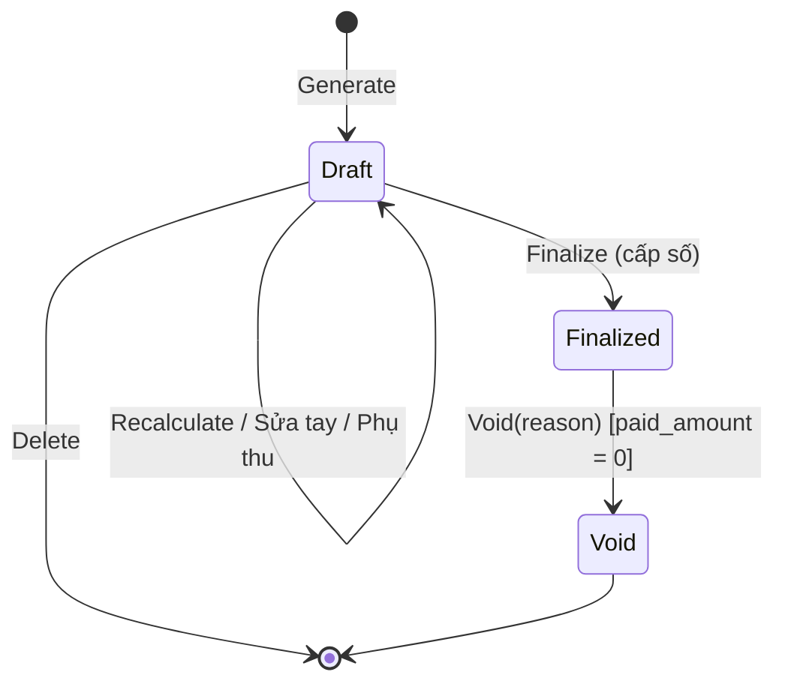

# M07 — Billing (Kỳ thu, Phiếu báo tiền phòng, Phụ thu, Khoản phát sinh)

> Theo khuôn [_TEMPLATE.md](_TEMPLATE.md). Quy ước: C-03 (tiền), C-05 (kỳ thu), C-06 (snapshot). Pháp lý: L9, L15, LEG-05, LEG-08.

## 1. Mục tiêu & phạm vi

**Mục tiêu**: Tính **phiếu tiền phòng mỗi kỳ** cho từng hợp đồng, gồm 4 nhóm (04/10/2026):

| Nhóm trên phiếu | Nguồn | Ví dụ |
|---|---|---|
| **Tiền phòng** | Giá thuê HĐ (M05) | 3.500.000 |
| **Điện nước** | Công tơ của phòng (M06) × bản giá M04 `Metered` (một giá hoặc theo bậc) | Điện 88 kWh × 3.800 |
| **Dịch vụ** | Khoản dịch vụ gắn HĐ (M04 `Service`): theo phòng / theo đầu người / theo số gói | Mạng 120.000; Giữ xe 120.000 × 2 xe |
| **Phụ thu / bù** | **Khoản phát sinh của phòng** tạo ngay lúc xảy ra (BL-UC-15), hoặc nhập tay trên phiếu nháp — 1 phòng hoặc nhiều phòng một lúc, bắt buộc lý do | Sửa khóa do người thuê làm hỏng; lắp thêm đã thỏa thuận; tiền điện công tơ cũ khi thay công tơ |

Cộng giảm trừ (giảm tay — 1 hoặc nhiều phòng) và **hoàn trả** (nhập tay như phụ thu, trả lại người thuê — BL-BR-27). Phiếu tồn tại dạng **nháp để chỉnh sửa** (mọi ô sửa được, đánh dấu "sửa tay");
**chốt** xong mới gửi cho người thuê (P2: qua Zalo Bot / email — [M11](11-notification.md)) và chỉ số cuối kỳ trở thành chỉ số cũ của phòng; sau khi chốt thì **bất biến** và là căn cứ thu tiền (M08).

**Trong phạm vi**
- Tạo phiếu nháp hàng loạt theo khu + tháng thu (idempotent); tính lại nháp.
- **Sửa tiền phòng của riêng kỳ này** (không đổi giá HĐ); thêm khoản phát sinh / giảm trừ thủ công.
- Chốt phiếu (cấp số), hủy phiếu (Void), hóa đơn trả phòng khi thanh lý.

**Ngoài phạm vi**: hóa đơn điện tử (L15), in / xuất phiếu (P2), gửi phiếu và nhắc nợ qua Zalo Bot / email (P2 — thiết kế ở [M11](11-notification.md)), thanh toán online (P3 — sau khi có gửi Zalo), trừ cọc vào phiếu và lãi / phạt chậm trả (**không làm** — dùng phụ thu nếu cần).

**Phase**: P1.

**Hiện trạng (rà soát 10/10/2026 — đã code hết các mục dưới)**
- Phiếu nháp **Regular** theo khu + tháng thu (lọc phòng / tầng): Tiền phòng (kỳ lẻ theo C-05), Dịch vụ (trọn tháng — BL-BR-04), Điện nước (công tơ của phòng —
  cộng nhiều công tơ khi thay công tơ; chuyển phòng: sản lượng phòng cũ cộng vào cùng dòng của kỳ — M05 CT-BR-47; mỗi kỳ sử dụng một dòng riêng — BL-BR-05). Lập **tuần tự từ kỳ đầu** (BL-BR-21), kỳ đầu theo "Tính tiền từ ngày" (K5).
- Sửa tay dòng hệ thống (BL-BR-07), phụ thu / giảm trừ / hoàn trả cho 1 hoặc nhiều phòng (BL-BR-23, BL-UC-05; hoàn trả có phiếu nguồn — BL-BR-27),
  tính lại giữ ô sửa tay (BL-UC-06), cờ **"Cần tính lại"** + tính lại hàng loạt (BL-BR-20), **làm tròn** tổng xuống nghìn (BL-BR-29).
- Chốt (số `PB{yyyy}-{000000}`, BL-BR-12 tính lại và so — lệch ⇒ `DRAFT_STALE`), chốt hàng loạt, hủy phiếu theo thứ tự ngược (BL-BR-22), phiếu theo phòng.
- **Hóa đơn trả phòng** khi trả phòng (BL-UC-11, BL-BR-17/18) — bồi thường là phụ thu; phiếu Regular không lập cho kỳ chứa ngày trả phòng (BL-BR-02).
- **Giá theo phiên bản**: bản giá mới nhất có hiệu lực tới ngày cuối khoảng tính, áp cả dòng (FE-BR-10); điện nước một giá hoặc theo bậc (FE-BR-15).
- Kỳ thu theo khu, đổi ngày chốt có **kỳ chuyển tiếp** (BL-BR-28). Tiền phòng **thu hằng tháng** (không có đóng nhiều tháng / lần).
- Chi tiết phiếu hiện **nợ các kỳ trước** + tổng cần thanh toán (M08 PM-UC-18).
- ✅ **Khoản phát sinh theo phòng** (chốt 10/10/2026 — BL-UC-15..17, BL-BR-30..37): phụ thu / bù tạo ngay lúc xảy ra, có trạng thái đã thanh toán, cuối tháng tự vào phiếu.
- **Chưa code**: in / xuất phiếu (BL-UC-12), gửi phiếu qua Zalo Bot / email (BL-UC-13 — thiết kế ở [M11](11-notification.md)) — P2. Việc đã chốt chưa code (nợ HĐ cũ sau khi ký lại, khoản bù lớn hơn hóa đơn trả phòng): [99-self-review.md](99-self-review.md) mục C.
- Dữ liệu: `invoices.issues` jsonb, `is_stale`, `rounding_amount`, `round_total`; `invoice_lines` có `is_manually_edited`, `system_*`, `note`, `proration_factor`,
  `source_invoice_id`; `invoice_meter_segments` có `fee_type_id`; số phiếu dùng `document_number_sequences (organization_id, prefix, year)`. API: `docs/api/invoices.md`.

## 2. Thuật ngữ

| Thuật ngữ | Code | Định nghĩa |
|-----------|------|-----------|
| Phiếu báo tiền phòng | `Invoice` | Bảng kê số tiền phải trả của 1 HĐ cho 1 kỳ. **Không phải hóa đơn GTGT** (LEG-08) |
| Loại phiếu | `InvoiceType` | `Regular` (định kỳ), `Final` (hóa đơn trả phòng khi thanh lý) |
| Dòng phiếu | `InvoiceLine` | 1 khoản; lưu snapshot tên, đơn vị, số lượng, đơn giá, khoảng dịch vụ |
| Loại dòng | `LineType` | `Rent` (nhóm Tiền phòng), `Metered` (nhóm Điện nước), `Service` (nhóm Dịch vụ), `Surcharge` (nhóm Phụ thu — thủ công), `ManualDiscount` (giảm tay), `Refund` (nhóm **Hoàn trả** — thủ công) |
| Sửa tay | `is_manually_edited` | Ô (số lượng, đơn giá, chỉ số, thành tiền) trên **phiếu nháp** do chủ trọ sửa; lưu giá trị hệ thống gốc; tính lại vẫn giữ (trừ khi chọn bỏ sửa tay) |
| Nháp lỗi thời | `is_stale` | Dữ liệu nguồn (giá, chỉ số, HĐ, quy tắc) đổi sau khi tạo nháp |
| Vấn đề | `issues` | Lỗi chặn chốt: thiếu chỉ số, thiếu giá… |

## 3. Nghiệp vụ

### 3.1 Use case

| ID | Mô tả |
|----|-------|
| BL-UC-01 ✅ | Tạo phiếu nháp cho **1 khu** + tháng thu M, lọc phòng / tầng / **1 HĐ cụ thể** (`contractId`). ✅ 12/10/2026 **nhiều khu một lệnh**: `POST /invoices/generate-bulk` `{ propertyIds[] (trống = mọi khu đang dùng), billingMonth, recalculateExistingDrafts }` → kết quả **từng khu** (khu lỗi không làm hỏng khu khác). Phòng thiếu chỉ số cuối kỳ ⇒ không tạo nháp, kết quả `MISSING_READING` (BL-BR-21, 17/10/2026) — các phòng khác vẫn tạo; nhập đủ chỉ số rồi tạo lại. **Đã báo trả phòng** (20/10/2026 — M05 CT-UC-07): HĐ đang hiệu lực có ngày dự kiến trả ≤ cuối kỳ ⇒ bỏ qua, kết quả `MOVE_OUT_NOTICED` (kỳ đó do hóa đơn trả phòng tính theo số ngày ở — không sinh nợ ảo nguyên tháng); HĐ đang thanh lý có ngày trả phòng ≤ cuối kỳ ⇒ `USE_FINAL_INVOICE` như cũ. Rút báo trả phòng ⇒ tạo lại được |
| BL-UC-02 ✅ | Xem danh sách phiếu theo khu/tháng/trạng thái. ✅ 12/10/2026 **số tổng hợp** `GET /invoices/totals` (cùng bộ lọc với danh sách, tính trên **toàn bộ** kết quả chứ không riêng trang đang xem): phiếu đã chốt — số phiếu, tổng phải thu, đã thu, còn nợ, nợ quá hạn; phiếu nháp — số phiếu, tổng tạm tính |
| BL-UC-03 ✅ | Xem chi tiết phiếu: từng dòng + công thức (chỉ số cũ/mới, số người, prorate) |
| BL-UC-04 ✅ | **Sửa tay mọi ô** trên phiếu nháp (tiền phòng, số lượng, đơn giá, chỉ số, thành tiền) + ghi chú; ô bị sửa hiện nhãn "Sửa tay" và giá trị hệ thống tính; bỏ sửa tay từng ô |
| BL-UC-05 ✅ | Thêm/sửa/xóa **phụ thu** (lý do bắt buộc: sửa chữa do người thuê làm hỏng, lắp đặt thêm có thu phí, đền bù, tiền điện công tơ cũ…), **giảm trừ** hoặc **hoàn trả** thủ công — cho **1 phiếu** hoặc **nhiều phòng một lúc** (chọn phiếu, hoặc khu + tháng thu lọc phòng / tầng; kết quả từng phòng, phòng chưa có nháp báo `NO_DRAFT_INVOICE`) |
| BL-UC-06 ✅ | **Tính lại nháp** theo phạm vi: 1 phòng / nhiều phòng chọn / 1 tầng / cả khu (tháng thu M) — tùy chọn "giữ ô sửa tay" (mặc định) hoặc "tính lại từ đầu"; luôn giữ phụ thu & giảm tay |
| BL-UC-07 ✅ | Chốt phiếu (1 hoặc hàng loạt) |
| BL-UC-08 ✅ | Hủy phiếu đã chốt (chưa có thanh toán) với lý do → có thể lập lại |
| BL-UC-09 ✅ | Xóa phiếu nháp |
| BL-UC-11 ✅ | **Lập hóa đơn trả phòng** khi trả phòng (HĐ đang thanh lý): nhập chỉ số cuối các công tơ (M06) → hệ thống lập phiếu nháp loại `Final` cho đoạn cuối [đầu kỳ chứa ngày trả phòng, ngày trả phòng] — sửa tay / phụ thu (VD phạt báo trễ theo điều khoản) / giảm trừ / **hoàn trả** (tiền phòng chưa ở…) như phiếu thường → chốt. **Dòng tóm tắt kỳ cuối** (20/10/2026): chi tiết hóa đơn trả phòng có `finalPeriod { stayedUntil, periodStart, periodEnd, days, periodDays, charge, rentBilledInvoiceNo }` ⇒ UI hiện đầu hóa đơn "Ở đến 15/02 · Kỳ 01/02–28/02 · Tính: trọn kỳ · Tiền phòng kỳ này: thu ở hóa đơn này / đã thu ở hóa đơn PB…". `charge`: nháp ⇒ lựa chọn đang áp của HĐ; đã chốt / đã hủy ⇒ suy từ dòng tiền phòng của chính hóa đơn (hệ số 0 ⇒ không thu, < 1 ⇒ theo ngày, đủ ⇒ trọn kỳ) để hóa đơn cũ hiện đúng cách đã tính. **Sửa tay phải rõ ràng** (20/10/2026): trên nháp hóa đơn trả phòng **mọi dòng** sửa được — tiền phòng, dịch vụ (số lượng / đơn giá / thành tiền), điện nước (sản lượng / thành tiền) — **bắt buộc ghi lý do** cho mọi dòng sửa tay (phiếu tháng chỉ bắt buộc với tiền phòng) → thiếu 422 `NOTE_REQUIRED`; dòng giữ **số hệ thống** bên cạnh số sửa tay + lý do (UI hiện "Sửa tay: 3.000.000 → 2.000.000 — lý do", nút "Bỏ sửa tay"); tính lại / đổi kỳ cuối giữ số sửa tay, số hệ thống đổi ⇒ cảnh báo `EDITED_BASE_CHANGED`. Chốt rồi là số người thuê phải trả Bồi thường tài sản = phụ thu; khoản phát sinh còn chờ của HĐ tự vào phiếu này (BL-BR-32). Không trừ cọc vào phiếu (M08 PM-BR-32). Kỳ cuối tính theo lựa chọn **"Tính theo ngày ở" / "Thu trọn kỳ"** của lần trả phòng (M05 CT-BR-11 — BL-BR-17) |
| BL-UC-12 (P2 — chưa code) | In/xuất phiếu (PDF/ảnh; Excel ở M10 E2) |
| BL-UC-13 (P2 — chưa code) | Gửi phiếu đã chốt cho người thuê và nhắc nợ quá hạn: **toàn bộ thiết kế ở [M11](11-notification.md)** (Zalo Bot + email, tin dạng chữ; mã VietQR để sau). Hiện tại: UI hiển thị chi tiết phiếu, chủ trọ tự chụp gửi |
| BL-UC-14 ✅ | Xem **phiếu theo phòng**: danh sách phiếu của phòng (mọi HĐ), trạng thái thu, còn nợ (M08) |
| BL-UC-15 ✅ | **Tạo khoản phát sinh cho phòng đang có người thuê** — ngay lúc xảy ra (VD ngày 3/3 phòng 301 hỏng khóa, chủ trọ / quản lý khu thuê thợ thay ⇒ tạo phụ thu "Thay khóa 250k"; mất nước 2 ngày ⇒ tạo khoản bù 50k): loại **phụ thu** hoặc **bù** (giảm trừ cho người thuê), nội dung, số tiền, ngày phát sinh, lý do, và **đã thanh toán hay chưa** (phụ thu: người thuê đã trả ngay; bù: chủ trọ đã trả ngay) |
| BL-UC-16 ✅ | **Đánh dấu đã thanh toán / bỏ đánh dấu**, **hủy** khoản phát sinh khi nó chưa nằm trên phiếu đã chốt |
| BL-UC-17 ✅ | **Theo dõi khoản phát sinh theo phòng / khu**: chờ vào phiếu, đang trên nháp, đã vào phiếu số …, đã thanh toán ngay, đã hủy — chủ trọ ở xa thấy người quản lý đã ghi gì |

### 3.2 Quy tắc nghiệp vụ

| Mã | Quy tắc | Nơi kiểm tra |
|----|---------|-------------|
| BL-BR-01 ✅ | Mỗi `(contract, invoice_type, period_start)` có tối đa **1 phiếu chưa Void** | DB partial unique |
| BL-BR-02 ✅ | Kỳ phiếu Regular theo C-05: **kỳ của HĐ** có tháng thu = M (tháng của kỳ chuẩn của khu chứa kỳ đó — mỗi HĐ mỗi tháng đúng 1 kỳ, chốt 09/10/2026). Không tạo nếu kỳ bắt đầu sau `actual_end_date`; không tạo Regular khi HĐ đã có phiếu Final chưa Void. **Thêm (04/10/2026)**: HĐ đang / đã thanh lý — kỳ chứa `actual_end_date` không lập Regular (bỏ qua lý do `USE_FINAL_INVOICE`), do hóa đơn trả phòng đảm nhận | Domain |
| BL-BR-03 ✅ | **Dòng Tiền phòng** (hằng tháng) = giá thuê hiệu lực tại `period_start` (M05) × hệ số prorate C-05 (`Daily`: Σ overlap/len kỳ chuẩn; `FullPeriod`: 1). Không có chu kỳ nhiều tháng (BL-BR-26 đã bỏ) | Domain |
| BL-BR-04 ✅ | **Dòng Dịch vụ** (`Service`): đăng ký hiệu lực tại `period_start`; `PerRoom` qty = 1, `PerOccupant` qty = số người ở tại `period_start` (FE-BR-14), `PerUnit` qty = số gói đăng ký (VD 2 xe = 2 gói). **Thu trọn tháng, không tính theo ngày** ở kỳ lẻ (đổi 08/10/2026, code 09/10/2026): vào ở 3 ngày hay thỏa thuận riêng thì chủ trọ **sửa số lượng / thành tiền** trên nháp (BL-BR-07). Đơn giá = `unit_price_override` ?? **bản giá theo phiên bản** tại ngày cuối kỳ (FE-BR-10). Sai mà phiếu đã chốt / đã thu ⇒ sửa ở phiếu tháng sau (hoàn trả hoặc phụ thu) | Domain |
| BL-BR-05 ✅ | **Dòng Điện nước** (`Metered`): **không cần HĐ đăng ký** — mỗi công tơ của phòng hoạt động trong kỳ sử dụng U (FE-BR-17) sinh 1 dòng theo khoản thu của công tơ. U = kỳ của phiếu (`Postpaid`) hoặc kỳ liền trước (`Prepaid`; kỳ đầu tiên không có dòng Điện nước), U cắt theo khoảng ở của HĐ (bắt đầu từ chỉ số nhận phòng MT-BR-13). Sản lượng theo thuật toán M06 §3.3 (thay công tơ giữa kỳ: tự cộng phần công tơ cũ — MT-BR-15). Thành tiền theo **bản giá theo phiên bản** tại **ngày cuối U** (FE-BR-10 — đổi giá giữa kỳ thì cả kỳ tính giá mới; giá có hiệu lực từ ngày đầu kỳ sau thì thuộc kỳ sau; tạo phiếu muộn vẫn lấy giá tới ngày cuối kỳ, không lấy giá ngày tạo phiếu — (chốt 09/10/2026)): **một giá** ⇒ sản lượng × đơn giá; **theo bậc** (FE-BR-15) ⇒ chia **tổng sản lượng của kỳ** (mọi đoạn đo) theo bậc, không prorate bậc theo số ngày. Không giá riêng theo HĐ. Khoản đã ngừng dùng thì bỏ qua. **Mỗi kỳ sử dụng tính riêng** (17/10/2026): hóa đơn trả phòng khu thu trước mà kỳ trước chưa thu (BL-BR-17) ⇒ mỗi kỳ **1 dòng riêng** ghi khoảng ngày, giá / bậc tính riêng từng kỳ theo bản giá ngày cuối kỳ đó; mốc giữa 2 kỳ là chỉ số cuối kỳ `Periodic` (thiếu ⇒ `MISSING_READING`). VD bậc 0–50: 1.800đ, 51–100: 2.300đ, > 100: 3.000đ; tháng 11 80 kWh + 05/12–20/12 40 kWh ⇒ 159.000 + 72.000 = 231.000đ (không gộp 120 kWh = 265.000đ). **Chuyển phòng** trong kỳ vẫn **1 dòng** = phòng cũ + phòng mới (M05 CT-BR-47). **Hiển thị cho UI** (18/10/2026): dòng Điện nước luôn kèm `segments[]` — mỗi đoạn đo 1 phần tử có `roomCode`, `meterSerial`, `startDate` → `endDate`, `startValue` → `endValue`, `consumption`; dòng có **từ 2 đoạn** (chuyển phòng / thay công tơ / quay lại phòng cũ) ⇒ UI hiện chi tiết dưới dòng, mỗi đoạn một hàng: "Phòng 203 (E-101): 01/10 1.200 → 20/10 1.260 = 60 kWh", "Phòng 206: 20/10 3.500 → 04/11 3.540 = 40 kWh", tổng = số lượng của dòng; bản in / gửi phiếu (BL-UC-12/13) cũng in các hàng này. Dòng 1 đoạn: chỉ hiện "chỉ số cũ → chỉ số mới". Mỗi đoạn chỉ thuộc đúng 1 dòng (hóa đơn trả phòng tách 2 dòng thì mỗi dòng chỉ có đoạn của kỳ mình). **Ngoại lệ**: kỳ vừa đổi thu trước → thu sau (BL-BR-28) vẫn 1 dòng gộp 2 kỳ — không có chỉ số mốc giữa 2 kỳ (lưới ghi chỉ số mỗi tháng thu chỉ hỏi 1 kỳ) và việc đổi cách thu rất hiếm | Domain |
| BL-BR-06 ✅ | Làm tròn mỗi dòng về đồng (C-03). `amount` dòng giảm trừ là **số âm** | Domain + CHECK theo loại dòng |
| BL-BR-07 ✅ | **Sửa tay** (thay "sửa tiền phòng tháng"): chỉ phiếu Draft; sửa được số lượng / đơn giá / chỉ số cuối / thành tiền của mọi dòng hệ thống; dòng bị sửa lưu `is_manually_edited`, `system_quantity/system_unit_price/system_amount` (giá trị hệ thống tính) và ghi chú (bắt buộc với dòng Tiền phòng). Không ảnh hưởng HĐ / bảng giá / chỉ số gốc. Tính lại (BL-UC-06) mặc định **giữ** ô sửa tay và cập nhật giá trị hệ thống bên cạnh; nếu giá trị hệ thống mới khác giá trị hệ thống lúc sửa → cờ cảnh báo `EDITED_BASE_CHANGED`. Sửa chỉ số cuối trên phiếu = ghi chỉ số `Periodic` (M06) rồi tính lại dòng đó | Domain |
| BL-BR-08 ✅ | **Thứ tự tính**: Tiền phòng → Điện nước / Dịch vụ (hệ thống) → sửa tay → dòng thủ công (phụ thu / giảm trừ / hoàn trả). Không có quy tắc điều chỉnh | Domain |
| BL-BR-10 ✅ | **Phần thu sau giảm trừ ≥ 0** (`subtotal + discount_total`, kể cả hóa đơn trả phòng): giảm tay làm phần này âm → 422 `NEGATIVE_TOTAL`; muốn trả tiền lại cho người thuê thì dùng **Hoàn trả** (BL-BR-27) — chỉ dòng hoàn trả được làm **tổng phiếu âm**. **Ngoại lệ hóa đơn trả phòng** (20/10/2026): khoản bù (khoản phát sinh chưa trả, khoản điều chỉnh chỉ số) **được làm phần thu âm** — hóa đơn trả phòng là hóa đơn cuối, không còn hóa đơn sau để trừ tiếp; tổng âm ⇒ **Chờ hoàn** như BL-BR-27, phải xác nhận đã hoàn trước khi hoàn tất thanh lý (`REFUND_PENDING`). Mọi dòng giảm trừ trên nháp đều là khoản phát sinh (BL-BR-34) nên áp chung cho mọi khoản giảm của hóa đơn trả phòng | Domain + CHECK `invoice_type = 'Final' OR subtotal + discount_total >= 0` |
| BL-BR-11 ✅ | Phiếu Draft có `issues` mức lỗi (`MISSING_READING`, `FEE_PRICE_MISSING`, `RENT_TERM_MISSING`) → không chốt được | Domain |
| BL-BR-12 ✅ | **Chốt**: tính lại dòng hệ thống trong cùng transaction và so với nháp — **bỏ qua ô sửa tay**; lệch ở ô hệ thống → 409 `DRAFT_STALE` (người dùng tính lại / xem lại rồi chốt) ⇒ phần hệ thống của phiếu chốt luôn khớp dữ liệu nguồn tại thời điểm chốt. **Khóa** (20/10/2026): HĐ → **công tơ của các phòng HĐ ở trong kỳ** (theo id) → hóa đơn — lệnh sửa chỉ số cùng phòng phải chờ chốt xong (M06 §10) | Application |
| BL-BR-13 ✅ | Chốt cấp `invoice_no` = `PB{yyyy}-{seq:000000}` theo tổ chức/năm (bảng sequence, `UPDATE … RETURNING`), `issue_date` = hôm nay (C-04), `due_date` = issue_date + `payment_due_days` | Application |
| BL-BR-14 ✅ | Phiếu `Finalized`/`Void` **bất biến** (không sửa dòng, không sửa tổng). Ngoại lệ: (1) lệnh ẩn danh người thuê (RT-BR-06) thay `snapshot_representative_name`; (2) **điều chỉnh chỉ số đã chốt** (M06 MT-BR-19, 20/10/2026) tính lại **dòng điện nước** của hóa đơn đã chốt khi hóa đơn chưa thu hoặc chủ trọ chọn "Xử lý ngay" — giữ số hóa đơn / ngày lập / hạn, ghi lịch sử (BL-BR-40). Không có endpoint sửa tay hóa đơn đã chốt | Domain |
| BL-BR-15 ✅ | **Void** chỉ khi `paid_amount = 0` (phải hủy phân bổ thanh toán ở M08 trước); lý do bắt buộc; đặt `voided = true` cho các `invoice_meter_segments`. Khoản điều chỉnh chỉ số (BL-BR-40) có `source_invoice_id` = phiếu bị hủy và chưa nằm trên phiếu đã chốt ⇒ **tự hủy** (lý do "Hóa đơn nguồn đã hủy") | Domain + Application |
| BL-BR-16 ✅ | Phiếu tổng = 0 khi chốt → coi như đã thanh toán (trạng thái thanh toán `Paid`) | Dẫn xuất |
| BL-BR-17 ✅ | **Hóa đơn trả phòng** (`Final`): kỳ = [Pk.start, `actual_end_date`], Pk = kỳ HĐ chứa ngày trả phòng; các kỳ trước Pk phải có phiếu (BL-BR-21). Dòng hệ thống chỉ **thu phần còn thiếu**: (1) **Tiền phòng** cho số ngày đã ở trong Pk (prorate theo HĐ) nếu Pk **chưa** có dòng Tiền phòng trên phiếu chưa hủy; đã có ⇒ không có dòng, và nếu số đã thu > tiền phòng số ngày ở thực tế ⇒ cảnh báo `RENT_OVERPAID` (ghi số thừa) — **không tự hoàn**, chủ trọ thêm dòng **Hoàn trả** nếu trả lại (BL-BR-27); (2) **Dịch vụ** của Pk nếu Pk chưa có phiếu Regular — **đổi 20/10/2026**: theo lựa chọn kỳ cuối của lần trả phòng (M05 CT-BR-11): **`FullPeriod` "Thu trọn kỳ" (mặc định)** ⇒ tiền phòng và dịch vụ thu đủ kỳ (không theo "Tính kỳ lẻ" của khu); `Daily` "Tính theo ngày ở" ⇒ tiền phòng **và dịch vụ** × số ngày ở / số ngày kỳ (dòng có hệ số); `None` "Không thu" ⇒ dòng tiền phòng + dịch vụ hệ số 0 (0đ, vẫn hiện để sửa tay nếu cần). Tiền phòng (1) cũng theo lựa chọn này; `RENT_OVERPAID` (khu thu trước) tính theo lựa chọn — cảnh báo kèm **số gợi ý hoàn** và hóa đơn nguồn (`issues[].amount`, `issues[].refId`) ⇒ UI nút "Thêm hoàn trả X" điền sẵn dòng Hoàn trả (BL-BR-27); không bấm ⇒ không hoàn. Số gợi ý = min(phần thừa, **số người thuê đã trả thật** cho hóa đơn nguồn — đã thu − bỏ nợ) − các dòng hoàn trả đã trỏ tới hóa đơn đó (rà 20/10/2026 — trước đây tính theo số đã lập ⇒ bấm nút bị `REFUND_EXCEEDS_PAID`); đã hoàn đủ ⇒ hết cảnh báo; hóa đơn nguồn **chưa thu** ⇒ cảnh báo không kèm số: "hủy hóa đơn tháng đó để tính lại theo lựa chọn kỳ cuối". **Không cần hóa đơn trả phòng** khi ngày trả phòng = ngày cuối Pk, Pk đã có phiếu Regular và khu thu sau (M05 CT-UC-08). Vẫn lập (để ghi bồi thường / phạt) ⇒ chỉ số cuối nhập **đúng số chốt kỳ** (UI điền sẵn — nhỏ hơn ⇒ lỗi thứ tự chỉ số), dòng điện 0. Phiếu tháng thường vẫn thu dịch vụ trọn tháng (BL-BR-04); hóa đơn trả phòng còn là nháp nên chủ trọ sửa số lượng / thành tiền, chốt rồi mới là số người thuê phải trả; (3) **Điện nước** từ đoạn đo cuối đã lập phiếu tới **chỉ số cuối** `Final`; Prepaid mà kỳ trước chưa thu ⇒ **2 dòng**: kỳ trước (tới chỉ số cuối kỳ) + kỳ cuối (tới `Final`), tính riêng từng kỳ (BL-BR-05). (4) **Bồi thường tài sản**: chủ trọ thêm **phụ thu** (BL-BR-23) — không có dòng hệ thống riêng (đổi 10/10/2026, M05 CT-BR-23). Sửa tay / phụ thu / giảm trừ / hoàn trả như phiếu thường | Domain + Application |
| BL-BR-18 ✅ | Tạo phiếu Final khi HĐ còn phiếu **Draft** → 409 `INVOICE_DRAFT_EXISTS` (chốt hoặc xóa trước); đã có phiếu Final chưa hủy → 409 `FINAL_INVOICE_EXISTS` | Application |
| BL-BR-20 ✅ | **Cờ "Cần tính lại"** (I1 — chốt 09/10/2026): nháp đã lập mà sau đó **dữ liệu nguồn** đổi ⇒ `is_stale = true` (gợi ý UI, không chặn). Nguồn (rút gọn 10/10/2026 — chỉ những thứ hay đổi trước kỳ trả phòng mà đã lập nháp; phiếu đã chốt không bao giờ "cần tính lại" vì đổi giá trong kỳ đã chốt bị chặn): (1) **công tơ** của phòng (lắp / thay / gỡ) — riêng **ghi / sửa / hủy chỉ số** từ 20/10/2026 **tự tính lại nháp ngay** (M06 MT-BR-06), không qua cờ; (2) HĐ: giá thuê, khoản thu, người ở (vào / ra), ngày trả phòng, "Tính tiền từ ngày", **chuyển phòng**; (xe, cài đặt khu không tính — tránh báo thừa); (3) bảng giá khoản thu (phiên bản giá mới / sửa / xóa) ⇒ nháp của khu có kỳ kết thúc từ ngày hiệu lực của giá (khoản thu vừa tạo kèm giá ban đầu: bỏ qua — chưa HĐ nào dùng); (3b) công tơ (lắp / thay / gỡ) của phòng. Đánh dấu tự động trong **cùng lần lưu** (đọc ChangeTracker — không cần nhớ gọi ở từng lệnh). Tính lại phiếu ⇒ `is_stale = false`. `GET /invoices?stale=true`; `POST /invoices/recalculate` thêm `staleOnly` (tính lại các nháp cần tính lại của khu / tháng, giữ ô sửa tay). Chốt vẫn tính lại và so (BL-BR-12) — cờ chỉ là gợi ý | Infrastructure (SaveChanges) + Application |
| BL-BR-21 ✅ | **Lập phiếu tuần tự từ kỳ đầu** (đổi (chốt 09/10/2026)): phiếu kỳ k chỉ tạo được khi kỳ k−1 của HĐ đã có phiếu chưa Void; kỳ đầu = kỳ chứa "Tính tiền từ ngày" (C-05). Bỏ ngoại lệ "phiếu đầu tiên lập kỳ nào cũng được" — HĐ nhập từ sổ cũ đặt "Tính tiền từ ngày" thay vào đó. Quên kỳ đầu ⇒ `PREVIOUS_PERIOD_NOT_BILLED`, không tự cộng dồn. Lý do: chuỗi chỉ số (MT-BR-12) và không để kỳ sau "nuốt" / bỏ sót kỳ trước. **Nháp chỉ lập khi đủ chỉ số** (17/10/2026): công tơ đang hoạt động của phòng thiếu chỉ số cuối kỳ sử dụng ⇒ **không tạo nháp**, kết quả `MISSING_READING` (tạo hàng loạt: phòng khác vẫn tạo); kỳ trước còn nháp mang lỗi `MISSING_READING` (chỉ số bị hủy sau khi lập) ⇒ kỳ sau `PREVIOUS_PERIOD_INCOMPLETE`. Chỉ số sửa được bất kỳ lúc nào chưa bị phiếu đã chốt khóa; xóa nháp không mất chỉ số — tạo lại dùng tiếp; tính lại từng phiếu / hàng loạt như cũ. Hóa đơn trả phòng vẫn lập được khi thiếu chỉ số giữa kỳ (lỗi hiện trên nháp, chặn chốt) vì chỉ số cuối nhập cùng lệnh | Domain + Application |
| BL-BR-22 ✅ | **Hủy/xóa theo thứ tự ngược (LIFO)**: chỉ Void phiếu đã chốt / xóa phiếu nháp khi nó là phiếu **mới nhất chưa Void** của HĐ (theo `period_start`; **hóa đơn trả phòng chưa hủy luôn là mới nhất** — cùng kỳ với phiếu tháng cuối nhưng phiếu tháng cuối không hủy / xóa được khi còn hóa đơn trả phòng, 17/10/2026 sửa code cho đúng) → 422 `NOT_LATEST_INVOICE`. Muốn sửa phiếu kỳ cũ → hủy lần lượt các phiếu sau nó | Domain |
| BL-BR-23 ✅ | **Phụ thu** (`Surcharge`): dòng nhập tay trên phiếu nháp, số tiền > 0, **lý do bắt buộc**, tùy chọn gắn khoản thu (`fee_type_id`) và số lượng × đơn giá. Thêm cho 1 phiếu hoặc **nhiều phòng một lúc** (BL-UC-05). Dùng cho: sửa chữa do người thuê làm hỏng (VD khóa cửa), lắp đặt thêm có thu phí đã thỏa thuận, đền bù, và **thay công tơ — cách 1**: tính theo công tơ mới + phụ thu = tiền điện công tơ cũ do chủ trọ tự tính (cách 2: công tơ phiên bản, hệ thống tự cộng — MT-BR-15). Giữ nguyên khi tính lại; không tạo đoạn đo | Domain |
| BL-BR-24 ✅ | **Sau khi chốt**: phiếu bất biến (BL-BR-14); chỉ số cuối kỳ bị khóa và thành chỉ số cũ của phòng cho kỳ sau (MT-BR-16); phiếu sẵn sàng gửi (BL-UC-13). Sai sót sau khi chốt: **gõ sai chỉ số** ⇒ điều chỉnh chỉ số (M06 MT-BR-19); sai khác ⇒ hủy phiếu (BL-BR-15, chưa có thanh toán) rồi lập lại, hoặc hoàn trả / phụ thu ở phiếu sau | Domain |
| BL-BR-27 ✅ | **Hoàn trả** (07/10/2026; **đổi 09/10/2026 — E**): nhóm dòng riêng `Refund` trên phiếu (không thuộc Dịch vụ), nhập tay, số tiền nhập dương, lưu **âm**, lý do bắt buộc. **Chỉ dùng khi hệ thống tính sai trên phiếu đã chốt mà người thuê đã trả** (VD trả phòng sớm đã thu trọn tiền phòng — gợi ý từ `RENT_OVERPAID`, thu nhầm kỳ trước): bắt buộc chọn **phiếu nguồn** (`source_invoice_id` — phiếu đã chốt của cùng HĐ) → thiếu ⇒ 400 `REFUND_SOURCE_REQUIRED`; số tiền ≤ **số đã thu thật** của phiếu nguồn (`paid_amount − written_off_amount`) − Σ hoàn trả khác đã trỏ tới phiếu nguồn (phiếu chưa hủy) → 422 `REFUND_EXCEEDS_PAID` (chặn nhẹ — tránh hoàn tiền chưa từng thu); kiểm khi thêm dòng, **khi sửa dòng và khi chốt phiếu** (17/10/2026 — phiếu nguồn có thể bị đảo thu sau khi thêm dòng). Phiếu nguồn **chưa thu** mà tính sai ⇒ không hoàn — dùng bỏ nợ phần sai (M08 PM-UC-16). Thêm hàng loạt **không** cho loại Hoàn trả (mỗi phòng một phiếu nguồn khác nhau) → 400. Chỉ hoàn trả được làm **tổng phiếu âm** (`total = subtotal + discount_total + refund_total + rounding_amount`). Phiếu đã chốt tổng âm: **Chờ hoàn** (`RefundPending`) — không phải nợ, không bù trừ nợ phiếu khác — tới khi chủ trọ **xác nhận đã hoàn** (`POST /invoices/{id}/refund`: ngày hoàn ∈ [ngày lập phiếu, hôm nay], phương thức, ghi chú) ⇒ **Đã hoàn** (`Refunded`); bỏ xác nhận được (nhập nhầm) và phải bỏ trước khi hủy phiếu (`REFUND_CONFIRMED`). Hoàn tất thanh lý bị chặn khi còn phiếu Chờ hoàn → 422 `REFUND_PENDING`. Trả thừa (người thuê chuyển dư) vẫn chặn ở M08 `PAYMENT_EXCEEDS_DEBT` — backlog khi có thanh toán online (M08 §1) | Domain + Application |
| BL-BR-28 ✅ | **Kỳ chuyển tiếp khi đổi ngày chốt / thu trước–thu sau** (K4 — chốt 09/10/2026, PR-BR-09). (1) **Tiền phòng** kỳ chuyển tiếp = 1 tháng ± **số ngày điều chỉnh** chủ trọ chọn khi đổi ngày chốt: kỳ dư N ngày ⇒ tính thêm 0..N ngày, kỳ thiếu N ngày ⇒ trừ 0..N ngày; hệ thống hiện "Kỳ chuyển tiếp dư / thiếu N ngày (≈ X đ/phòng)" và **điền sẵn**: lệch ≤ 3 ngày ⇒ 0 (không đáng thu), lệch ≥ 4 ngày ⇒ đủ N ngày; chủ trọ sửa được. Một số ngày cho cả khu, tiền tính theo giá từng phòng, giá 1 ngày theo cách chia ngày của khu (như kỳ lẻ). Dòng tiền phòng ghi rõ "1 tháng + 4 ngày (đổi ngày chốt)"; phòng ngoại lệ sửa tay trên phiếu nháp. (2) **Điện nước theo công tơ**: theo chỉ số thật cuối kỳ chuyển tiếp — không điều chỉnh; thu trước → thu sau ⇒ phiếu kỳ đầu thu sau gộp điện nước kỳ trước (chưa ai thu) + kỳ này trên 1 dòng (ngoại lệ của BL-BR-05 — không có chỉ số mốc). (3) **Dịch vụ cố định**: trọn 1 tháng, không chia ngày. (4) **Thu trước ↔ thu sau**: mỗi kỳ tiền phòng / dịch vụ cố định chỉ thu một lần — thu trước → thu sau: phiếu thu sau của kỳ đã thu trước không có lại tiền phòng / dịch vụ cố định (chỉ điện nước); thu sau → thu trước: phiếu đầu tiên gồm kỳ vừa qua (thu sau) + kỳ mới (thu trước) ⇒ cảnh báo `TWO_RENT_PERIODS` "Phiếu này gồm 2 tháng tiền phòng". Khóa mức lệch / số lần đổi: **để sau**. Code 09/10/2026: `BillingSchedule` (kỳ chuyển tiếp = [mốc đổi, ngày chốt mới tháng sau − 1], tháng thu = tháng của mốc đổi), dòng tiền phòng ghi "Tiền phòng (1 tháng + N ngày — đổi ngày chốt)" | Domain `InvoiceCalculator` + Application |
| BL-BR-29 ✅ | **Làm tròn tổng phiếu** (H1 — chốt 09/10/2026): khu bật "Làm tròn tổng phiếu" (`properties.round_invoice_total`, mặc định **bật**) ⇒ sau khi tính mọi dòng, bỏ phần lẻ dưới 1.000đ của tổng (về 0 — 523.560 → 523.000; tổng âm −12.400 → −12.000), lưu ở cột `rounding_amount` (|x| < 1.000) và **hiển thị thành dòng "Làm tròn" (−560)** cuối phiếu — không phải `invoice_line` (code: tránh lẫn với dòng hệ thống khi so BL-BR-12, không sửa tay được). Tính lại mỗi khi tổng nháp đổi (tính lại, sửa tay, thêm / xóa dòng); phiếu nhớ cờ `round_total` lúc tính. Tổng đã tròn nghìn ⇒ không có dòng. Tắt ở khu ⇒ nháp sau khi tính lại không còn dòng làm tròn. Phiếu đã chốt giữ nguyên | Domain |
| BL-BR-30 ✅ | **Bổ sung 13/10/2026**: giới hạn khoản bù (tổng bù chưa trả ≤ 1 tháng tiền phòng) kiểm cả khi **bỏ đánh dấu "đã thanh toán"** một khoản bù — vượt → 422 `ROOM_CHARGE_CREDIT_TOO_HIGH`, khoản giữ nguyên trạng thái đã thanh toán. **Khoản phát sinh** (`room_charges`, chốt 10/10/2026): thuộc **phòng** nhưng chỉ tạo được khi phòng **có người thuê** tại ngày phát sinh — hệ thống gắn với HĐ đang ở phòng ngày đó (tính cả lịch sử chuyển phòng, M05 CT-BR-14); phòng trống → 422 `ROOM_CHARGE_NO_TENANT` (việc của riêng chủ trọ, không ghi ở đây). HĐ phải còn lập được phiếu: `Active`, hoặc `Liquidating` mà hóa đơn trả phòng chưa chốt → ngược lại 422 `ROOM_CHARGE_NO_OPEN_INVOICE`. Loại `Surcharge` (phụ thu, +) / `Credit` (bù cho người thuê, −); số tiền > 0 nguyên đồng; ngày phát sinh ≤ hôm nay; nội dung + lý do bắt buộc. **Giới hạn khoản bù** (11/10/2026 — G-01): khoản bù **chưa trả** + các khoản bù chưa trả khác của HĐ chưa nằm trên phiếu đã chốt **không vượt một tháng tiền phòng** của HĐ tại ngày phát sinh → 422 `ROOM_CHARGE_CREDIT_TOO_HIGH` (kèm `limit`) — phiếu tháng luôn có tiền phòng nên trừ được hết, không còn khoản bù treo; khoản bù **đã trả ngay** không bị giới hạn (không vào tổng phiếu). Hóa đơn trả phòng vài ngày lẻ có thể nhỏ hơn khoản bù ⇒ khoản **vẫn vào** và làm hóa đơn âm (BL-BR-10, 20/10/2026) — không còn khoản bù treo khi trả phòng | Domain + Application |
| BL-BR-31 ✅ | **Trạng thái thanh toán của khoản**: `settled = false` (chưa thanh toán — sẽ thu / trừ qua phiếu) hoặc `true` kèm ngày + phương thức (phụ thu: người thuê **đã trả ngay**; bù: chủ trọ **đã trả ngay**). Đánh dấu / bỏ đánh dấu được khi khoản **chưa nằm trên phiếu đã chốt**; HĐ **đã kết thúc** ⇒ không bỏ đánh dấu được (khoản sẽ treo, không còn hóa đơn / màn hoàn tất nào xử lý) → 422 `ROOM_CHARGE_NO_OPEN_INVOICE`, trừ khoản "Chênh lệch sau thanh lý" (sửa nhầm "Đã trả lại") — rà 20/10/2026; khoản đang trên nháp ⇒ dòng trên nháp đổi theo ngay. Đã chốt ⇒ khóa (422 `ROOM_CHARGE_LOCKED`) | Domain + Application |
| BL-BR-32 ✅ | **Vào phiếu nào — tháng nào ra tháng đấy**: khoản được gắn vào **phiếu nháp của HĐ có ngày cuối kỳ ≥ ngày phát sinh** (phiếu thường hoặc hóa đơn trả phòng). Nháp đã có ⇒ gắn ngay lúc tạo khoản; chưa có ⇒ khoản **chờ**, tự gắn khi lập / tính lại nháp. Kỳ chứa ngày phát sinh **đã chốt** (VD phát sinh 29/3 nhưng phiếu tháng 3 chốt 28/3) ⇒ vào phiếu **kỳ kế tiếp**; chốt sau (1/4) ⇒ vào tháng 3. Một khoản chỉ nằm trên 1 phiếu. **HĐ đang thanh lý mà hóa đơn trả phòng đã chốt** (20/10/2026 — trước đây `ROOM_CHARGE_NO_OPEN_INVOICE`): vẫn tạo được (VD mất chìa khóa phát hiện lúc trả phòng) ⇒ khoản **chưa xử lý**, không vào hóa đơn nào, hiện ở màn hoàn tất thanh lý và được xác nhận "đã trả / thu tay" khi hoàn tất (M05 CT-BR-12). HĐ đã kết thúc ⇒ vẫn `ROOM_CHARGE_NO_OPEN_INVOICE` | Application |
| BL-BR-33 ✅ | **Trên phiếu**: mỗi khoản là 1 dòng `Surcharge` / `ManualDiscount` có `room_charge_id`. Khoản **chưa thanh toán** cộng vào tổng (phụ thu +, bù −). Khoản **đã thanh toán / đã hoàn** vẫn hiện trên phiếu cho đầy đủ ("đã thu 3/3" / "đã trả 3/3") nhưng **không tính vào tổng** (`is_settled = true`) — tiền hai phía rõ ràng, không thu / trừ lần 2. Bù chưa trả mà làm phần thu của **phiếu tháng** âm (BL-BR-10) ⇒ chưa gắn, khoản vẫn chờ, nháp có cảnh báo `ROOM_CHARGE_NOT_ATTACHED`; **hóa đơn trả phòng** luôn nhận (được âm) | Domain |
| BL-BR-34 ✅ | **Thêm tay trên nháp cũng là khoản phát sinh**: phụ thu / giảm trừ thêm trên nháp (BL-BR-23, 1 phiếu hoặc nhiều phòng) tạo luôn 1 khoản phát sinh của phòng gắn vào nháp đó (ngày phát sinh = hôm nay, hoặc ngày cuối kỳ nếu kỳ đã qua), cũng chọn đã thanh toán / chưa ⇒ mọi phụ thu / bù đều theo dõi được theo phòng. Sửa dòng trên nháp ⇒ sửa khoản; xóa dòng ⇒ **hủy** khoản. (Dòng **Hoàn trả** theo phiếu nguồn — BL-BR-27 — không phải khoản phát sinh.) | Application |
| BL-BR-35 ✅ | **Hủy khoản** (lý do): khi chưa nằm trên phiếu đã chốt; đang trên nháp ⇒ xóa dòng. **Nháp bị xóa / phiếu đã chốt bị hủy** ⇒ các khoản của phiếu đó quay về **chờ** và vào phiếu lập lại | Application |
| BL-BR-36 ✅ | **Tính lại nháp** giữ nguyên dòng khoản phát sinh (như dòng nhập tay) và gắn thêm các khoản đang chờ đủ điều kiện (BL-BR-32). Chốt phiếu ⇒ khoản bị khóa cùng phiếu | Application |
| BL-BR-38 ✅ | **Khoản chốt điện nước khi chuyển phòng — chỉ còn dữ liệu cũ** (17/10/2026: không tạo mới — sản lượng phòng cũ cộng vào dòng của kỳ, M05 CT-BR-47; khoản đã có giữ nguyên, phiếu không tính lại đoạn đo của nó; hủy chuyển phòng đã bỏ). Mô tả cũ (11/10/2026): khoản phát sinh loại phụ thu do **hệ thống** tạo, lưu công tơ, chỉ số đầu / cuối, khoản thu, sản lượng, đơn giá; ngày phát sinh = ngày chuyển; vào phiếu theo BL-BR-32 — dòng trên phiếu mang khoản thu + sản lượng + đơn giá (báo cáo điện nước không lẫn vào phụ thu). **Không sửa / hủy tay** (kể cả sửa / xóa dòng trên nháp) → 422 `ROOM_CHARGE_SYSTEM`; chỉ đánh dấu "đã thu ngay" (BL-BR-31) hoặc hủy qua **hủy chuyển phòng** (CT-BR-14). Khóa 2 chỉ số của nó (M06 MT-BR-06) | Domain + Application |
| BL-BR-37 ✅ | **Báo cáo** (M10): phụ thu đã thu ngay tính vào tiền thực nhận theo ngày thanh toán; bù đã trả ngay tính là tiền đã trả lại người thuê | M10 |
| BL-BR-39 ✅ | **Bộ giá đã áp trên dòng** (20/10/2026): mỗi dòng **Điện nước** và **Dịch vụ** do hệ thống tính lưu `price_snapshot` lúc tính — nguồn giá (`Catalog` = bảng giá khu, `ContractOverride` = giá riêng của HĐ), ngày hiệu lực của bản giá (`effectiveFrom`, null với giá riêng HĐ), đơn giá; theo bậc thêm từng bậc `{ from, upTo, unitPrice, quantity, amount }` (sản lượng của dòng chia theo bậc). Tính lại ⇒ cập nhật theo bản giá mới nhất tới ngày cuối kỳ (FE-BR-10). Chi tiết phiếu trả `lines[].price` để UI hiện "Bảng giá áp dụng" (VD "Điện — bản giá từ 01/04/2026: 0–50 kWh × 1.984đ = 99.200đ …"). Dòng nhập tay, Tiền phòng: `price = null`. Phiếu lập trước 20/10/2026: `null` (không suy ngược). Điều chỉnh chỉ số (M06 MT-BR-19) tính tiền chênh theo bộ giá đã lưu; dòng cũ không có ⇒ theo bản giá tới ngày cuối kỳ | Domain + Application |
| BL-BR-40 ✅ | **Khoản điều chỉnh chỉ số + lịch sử điều chỉnh** (20/10/2026 — M06 MT-BR-19): (1) **khoản điều chỉnh** là khoản phát sinh (`room_charges`) do hệ thống tạo khi chọn "Đẩy sang hóa đơn sau": `source_invoice_id`, `fee_type_id`, `source_usage_start` (ngày đầu kỳ sử dụng của dòng nguồn) — **tối đa 1 khoản chưa hủy** cho mỗi bộ ba này; **khóa** như khoản hệ thống (không sửa / hủy tay → 422 `ROOM_CHARGE_SYSTEM`; được đánh dấu đã trả / đã thu ngay — BL-BR-31); chỉ đổi qua điều chỉnh lần sau (sửa số tiền / loại, về 0 ⇒ hủy) hoặc tự hủy khi hóa đơn nguồn bị hủy (BL-BR-15); khoản **đã thanh toán** (đã trả / thu ngay, hoặc đã nằm trên hóa đơn đã chốt) thì không điều chỉnh tiếp được (`ADJUSTMENT_ALREADY_BILLED` — tránh trả / thu 2 lần); không áp giới hạn bù (BL-BR-30), kể cả khi bỏ đánh dấu "đã trả". (2) **Lịch sử** `invoice_adjustments`: mỗi lần điều chỉnh 1 dòng gắn hóa đơn nguồn — chỉ số, số cũ → mới, sản lượng cũ → mới, thành tiền dòng cũ → mới, chênh, cách xử lý (`Recalculated` / `Immediate` / `NextInvoice`), khoản điều chỉnh, các phiếu thu / hoàn / bỏ nợ đã ghi, lý do, người làm, lúc. (3) **Nhãn trên hóa đơn**: `is_adjusted` ("Đã điều chỉnh" — có ít nhất 1 dòng lịch sử); `needs_resend` ("Cần gửi lại" — hóa đơn đã chốt bị tính lại; bỏ khi chủ trọ bấm "Đã gửi lại" hoặc M11 gửi xong). `GET /invoices?adjusted=true` / `needsResend=true` | Domain + Application |

### 3.3 Vòng đời


Trạng thái thanh toán (dẫn xuất, chỉ khi Finalized): tổng âm ⇒ `RefundPending` (chưa xác nhận hoàn) / `Refunded`; còn lại `Unpaid` (paid = 0), `PartiallyPaid`, `Paid` (paid ≥ total), `WrittenOff` (đủ nhờ bỏ nợ — PM-BR-16), `Overdue` = chưa Paid ∧ hôm nay > due_date.

### 3.4 Ví dụ tính (khu thu trước, chốt ngày 5)

HĐ bắt đầu 05/10/2026, giá 3.500.000; dịch vụ: giữ xe 2 gói × 100.000, wifi 50.000 (theo phòng); điện nước: điện 3.800đ/kWh.
- Phiếu tháng 10 (kỳ 05/10–04/11): Rent 3.500.000; Giữ xe 200.000; Wifi 50.000; **không có điện** (kỳ đầu, prepaid) → 3.750.000.
- Phiếu tháng 11 (kỳ 05/11–04/12): Rent 3.500.000; Giữ xe 200.000; Wifi 50.000; Điện kỳ 05/10–04/11: 1.338 − 1.250 = 88 kWh × 3.800 = 334.400;
  → **4.084.400**.
- Chủ trọ sửa tay tiền phòng tháng 11 thành 3.000.000 (ghi chú: mất nước 5 ngày) → 3.584.400.
- Người thuê làm hỏng khóa: thêm **phụ thu** 250.000 (lý do "Thay khóa cửa do làm hỏng") → 3.834.400.
- Bồn nước hỏng 3 ngày: chủ trọ thêm **giảm trừ** 100.000 cho cả khu một lúc (BL-UC-05) → **3.734.400**.
- Giá điện đổi 3.800 → 4.000 từ 20/10: cả kỳ 05/10–04/11 tính **4.000** (giá mới) → điện 352.000.

## 4. Dữ liệu

**`invoices`**

| Cột | Kiểu | Null | Ghi chú |
|-----|------|------|--------|
| id, organization_id | uuid | N | |
| property_id, room_id, contract_id | uuid | N | FK composite; property/room = của HĐ (kiểm khi tạo) |
| invoice_type | varchar(8) | N | `Regular`,`Final` |
| period_start / period_end | date | N | CHECK period_end ≥ period_start |
| billing_month | date | N | ngày 1 của tháng thu = tháng của kỳ chuẩn của khu chứa `period_start` (C-05) |
| status | varchar(12) | N | `Draft`,`Finalized`,`Void` |
| invoice_no | varchar(20) | Y | NOT NULL khi Finalized/Void (CHECK); UNIQUE (organization_id, invoice_no) |
| issue_date / due_date | date | Y | NOT NULL khi Finalized |
| subtotal | numeric(18,0) | N | Σ dòng dương |
| discount_total | numeric(18,0) | N | Σ dòng giảm trừ (≤ 0, không gồm hoàn trả) |
| refund_total | numeric(18,0) | N | Σ dòng hoàn trả (≤ 0) — BL-BR-27 |
| total_amount | numeric(18,0) | N | subtotal + discount_total + refund_total + rounding_amount; được âm (chủ trọ phải hoàn). CHECK `subtotal + discount_total >= 0` khi đã chốt |
| paid_amount | numeric(18,0) | N | 0; cache do M08 cập nhật trong cùng transaction (gồm cả phần bỏ nợ); CHECK 0 ≤ paid_amount ≤ max(total_amount, 0) |
| written_off_amount | numeric(18,0) | N | phần của `paid_amount` đóng bằng bỏ nợ (PM-BR-16) — loại khỏi doanh thu; CHECK 0 ≤ written_off ≤ paid |
| is_stale | bool | N | false — "Cần tính lại" (BL-BR-20, I1) |
| rounding_amount | numeric(18,0) | N | 0 — "Làm tròn" (BL-BR-29); CHECK \|x\| < 1000 |
| round_total | bool | N | khu bật làm tròn lúc tính phiếu gần nhất |
| issues | jsonb | N | `[]` — `{code, severity: Error|Warning, ref}` |
| refunded_on / refund_method / refund_note | date / varchar(16) / varchar(300) | Y | xác nhận đã trả lại người thuê phần tổng âm (BL-BR-27); CHECK `refunded_on IS NULL OR (total_amount < 0 AND refund_method IS NOT NULL)` |
| is_adjusted / needs_resend | bool | N | false — BL-BR-40 |
| snapshot_room_code / snapshot_contract_no / snapshot_representative_name | varchar | N | C-06 |
| note | text | Y | in trên phiếu |
| finalized_at/by, voided_at/by, void_reason | | Y | |
| audit, xmin | | | |

- UNIQUE `(contract_id, invoice_type, period_start) WHERE status <> 'Void'` (BL-BR-01).
- UNIQUE `(organization_id, contract_id, id)` — đích của FK composite từ `payment_allocations` (M08), chặn phân bổ chéo HĐ.
- FK composite `(organization_id, property_id, contract_id)` → contracts.
- CHECK `status <> 'Void' OR void_reason IS NOT NULL`; CHECK `status = 'Draft' OR (invoice_no IS NOT NULL AND issue_date IS NOT NULL)`.
- INDEX `(organization_id, property_id, billing_month)`, `(organization_id, contract_id, period_start)`, `(organization_id, due_date) WHERE status='Finalized' AND paid_amount < total_amount`.

**`invoice_lines`**

| Cột | Kiểu | Null | Ghi chú |
|-----|------|------|--------|
| id, organization_id, invoice_id | uuid | N | |
| line_type | varchar(16) | N | |
| is_system | bool | N | true = do hệ thống sinh (bị thay khi tính lại) |
| fee_type_id | uuid | Y | Metered / Service; Surcharge tùy chọn |
| description | varchar(200) | N | snapshot tên |
| unit | varchar(20) | Y | snapshot |
| service_from / service_to | date | N | khoảng dịch vụ của dòng |
| quantity | numeric(12,2) | N | |
| unit_price | numeric(18,2) | N | |
| proration_factor | numeric(12,8) | Y | hệ số prorate (C-05); điện nước theo bậc: thành tiền / (sản lượng × đơn giá bình quân) |
| system_quantity / system_unit_price / system_amount | numeric | Y | giá trị hệ thống tính khi dòng bị sửa tay (BL-BR-07) |
| is_manually_edited | bool | N | false |
| note | varchar(300) | Y | ghi chú sửa tay / lý do phụ thu (bắt buộc với `Surcharge`) |
| source_invoice_id | uuid | Y | phiếu nguồn của dòng `Refund` (BL-BR-27 — bắt buộc với dòng hoàn trả mới) |
| price_snapshot | jsonb | Y | BL-BR-39 — `{ source, effectiveFrom, unitPrice, tiers: [{ from, upTo, unitPrice, quantity, amount }] }`; dòng Điện nước / Dịch vụ hệ thống |
| amount | numeric(18,0) | N | |
| sort_order | int | N | |

CHECK theo loại: `line_type IN ('ManualDiscount','Refund') OR amount >= 0`; `line_type NOT IN ('ManualDiscount','Refund') OR amount <= 0`; `line_type NOT IN ('Surcharge','ManualDiscount','Refund') OR note IS NOT NULL`.
UNIQUE `(invoice_id) WHERE line_type = 'Rent'` (tối đa 1 dòng Rent); UNIQUE `(invoice_id, fee_type_id) WHERE fee_type_id IS NOT NULL AND is_system` (dòng thủ công gắn khoản thu — BL-BR-23 — không bị giới hạn).

**`room_charges`** (BL-BR-30..38)

| Cột | Kiểu | Null | Ghi chú |
|-----|------|------|--------|
| id, organization_id, property_id, room_id | uuid | N | phòng phát sinh |
| contract_id | uuid | N | HĐ đang ở phòng tại ngày phát sinh |
| kind | varchar(10) | N | `Surcharge` / `Credit` |
| description | varchar(200) | N | |
| amount | numeric(18,0) | N | CHECK > 0 |
| incurred_on | date | N | ngày phát sinh |
| reason | varchar(300) | N | |
| is_settled | bool | N | đã thanh toán / đã hoàn ngay |
| meter_id, start_reading_id, end_reading_id, fee_type_id | uuid | Y | BL-BR-38 — khoản chốt điện nước khi chuyển phòng (hệ thống tạo); NULL với khoản nhập tay |
| quantity / unit_price | numeric(12,2) / numeric(18,2) | Y | sản lượng, đơn giá tại ngày chuyển; CHECK có `meter_id` thì đủ 5 cột còn lại |
| source_invoice_id / source_usage_start | uuid / date | Y | BL-BR-40 — khoản điều chỉnh chỉ số: hóa đơn nguồn + ngày đầu kỳ sử dụng của dòng nguồn (cùng `fee_type_id`); NULL với khoản khác. UNIQUE `(source_invoice_id, fee_type_id, source_usage_start) WHERE cancelled_at IS NULL AND source_invoice_id IS NOT NULL` |
| settled_on / settled_method | date / varchar(20) | Y | CHECK có khi `is_settled` |
| invoice_id | uuid | Y | phiếu đang chứa khoản (nháp hoặc đã chốt); NULL = chờ |
| cancelled_at / cancel_reason | | Y | |
| audit, xmin | | | |

`invoice_lines` thêm `room_charge_id uuid NULL` (index, không unique — phiếu đã hủy vẫn giữ dòng cũ khi khoản vào phiếu lập lại), `is_settled bool` (dòng không tính vào tổng).
Index `(organization_id, room_id, incurred_on)`, `(organization_id, contract_id) WHERE invoice_id IS NULL AND cancelled_at IS NULL`.

**`invoice_meter_segments`**: id, organization_id, invoice_id, fee_type_id, meter_id, start_reading_id, end_reading_id, start_value, end_value,
consumption numeric(12,2), voided bool; **bản chụp để hiển thị** (18/10/2026, C-06): `room_id`, `room_code`, `meter_serial`, `start_date`, `end_date`
(ngày của chỉ số đầu / cuối), `usage_start` (ngày đầu kỳ sử dụng của dòng chứa đoạn — đoạn thuộc dòng Điện nước có cùng `fee_type_id` và
`service_from = usage_start`; NULL ở dữ liệu cũ ⇒ theo `fee_type_id`). Migration điền giá trị cho đoạn đo đã có từ công tơ / phòng / chỉ số.
- UNIQUE `(end_reading_id) WHERE NOT voided`; UNIQUE `(start_reading_id) WHERE NOT voided` ⇒ một khoảng chỉ số **không thể** bị tính 2 lần.
- CHECK `end_value >= start_value`, `consumption = end_value - start_value`.

**`invoice_adjustments`** (BL-BR-40): id, organization_id, contract_id, invoice_id (hóa đơn nguồn), meter_reading_id, fee_type_id, usage_start, old_value / new_value numeric(12,2), old_quantity / new_quantity numeric(12,2), old_amount / new_amount numeric(18,0) (thành tiền hệ thống của dòng), difference numeric(18,0), handling varchar(16) (`Recalculated` / `Immediate` / `NextInvoice`), room_charge_id uuid NULL, payment_ids uuid[] (phiếu thu / hoàn / bỏ nợ ghi trong lệnh), reason varchar(300), created_at / created_by. Index `(organization_id, invoice_id, created_at)`.

**`document_number_sequences`**: (organization_id, prefix, year) PK, last_value bigint — dùng chung `PB` (phiếu báo), `PT` (phiếu thu), `PC` (phiếu hoàn tiền — M08 PM-BR-37).

## 5. Domain model

```
Invoice (aggregate root; Lines, MeterSegments)
  + static CreateDraft(contractSnapshot, period, type)
  + ApplyCalculation(CalculationResult)        // thay dòng is_system, giữ dòng thủ công & ô sửa tay (BL-BR-07)
  + EditLine(lineId, values, note) / ResetLine(lineId)   // sửa tay / bỏ sửa tay
  + AddManualLine(type, description, amount, ...) / UpdateManualLine / RemoveManualLine
  + Finalize(invoiceNo, today, dueDays)         // BL-BR-11, 14
  + Void(reason, now)                            // BL-BR-15
  + ApplyPayment(delta) // chỉ M08 gọi; giữ 0 ≤ paid ≤ total
InvoiceCalculator (domain service thuần) — đầu vào là snapshot dữ liệu (HĐ, rent terms, fees, giá, người ở, đoạn đo):
  Calculate(contract, period, type, options) : CalculationResult { lines[], segments[], issues[] }
```
Toàn bộ logic tính tiền (kể cả sản lượng công tơ — M06 §3.3) nằm trong `InvoiceCalculator` + `BillingPeriodCalculator` → unit test thuần, không DB.
`RoomCharge` (aggregate riêng) + `RoomChargeBilling` (Application): gắn / gỡ khoản phát sinh với phiếu nháp (BL-BR-32..36).

## 6. Application

| Use case | Loại | Lỗi nghiệp vụ |
|----------|------|---------------|
| `GenerateInvoicesCommand` (Idempotency-Key) | Cmd | input: propertyId, billingMonth, `roomIds[]?`, `floor?`, `recalculateExistingDrafts` → `{created, recalculated, skipped:[{contractId, reason: EXISTS \| PREVIOUS_PERIOD_NOT_BILLED \| ENDED \| HAS_FINAL}], withIssues}` |
| `RecalculateInvoicesCommand` | Cmd | phạm vi: `invoiceIds[]` \| `roomIds[]` \| `propertyId + floor` \| `propertyId` + `billingMonth`; `keepManualEdits` (mặc định true), `staleOnly` (chỉ nháp "Cần tính lại") → kết quả từng phiếu; bỏ qua phiếu không phải Draft |
| `EditInvoiceLineCommand` / `ResetInvoiceLineCommand` | Cmd | sửa tay / bỏ sửa tay 1 dòng hệ thống — `INVOICE_NOT_DRAFT`, `NEGATIVE_TOTAL`, `NOTE_REQUIRED` |
| `AddManualLineCommand` / `UpdateManualLineCommand` / `RemoveManualLineCommand` | Cmd | phụ thu (`Surcharge`) / giảm tay (`ManualDiscount`) / hoàn trả (`Refund`), lý do bắt buộc — `INVOICE_NOT_DRAFT`, `NEGATIVE_TOTAL`, `NOTE_REQUIRED` |
| `BulkAddManualLineCommand` | Cmd | cùng 1 dòng tay cho nhiều phiếu nháp: `invoiceIds[]` hoặc `propertyId + billingMonth` (lọc `roomIds[]`, `floor`) → `{ added, results:[{invoiceId?, roomId, roomCode, success, errorCode}] }` |
| `ConfirmInvoiceRefundCommand` / `CancelInvoiceRefundCommand` | Cmd | xác nhận / bỏ xác nhận đã hoàn phần tổng âm — `NOTHING_TO_REFUND`, `REFUND_CONFIRMED`, `REFUND_NOT_CONFIRMED`, `INVALID_REFUND_DATE` |
| `FinalizeInvoiceCommand` | Cmd | `INVOICE_HAS_ISSUES`, `DRAFT_STALE`, `CONCURRENCY_CONFLICT` |
| `FinalizeInvoicesBatchCommand` | Cmd | mỗi phiếu chốt trong transaction riêng; trả kết quả từng phiếu |
| `VoidInvoiceCommand` | Cmd | `INVOICE_HAS_PAYMENTS`, `NOT_LATEST_INVOICE` |
| `DeleteDraftInvoiceCommand` | Cmd | `INVOICE_NOT_DRAFT`, `NOT_LATEST_INVOICE` |
| `CreateFinalInvoiceCommand` (từ M05) | Cmd | `INVOICE_DRAFT_EXISTS`, `FINAL_INVOICE_EXISTS`, `PREVIOUS_PERIOD_NOT_BILLED`, `MISSING_READING` |
| `ListInvoicesQuery` | Qry | propertyId, billingMonth, status, roomId, contractId, floor, unpaidOnly, stale, adjusted, needsResend |
| `GetInvoiceAdjustmentsQuery` / `MarkInvoiceResentCommand` | Qry / Cmd | BL-BR-40 — lịch sử điều chỉnh; "Đã gửi lại" bỏ nhãn `needs_resend` (`INVOICE_NOT_FINALIZED`) |
| `GetInvoiceQuery` | Qry | chi tiết + segments + công thức + nợ các kỳ trước (M08 PM-UC-18) |
| `Create / Settle / Unsettle / Cancel RoomChargeCommand`, `ListRoomChargesQuery` | Cmd / Qry | BL-UC-15..17 — `ROOM_CHARGE_NO_TENANT`, `ROOM_CHARGE_NO_OPEN_INVOICE`, `ROOM_CHARGE_LOCKED`, `ROOM_CHARGE_CANCELLED`, `ROOM_CHARGE_NOT_SETTLED` |
| Cung cấp cho module khác | | `IInvoiceLockReader` (M05 — kỳ chưa chốt đầu tiên), `FeePriceLockReader` (M04), khóa chỉ số theo đoạn đo đã chốt (M06) |

## 7. API

| Method | Route | Mã lỗi |
|--------|-------|--------|
| POST | `/rooms/{roomId}/charges` `{ kind, description, amount, incurredOn, reason, settled?, settledOn?, method? }` (Idempotency-Key) | 422 `ROOM_CHARGE_NO_TENANT`, `ROOM_CHARGE_NO_OPEN_INVOICE` |
| GET | `/rooms/{roomId}/charges` · `/room-charges?propertyId=&status=&from=&to=` | danh sách theo phòng / khu |
| POST / DELETE | `/room-charges/{id}/settle` `{ settledOn, method }` | đánh dấu / bỏ đánh dấu đã thanh toán — 422 `ROOM_CHARGE_LOCKED` |
| POST | `/room-charges/{id}/cancel` `{ reason }` | 422 `ROOM_CHARGE_LOCKED` |
| POST | `/room-charges/{id}/waive` — "Không trả lại" khoản **Chênh lệch sau thanh lý** đang chờ (20/10/2026, M06 MT-BR-19) ⇒ khoản hủy, lý do "Không trả lại" | 422 `ROOM_CHARGE_NOT_WAIVABLE` |
| POST | `/invoices/generate` | 422 |
| GET | `/invoices?propertyId=&billingMonth=2026-11&status=&roomId=&contractId=&floor=&unpaidOnly=&stale=&adjusted=&needsResend=` | |
| GET | `/invoices/{id}/adjustments` | lịch sử điều chỉnh chỉ số (BL-BR-40), mới nhất trước |
| POST | `/invoices/{id}/resent` | "Đã gửi lại" — bỏ nhãn "Cần gửi lại"; 422 `INVOICE_NOT_FINALIZED` |
| GET | `/rooms/{roomId}/invoices` — phiếu theo phòng + còn nợ | |
| GET | `/invoices/{id}` | 404 |
| DELETE | `/invoices/{id}` (Draft) | 422 `INVOICE_NOT_DRAFT` |
| POST | `/invoices/recalculate` `{ invoiceIds? , roomIds?, propertyId?, floor?, billingMonth?, keepManualEdits, staleOnly }` | 200 kết quả từng phiếu |
| PUT / DELETE | `/invoices/{id}/lines/{lineId}` `{ quantity?, unitPrice?, endReading?, amount?, note, version }` — sửa tay / bỏ sửa tay | 422 |
| POST / PUT / DELETE | `/invoices/{id}/manual-lines[/{lineId}]` (phụ thu / giảm tay / hoàn trả) | 422 `NEGATIVE_TOTAL`, `NOTE_REQUIRED` |
| POST | `/invoices/manual-lines` — cùng 1 dòng tay cho nhiều phòng | 200 kết quả từng phiếu |
| POST | `/invoices/{id}/finalize` `{ version }` | 409 `DRAFT_STALE`, 422 `INVOICE_HAS_ISSUES` |
| POST | `/invoices/finalize-batch` `{ invoiceIds[] }` | 200 kết quả từng phiếu |
| POST | `/invoices/{id}/void` `{ reason }` | 422 `INVOICE_HAS_PAYMENTS`, `REFUND_CONFIRMED` |
| POST / DELETE | `/invoices/{id}/refund` `{ refundedOn, method, note? }` — xác nhận / bỏ xác nhận đã hoàn | 422 `NOTHING_TO_REFUND`, `REFUND_CONFIRMED` |

**Ví dụ — chi tiết phiếu**
```json
{
  "id": "…", "invoiceNo": null, "status": "Draft", "type": "Regular",
  "period": { "start": "2026-11-05", "end": "2026-12-04" }, "billingMonth": "2026-11",
  "room": "101", "contractNo": "HD2026-0012",
  "lines": [
    { "type": "Rent", "group": "Rent", "description": "Tiền phòng", "quantity": 1, "unitPrice": 3500000, "amount": 3000000,
      "isManuallyEdited": true, "systemAmount": 3500000, "note": "Mất nước 5 ngày" },
    { "type": "Metered", "description": "Điện", "unit": "kWh", "serviceFrom": "2026-10-05", "serviceTo": "2026-11-04",
      "segments": [ { "meterSerial": "E-101", "startValue": 1250, "endValue": 1338, "consumption": 88 } ],
      "quantity": 88, "unitPrice": 3800, "amount": 334400,
      "price": { "source": "Catalog", "effectiveFrom": "2026-10-01", "unitPrice": 3800, "tiers": null } },
    { "type": "Service", "description": "Giữ xe máy", "unit": "xe", "quantity": 2, "unitPrice": 100000, "amount": 200000 },
    { "type": "Service", "description": "Wifi", "unit": "phòng", "quantity": 1, "unitPrice": 50000, "amount": 50000 },
    { "type": "Surcharge", "description": "Thay khóa cửa", "quantity": 1, "unitPrice": 250000, "amount": 250000, "note": "Người thuê làm hỏng khóa" },
    { "type": "ManualDiscount", "description": "Giảm trừ – Mất nước 3 ngày", "amount": -100000, "note": "Bồn nước hỏng" }
  ],
  "subtotal": 3834400, "discountTotal": -100000, "totalAmount": 3734400, "paidAmount": 0,
  "isStale": false, "isAdjusted": false, "needsResend": false, "issues": [], "version": "123456"
}
```

## 8. Validation

| Field | Quy tắc |
|-------|---------|
| billingMonth | `yyyy-MM`; ≤ tháng hiện tại + 1 |

| line edit | quantity ≥ 0 (2 số lẻ); unitPrice / amount số nguyên ≥ 0, ≤ 1.000.000.000; note 1–300 (bắt buộc với dòng Tiền phòng) |
| surcharge reason / manual description / void reason | 1–300 |
| manualLine.amount | Surcharge / ManualDiscount / Refund: nhập dương 1…100.000.000; giảm trừ và hoàn trả lưu âm |

## 9. Phân quyền
P1: chủ trọ và phó quản lý toàn quyền nghiệp vụ (M01 §3.3). P3: quyền riêng `OverrideRent`, `VoidInvoice`.

## 10. Toàn vẹn dữ liệu & concurrency

| Kịch bản | Rủi ro | Giải pháp |
|----------|--------|-----------|
| 2 người bấm "tạo phiếu tháng 11" cùng lúc | Phiếu trùng | Partial unique BL-BR-01 + Idempotency-Key; xung đột unique → coi như "skipped: exists" |
| Chốt phiếu trong khi ai đó sửa giá/chỉ số | Phiếu chốt với số liệu cũ | BL-BR-12 tính lại khi chốt; khóa theo thứ tự cố định: `contracts` → `meters` (theo id) → `invoices` — sửa / điều chỉnh chỉ số khóa cùng thứ tự (20/10/2026). Đổi giá đúng lúc chốt: phiếu đã chốt không bao giờ tính lại giá nên chỉ lệch chữ trong bảng giá, không lệch tiền — không khóa thêm |
| Chốt song song 2 phiếu → trùng số | Trùng `invoice_no` | Sequence row lock + UNIQUE |
| Sửa nháp đồng thời 2 tab | Mất cập nhật | xmin version (C-07) |
| Void phiếu đã có thanh toán | Tiền "mồ côi" | BL-BR-15 + CHECK paid ≤ total |
| Chỉ số bị tính 2 lần (2 phiếu / Final + Regular) | Thu trùng | UNIQUE start/end reading trên segments chưa void |
| Giảm trừ / bù làm phần thu âm | Tổng âm ngoài ý muốn | BL-BR-10 + CHECK; phiếu tháng: chỉ dòng Hoàn trả được làm tổng âm; hóa đơn trả phòng: khoản bù cũng được (Chờ hoàn) |
| Điều chỉnh chỉ số 2 lần liên tiếp (2 người / bấm 2 lần) | Bù 2 lần | Khóa HĐ → công tơ → hóa đơn rồi đọc lại chỉ số và khoản điều chỉnh; tối đa 1 khoản điều chỉnh / (hóa đơn nguồn, khoản thu, kỳ sử dụng) — lần sau sửa chính khoản đó (UNIQUE, BL-BR-40) |
| Tạo khoản phát sinh đồng thời với chốt phiếu | Khoản gắn vào phiếu vừa chốt | Khóa `contracts` → `invoices` trước khi gắn; phiếu đã chốt ⇒ khoản chờ kỳ sau (BL-BR-32) |
| Giá thuê đổi giữa kỳ | Không rõ áp giá nào | CT-BR-05: chỉ đổi từ đầu kỳ |
| Draft cũ quên chốt, nguồn thay đổi nhiều lần | Lệch | `is_stale` + BL-BR-12 |
| Lệch múi giờ khi cấp `issue_date` | Ngày phiếu sai lúc 0h–7h | TimeProvider VN (C-04) |

## 11. Audit
Audit: tạo/tính lại/sửa tay (từng ô: giá trị hệ thống → giá trị sửa)/phụ thu/giảm trừ/hoàn trả/chốt/void/xóa nháp. Phụ thu & void luôn có lý do.

## 12. Kế hoạch test
- **Unit `InvoiceCalculator` (bảng ≥ 40 case)**: Prepaid vs Postpaid; kỳ đầu lẻ (Daily/FullPeriod); anchor 31 vào tháng 2 (năm nhuận/không);
  PerOccupant đổi người giữa kỳ; giữ xe đổi số lượng từ kỳ sau; giá danh mục vs giá riêng; sửa tay giữ qua tính lại; giá điện đổi giữa kỳ → giá mới; thay công tơ giữa kỳ (2 cách); dịch vụ kỳ lẻ thu trọn tháng;
  giá dịch vụ đổi giữa kỳ → bản giá mới nhất tới cuối kỳ; phiếu Final: Prepaid đã thu trọn kỳ → cảnh báo `RENT_OVERPAID`, Postpaid chưa có Regular, thay công tơ trong kỳ cuối; thiếu chỉ số → issue;
  hoàn trả làm tổng âm / giảm tay không vượt phần thu / xác nhận & bỏ xác nhận hoàn / hủy phiếu đã xác nhận hoàn → 422.
- Integration: generate idempotent (gọi 2 lần → không trùng); chốt khi nguồn đổi → 409 `DRAFT_STALE`; chốt song song 20 phiếu → số liên tục không trùng;
  void khi có thanh toán → 422; sau void lập lại được và chỉ số được tái sử dụng; trả phòng sớm → hoàn trả → Chờ hoàn chặn hoàn tất thanh lý → xác nhận hoàn;
  phụ thu nhiều phòng (phòng chưa có nháp báo `NO_DRAFT_INVOICE`); **C-01**.
- **Khoản phát sinh (BL-BR-30..37) — kịch bản**:
  1. Phòng trống → `ROOM_CHARGE_NO_TENANT`; phòng có người, chưa có nháp → khoản **chờ**; lập nháp tháng đó ⇒ có dòng phụ thu, tổng tăng.
  2. Nháp đã có ⇒ tạo khoản là gắn ngay; khoản **bù** ⇒ dòng giảm trừ, tổng giảm.
  3. Khoản **đã thanh toán** ⇒ dòng hiện trên phiếu với `isSettled`, **tổng không đổi**; đánh dấu đã thanh toán khoản đang trên nháp ⇒ tổng giảm đúng số đó; bỏ đánh dấu ⇒ tổng trở lại.
  4. Phát sinh ngày thuộc kỳ **đã chốt** ⇒ không vào phiếu đó, vào nháp kỳ kế tiếp; phát sinh ngày thuộc kỳ sau ⇒ không vào nháp kỳ trước.
  5. Chốt phiếu ⇒ đánh dấu / hủy khoản → `ROOM_CHARGE_LOCKED`. Hủy phiếu ⇒ khoản về chờ, lập lại phiếu thì có lại. Xóa nháp ⇒ về chờ.
  6. Hủy khoản đang trên nháp ⇒ dòng mất, tổng đổi. Xóa dòng trên nháp ⇒ khoản thành đã hủy.
  7. Thêm phụ thu tay trên nháp (kể cả nhiều phòng) ⇒ có khoản phát sinh tương ứng trong danh sách của phòng; chọn đã thanh toán ⇒ không tính tổng.
  8. Bù lớn hơn phần thu của **phiếu tháng** ⇒ không gắn, nháp có cảnh báo `ROOM_CHARGE_NOT_ATTACHED`, khoản vẫn chờ; bù lớn hơn **hóa đơn trả phòng** ⇒ vẫn gắn, hóa đơn âm, chốt được ⇒ Chờ hoàn ⇒ hoàn tất thanh lý → `REFUND_PENDING` cho tới khi xác nhận đã hoàn.
  9. HĐ đang thanh lý chưa có hóa đơn trả phòng ⇒ khoản vào hóa đơn trả phòng; hóa đơn trả phòng đã chốt ⇒ khoản **chờ** (chưa xử lý — xác nhận khi hoàn tất thanh lý, 20/10/2026); HĐ đã kết thúc → `ROOM_CHARGE_NO_OPEN_INVOICE`.
  10. Chuyển phòng: khoản tạo ở phòng cũ với ngày trước ngày chuyển ⇒ gắn HĐ đã chuyển đi, vào phiếu của HĐ đó.
- **Bổ sung 17/10/2026** (BL-BR-05, 17, 21, 22, 27, 28):
  1. Khu thu trước: phiếu tháng cuối đã chốt + hóa đơn trả phòng chưa hủy ⇒ hủy / xóa phiếu tháng cuối → 422 `NOT_LATEST_INVOICE`; hủy hóa đơn trả phòng trước thì được.
  2. Thiếu chỉ số cuối kỳ của công tơ đang hoạt động ⇒ tạo phiếu (1 khu / hàng loạt / 1 HĐ) không tạo nháp, kết quả `MISSING_READING`, phòng đủ chỉ số vẫn có nháp; nhập chỉ số rồi tạo lại ⇒ có nháp.
  3. Nháp kỳ k bị hủy chỉ số sau khi lập (mang lỗi `MISSING_READING`) ⇒ tạo kỳ k+1 → `PREVIOUS_PERIOD_INCOMPLETE`; xóa nháp kỳ k, chỉ số còn lại vẫn dùng khi tạo lại.
  4. Hóa đơn trả phòng khu thu trước khi kỳ trước chưa thu ⇒ 2 dòng điện (kỳ trước tới chỉ số cuối kỳ, kỳ cuối tới chỉ số trả phòng), giá bậc tính riêng từng dòng; thiếu chỉ số cuối kỳ giữa ⇒ nháp có `MISSING_READING`.
  5. Chuyển phòng giữa kỳ ⇒ 1 dòng điện = phòng cũ (tới chỉ số lúc chuyển) + phòng mới, giá bậc trên tổng; không có khoản phát sinh chốt điện nước.
  6. Sửa dòng hoàn trả vượt của phiếu nguồn → 422 `REFUND_EXCEEDS_PAID`; đảo phiếu thu của phiếu nguồn rồi chốt phiếu có dòng hoàn trả → 422 `REFUND_EXCEEDS_PAID`.
  7. Hóa đơn trả phòng tách 2 dòng Điện: tính lại nháp và chốt được (khóa dòng = loại + khoản thu + ngày đầu khoảng dịch vụ — trước 18/10/2026 hai dòng trùng khóa ⇒ lỗi tính lại / `DRAFT_STALE` khi chốt); mỗi dòng chỉ có `segments` của kỳ mình.
  8. Phiếu kỳ chuyển phòng: dòng Điện có 2 `segments` với `roomCode` phòng cũ / phòng mới, ngày và chỉ số đầu / cuối đúng.
- **Bổ sung 20/10/2026**:
  1. Bộ giá trên dòng (BL-BR-39): dòng điện một giá ⇒ `price.source = Catalog`, `effectiveFrom`, `tiers = null`; giá bậc ⇒ `tiers` đủ các bậc, Σ `amount` = thành tiền dòng; dịch vụ giá riêng HĐ ⇒ `source = ContractOverride`; thêm bản giá mới hiệu lực trong kỳ rồi tính lại nháp ⇒ `price` đổi theo; bản giá hiệu lực sau ngày cuối kỳ ⇒ `price` giữ nguyên.
  2. Chốt hóa đơn đúng lúc sửa chỉ số của phòng (D1): sửa trước ⇒ hóa đơn chốt theo số mới; chốt trước ⇒ sửa → `READING_LOCKED`.
  3. Lịch sử điều chỉnh + nhãn (BL-BR-40): sau điều chỉnh ⇒ `GET /invoices/{id}/adjustments` có 1 dòng, `isAdjusted = true`; hóa đơn bị tính lại ⇒ `needsResend = true`, `GET /invoices?needsResend=true` có hóa đơn; `POST /invoices/{id}/resent` ⇒ `needsResend = false`; gọi trên nháp → `INVOICE_NOT_FINALIZED`.
- **Lượt 2 (20/10/2026)**: tạo hóa đơn tháng bỏ qua HĐ đã báo trả phòng trong kỳ (`MOVE_OUT_NOTICED`); hóa đơn trả phòng ở 15/28 ngày: mặc định ⇒ đủ kỳ; chọn "Tính theo ngày ở" ⇒ tiền phòng + dịch vụ × 15/28; "Không thu" ⇒ tiền phòng + dịch vụ 0đ; khu thu trước + theo ngày ⇒ `RENT_OVERPAID` có `amount` = số thừa, `refId` = hóa đơn tháng đã thu; `finalPeriod` trên chi tiết hóa đơn trả phòng; sửa tay dòng điện / dịch vụ trên hóa đơn trả phòng thiếu lý do → `NOTE_REQUIRED`; khoản tạo sau khi hóa đơn trả phòng đã chốt ⇒ chờ, không lỗi.
- E2E: F4 trên khu 20 phòng.

## 13. Phụ thuộc
- Dùng: M02 (phòng, kỳ thu của khu), M04 (giá), M05 (HĐ, rent terms, fees, occupants, các lần ở), M06 (công tơ + chỉ số).
- Bị dùng: M08 (phân bổ thanh toán, cập nhật `paid_amount`), M05 (khóa kỳ, phiếu Final), M10.

## 15. Câu hỏi mở

| # | Câu hỏi | Đề xuất |
|---|---------|---------|
| Q2 | Có cho phép chốt phiếu khi thiếu chỉ số (tính sau)? | Không (P1) — giữ chặt; công tơ hỏng thì thay công tơ (MT-BR-15) hoặc sửa tay dòng điện nước có ghi chú |
| Q3 ✅ | Tiền nợ kỳ trước có cộng vào phiếu kỳ này? | **Không cộng vào tổng phiếu** (tránh tính trùng); chi tiết phiếu trả `previousDebts[]` + `totalDue` (M08 PM-UC-18) |
| Q4 ✅ | Lãi/phạt chậm trả? | **Không làm** — dùng phụ thu nếu cần |
