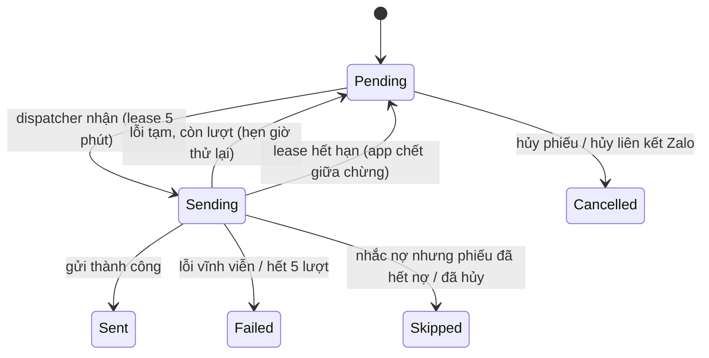

# M11 — Notification (Gửi phiếu & nhắc nợ qua Zalo Bot / Email)

> Theo khuôn [_TEMPLATE.md](_TEMPLATE.md). Pháp lý: L11 (dữ liệu cá nhân), C-11. Hiện thực **BL-UC-13** của [07-billing.md](07-billing.md).
> Hướng dẫn tạo bot và lấy token: [../guides/zalo-bot-setup.md](../guides/zalo-bot-setup.md).

## 1. Mục tiêu & phạm vi

**Mục tiêu**: sau khi chốt phiếu, hệ thống tự gửi phiếu báo tiền cho **người đứng tên hợp đồng** qua Zalo Bot và / hoặc email,
và tự **nhắc nợ** khi phiếu quá hạn mà chưa thu đủ. Gửi qua hàng đợi bền trong PostgreSQL: không mất tin, không gửi trùng, có thử lại.

**Quyết định đã chốt (12/10/2026)**
- Kênh Zalo = **Zalo Bot Platform** (bot.zaloplatforms.com), tạo bằng tài khoản Zalo cá nhân. Không OA, không ZNS, không thư viện không chính thức.
- **Một bot chung cho cả hệ thống** (token nằm ở cấu hình máy chủ, không theo tổ chức). B2B sau này: vẫn dùng bot chung, ZNS là kênh thêm.
- Nhận tin từ Zalo bằng **polling** (`getUpdates`) — không cần domain / HTTPS. Webhook: để sau (mục 15 Q5).
- Email qua **SMTP** (MailKit); bản tự dùng cấu hình Gmail + App Password.
- Hàng đợi = bảng `notification_outbox` + `BackgroundService`. **Không** Redis, **không** RabbitMQ.
- Mặc định **tắt**: khu nào muốn tự gửi / tự nhắc phải bật trong cài đặt khu (tránh tự nhắn người thuê ngay sau khi triển khai).

**Trong phạm vi**
- Liên kết người thuê với bot bằng mã (một lần), hủy liên kết.
- Tự gửi phiếu khi chốt (đơn lẻ và hàng loạt); gửi lại thủ công; nhắc nợ quá hạn theo số ngày cài đặt của khu.
- Nội dung tin dạng chữ: chi tiết phiếu, tổng tiền, hạn nộp, tài khoản ngân hàng của khu.
- Nội dung "chia sẻ tay" (văn bản + link `zalo.me/<sđt>`) cho người thuê chưa có kênh nào.
- Xem trạng thái gửi theo phiếu và tổng hợp theo khu / tháng thu.

**Ngoài phạm vi**
- Ảnh VietQR, trang xem phiếu công khai, PDF phiếu (cần UI công khai + mã BIN ngân hàng — mục 15 Q3, Q4).
- Nhắc trước hạn, tin "đã nhận tiền", chủ trọ tự sửa mẫu tin (mục 15 Q6).
- ZNS / Zalo OA, SMS, webhook, bot riêng cho từng tổ chức (P3 B2B).
- Bot trả lời hội thoại: bot chỉ hiểu **mã liên kết** và lệnh `HUY`.

**Phase**: P2. **Trạng thái (12/10/2026)**: chưa code gì — toàn bộ file là thiết kế. Bước đầu tiên là spike **NT-T00**.

## 2. Thuật ngữ

| Thuật ngữ (VI) | Tên trong code | Định nghĩa |
|---|---|---|
| Kênh | `NotificationChannel` | `Zalo`, `Email` |
| Loại tin | `NotificationKind` | `InvoiceIssued` (phiếu mới chốt), `OverdueReminder` (nhắc nợ), `ManualResend` (chủ trọ bấm gửi lại) |
| Bước | `Step` | `InvoiceIssued` = 0; `OverdueReminder` = số ngày quá hạn đã cài (VD 1, 3, 7); `ManualResend` = số thứ tự lần gửi lại |
| Tin chờ gửi | `NotificationOutbox` | 1 dòng = 1 tin tới 1 người trên 1 kênh |
| Mã liên kết | `ZaloLinkCode` | Mã dùng một lần để gắn một cuộc chat Zalo với một hồ sơ người thuê |
| Người nhận | — | Người đứng tên hợp đồng của phiếu (`Contract.RepresentativeRenterId`) |
| Khung giờ gửi | `SendWindow` | 08:00–20:00 giờ VN (C-04), cấu hình hệ thống |

## 3. Nghiệp vụ

### 3.1 Use case

| ID | Actor | Mô tả | Kết quả |
|---|---|---|---|
| NT-UC-01 | OrgOwner / OrgManager | Tạo mã liên kết Zalo cho một người thuê | Mã 8 ký tự, hạn 7 ngày; mã cũ chưa dùng của người đó bị hủy |
| NT-UC-02 | Người thuê (qua bot) | Mở bot, nhắn mã liên kết | Hồ sơ người thuê có `zalo_chat_id`; bot trả lời xác nhận kèm tên khu / phòng |
| NT-UC-03 | Người thuê (qua bot) | Nhắn `HUY` | Xóa liên kết mọi hồ sơ gắn với cuộc chat đó; bot xác nhận |
| NT-UC-04 | OrgOwner / OrgManager | Hủy liên kết Zalo của một người thuê | `zalo_chat_id` = null; tin Zalo đang chờ của người đó ⇒ `Cancelled` |
| NT-UC-05 | Hệ thống | Chốt phiếu ở khu bật "tự gửi khi chốt" | Mỗi kênh người nhận có ⇒ 1 dòng outbox `InvoiceIssued` |
| NT-UC-06 | Hệ thống | Phiếu quá hạn đúng số ngày đã cài mà còn nợ | Mỗi kênh ⇒ 1 dòng outbox `OverdueReminder`, bước = số ngày |
| NT-UC-07 | OrgOwner / OrgManager | Bấm "Gửi lại" một phiếu đã chốt | Dòng outbox `ManualResend` trên các kênh đã chọn |
| NT-UC-08 | OrgOwner / OrgManager | Xem lịch sử gửi của một phiếu; tổng hợp theo khu + tháng thu | Danh sách tin + số đếm theo trạng thái |
| NT-UC-09 | OrgOwner / OrgManager | Lấy nội dung chia sẻ tay của một phiếu | Văn bản phiếu + link `https://zalo.me/<sđt>` (nếu có số) |
| NT-UC-10 | OrgOwner | Bật / tắt tự gửi và cài số ngày nhắc nợ của khu | Lưu vào cài đặt kỳ thu của khu (M02) |
| NT-UC-11 | OrgOwner / OrgManager | Xem kênh nào đang dùng được | Zalo: đã cấu hình chưa + tên bot; Email: đã cấu hình chưa |

### 3.2 Quy tắc nghiệp vụ

| Mã | Quy tắc | Nơi kiểm tra |
|---|---|---|
| NT-BR-01 | Chỉ gửi cho phiếu `Finalized`, chưa hủy (`VoidedAt` null), `TotalAmount > 0`. Phiếu hoàn trả / phiếu 0 đồng không gửi tự động | Application (enqueue) |
| NT-BR-02 | Người nhận = người đứng tên HĐ của phiếu **tại thời điểm tạo tin**. Hồ sơ đã ẩn danh ⇒ không tạo tin | Application |
| NT-BR-03 | Tạo tin cho **mọi kênh** người nhận có: `zalo_chat_id` ⇒ Zalo; `email` ⇒ Email. Kênh chưa cấu hình ở máy chủ ⇒ bỏ qua kênh đó. Không có kênh nào ⇒ không tạo tin, phiếu hiện nhãn "Chưa gửi được" (dẫn xuất — mục 4.3) | Application |
| NT-BR-04 | Tin `InvoiceIssued` tạo **trong cùng transaction** với lệnh chốt phiếu, và chỉ khi khu bật `notify_on_finalize`. Lệnh chốt trả kết quả ngay, không chờ gửi | Application (handler chốt) |
| NT-BR-05 | Không gửi trùng: `UNIQUE (invoice_id, channel, kind, step)` | DB |
| NT-BR-06 | Nhắc nợ: với mỗi `n` trong `overdue_reminder_days` của khu, phiếu còn nợ (`Outstanding > 0`) và `due_date + n <= hôm nay` (C-04) ⇒ tạo tin bước `n` nếu chưa có. Job lỡ ngày chạy bù ⇒ chỉ tạo **bước lớn nhất** đã tới hạn, các bước nhỏ hơn bị bỏ (không dồn 3 tin một lúc) | Application (scheduler) |
| NT-BR-07 | Ngay trước khi gửi tin `OverdueReminder`: đọc lại phiếu; hết nợ / đã hủy ⇒ `Skipped`, không gửi | Infrastructure (dispatcher) |
| NT-BR-08 | Chỉ gửi trong khung 08:00–20:00 giờ VN. Ngoài khung ⇒ tin nằm chờ tới 08:00. `ManualResend` **không** bị giới hạn khung giờ | Infrastructure (dispatcher) |
| NT-BR-09 | Lỗi tạm (timeout, 5xx, 429) ⇒ thử lại sau 1 → 5 → 30 → 120 phút; quá 5 lần ⇒ `Failed`. 429 có `retry_after` ⇒ dùng giá trị đó | Infrastructure |
| NT-BR-10 | Lỗi vĩnh viễn ⇒ `Failed` ngay, không thử lại. Zalo báo người dùng chặn bot / chat không tồn tại ⇒ đồng thời xóa `zalo_chat_id` của người thuê | Infrastructure |
| NT-BR-11 | Tốc độ gửi mỗi kênh giới hạn bằng token bucket, cấu hình được (mặc định Zalo 5 tin / giây, Email 1 tin / giây) | Infrastructure |
| NT-BR-12 | Hủy phiếu (void) ⇒ mọi tin `Pending` của phiếu thành `Cancelled` trong cùng transaction | Application (handler hủy phiếu) |
| NT-BR-13 | Mã liên kết: 8 ký tự từ bảng chữ không gây nhầm (bỏ `0 O 1 I L`), DB chỉ lưu **SHA-256**; hạn 7 ngày; dùng 1 lần; tạo mã mới ⇒ mã cũ chưa dùng của người thuê đó hết hiệu lực | Domain + DB |
| NT-BR-14 | Một cuộc chat nhập sai mã quá 5 lần / giờ ⇒ bot im lặng tới hết giờ (chống dò mã) | Infrastructure (bộ đếm trong RAM, giống `LoginAttemptLimiter`) |
| NT-BR-15 | Một người thuê chỉ gắn 1 cuộc chat (liên kết lại ⇒ ghi đè). Một cuộc chat được gắn nhiều hồ sơ (bố mẹ trả tiền cho con, một người thuê 2 khu) | Domain |
| NT-BR-16 | Ẩn danh hồ sơ người thuê (RT-BR-06) ⇒ xóa `zalo_chat_id`, hủy mã liên kết, xóa `recipient` trong các dòng outbox của người đó | Application (M03) |
| NT-BR-17 | Nội dung tin **không** chứa số giấy tờ, ngày sinh, số điện thoại người thuê. Chỉ có: tên khu, mã phòng, tên người đứng tên, tháng thu, các dòng tiền, tổng, còn nợ, hạn nộp, tài khoản ngân hàng của khu | Application (bộ dựng nội dung) |
| NT-BR-18 | Dòng outbox quá 180 ngày ở trạng thái kết thúc ⇒ job dọn xóa (giống `IdempotencyCleanupService`) | Infrastructure |
| NT-BR-19 | `overdue_reminder_days`: tối đa 3 giá trị, mỗi giá trị 1–60, không trùng, tăng dần | Validator + DB CHECK |

### 3.3 Vòng đời trạng thái (dòng outbox)



| Từ → đến | Lệnh | Điều kiện | Tác động phụ |
|---|---|---|---|
| Pending → Sending | dispatcher | `next_attempt_at <= now`, trong khung giờ (trừ `ManualResend`) | `locked_until = now + 5 phút`, `attempts += 1` |
| Sending → Sent | dispatcher | Nhà cung cấp trả thành công | `sent_at`, `provider_message_id` |
| Sending → Pending | dispatcher | Lỗi tạm, `attempts < 5` | `next_attempt_at` theo NT-BR-09, `last_error` |
| Sending → Failed | dispatcher | Lỗi vĩnh viễn hoặc `attempts = 5` | `last_error`; NT-BR-10 |
| Sending → Skipped | dispatcher | NT-BR-07 | — |
| Pending → Cancelled | hủy phiếu / hủy liên kết | — | — |

`Sent`, `Failed`, `Skipped`, `Cancelled` là trạng thái kết thúc, không đổi nữa.

## 4. Dữ liệu

### 4.1 Entity / bảng

**`notification_outbox`** (mới, `TenantEntity`)

| Cột | Kiểu | Null | Ghi chú |
|---|---|---|---|
| id | uuid | N | UUIDv7 (C-02) |
| organization_id | uuid | N | C-01 |
| invoice_id | uuid | N | FK composite → `invoices` |
| renter_id | uuid | N | FK composite → `renters` |
| channel | varchar(10) | N | `Zalo` / `Email` |
| kind | varchar(20) | N | `InvoiceIssued` / `OverdueReminder` / `ManualResend` |
| step | smallint | N | mặc định 0 |
| recipient | varchar(320) | Y | Ảnh chụp chat id / email lúc tạo tin; null sau khi ẩn danh (NT-BR-16) |
| status | varchar(10) | N | mặc định `Pending` |
| attempts | smallint | N | mặc định 0 |
| next_attempt_at | timestamptz | N | mặc định = lúc tạo |
| locked_until | timestamptz | Y | Lease của dispatcher |
| last_error | varchar(500) | Y | Mã + mô tả ngắn, **không** chứa token |
| provider_message_id | varchar(100) | Y | |
| sent_at | timestamptz | Y | |
| created_at | timestamptz | N | |
| created_by | uuid | Y | null = hệ thống; có giá trị với `ManualResend` |

Nội dung tin **không lưu**: dựng lại từ phiếu lúc gửi (phiếu đã chốt là bất biến ⇒ nội dung ổn định; số "còn nợ" luôn mới nhất).

**`zalo_link_codes`** (mới, `TenantEntity`)

| Cột | Kiểu | Null | Ghi chú |
|---|---|---|---|
| id | uuid | N | |
| organization_id | uuid | N | |
| renter_id | uuid | N | FK composite → `renters` |
| code_hash | char(64) | N | SHA-256 dạng hex của mã (đã chuẩn hóa chữ hoa) |
| expires_at | timestamptz | N | tạo + 7 ngày |
| used_at | timestamptz | Y | |
| revoked_at | timestamptz | Y | Bị thay bằng mã mới / hồ sơ ẩn danh |
| created_at / created_by | timestamptz / uuid | N | |

**`renters`** (M03 — thêm cột)

| Cột | Kiểu | Null | Ghi chú |
|---|---|---|---|
| zalo_chat_id | varchar(64) | Y | Dữ liệu cá nhân (C-11): không trả ra API, chỉ trả cờ `zaloLinked` |
| zalo_linked_at | timestamptz | Y | |

**`properties`** (M02 — thêm vào nhóm cài đặt kỳ thu của khu)

| Cột | Kiểu | Null | Ghi chú |
|---|---|---|---|
| notify_on_finalize | boolean | N | mặc định `false` |
| overdue_reminder_days | smallint[] | N | mặc định `{}` (không nhắc). VD hạn 3 ngày + nhắc sau hạn 1 ngày: `payment_due_days = 3`, `overdue_reminder_days = {1}` |

### 4.2 Ràng buộc & index

- `notification_outbox`: `UNIQUE (organization_id, id)`; `UNIQUE (invoice_id, channel, kind, step)` (NT-BR-05);
  FK composite `(organization_id, invoice_id)`, `(organization_id, renter_id)`;
  index từng phần `(next_attempt_at) WHERE status = 'Pending'` (dispatcher); index `(organization_id, invoice_id)` (lịch sử theo phiếu);
  CHECK `status`, `channel`, `kind` thuộc tập cho phép; CHECK `attempts BETWEEN 0 AND 5`.
- `zalo_link_codes`: `UNIQUE (code_hash)` (toàn hệ thống — bot không biết tổ chức); index `(organization_id, renter_id)`.
- `renters`: index `(zalo_chat_id) WHERE zalo_chat_id IS NOT NULL` (lệnh `HUY`, NT-BR-10). **Không** unique (NT-BR-15).
- `properties`: CHECK `cardinality(overdue_reminder_days) <= 3`.

### 4.3 Dữ liệu dẫn xuất

- **Trạng thái gửi của phiếu** (không lưu): `Sent` nếu có ít nhất 1 tin `Sent`; `Pending` nếu còn tin `Pending` / `Sending`; `Failed` nếu mọi tin đều `Failed`;
  `NoChannel` nếu phiếu đã chốt, khu bật tự gửi, mà không có dòng outbox nào; `NotSent` cho các trường hợp còn lại.
- **`zaloLinked`** của người thuê = `zalo_chat_id IS NOT NULL`.

## 5. Domain model

- `NotificationOutbox` (aggregate root): `Create(...)`, `MarkSending(now, lease)`, `MarkSent(now, providerId)`, `ScheduleRetry(now, error, retryAfter?)`,
  `MarkFailed(error)`, `MarkSkipped()`, `Cancel()`. Invariant: trạng thái kết thúc không đổi; `attempts <= 5`.
- `RetryPolicy` (static, thuần): `NextDelay(attempts)` ⇒ 1 / 5 / 30 / 120 phút — unit test được.
- `ZaloLinkCode`: `Create(renterId, now)` trả cặp (entity, mã thô); `IsUsable(now)`; `MarkUsed(now)`; `Revoke(now)`.
- `Renter`: `LinkZalo(chatId, now)`, `UnlinkZalo()`; `Anonymize()` gọi `UnlinkZalo()`.
- `Property`: `UpdateNotificationSettings(notifyOnFinalize, overdueReminderDays)` — kiểm NT-BR-19.
- `OverdueReminderPolicy` (static, thuần): `DueStep(dueDate, today, configuredDays, sentSteps)` ⇒ bước cần tạo hoặc null (NT-BR-06).
- `InvoiceMessageBuilder` (Application, thuần): `(invoice, lines, property, kind, step, today)` ⇒ văn bản tin. Zalo tối đa 2000 ký tự: vượt thì gộp các dòng phí thành "Các khoản khác".

## 6. Application — Commands / Queries

| Use case | Loại | Input | Output | Lỗi nghiệp vụ |
|---|---|---|---|---|
| NT-UC-01 | Command `CreateZaloLinkCode` | renterId | code, expiresAt, botName | `RENTER_NOT_FOUND`, `RENTER_ANONYMIZED`, `ZALO_BOT_NOT_CONFIGURED` |
| NT-UC-02 / 03 | Nội bộ `HandleZaloBotMessage` (gọi từ poller) | chatId, text | văn bản trả lời | — (mọi lỗi thành câu trả lời của bot) |
| NT-UC-04 | Command `UnlinkRenterZalo` | renterId | — | `RENTER_NOT_FOUND` |
| NT-UC-05 | Nội bộ `INotificationEnqueuer.EnqueueInvoiceIssued(invoiceIds)` | gọi trong handler chốt | số tin đã tạo | — |
| NT-UC-06 | Command `EnqueueOverdueReminders(asOf)` (job, theo tổ chức) | ngày nghiệp vụ | số tin đã tạo | — |
| NT-UC-07 | Command `ResendInvoiceNotification` | invoiceId, channels? | danh sách tin đã tạo | `INVOICE_NOT_FOUND`, `INVOICE_NOT_FINALIZED`, `INVOICE_VOIDED`, `NO_NOTIFICATION_CHANNEL` |
| NT-UC-08 | Query `GetInvoiceNotifications`, `GetNotificationSummary` | invoiceId / propertyId + billingMonth | danh sách / số đếm | `INVOICE_NOT_FOUND`, `PROPERTY_NOT_FOUND` |
| NT-UC-09 | Query `GetInvoiceShareContent` | invoiceId | text, zaloLink? | `INVOICE_NOT_FOUND`, `INVOICE_NOT_FINALIZED` |
| NT-UC-10 | Mở rộng lệnh cập nhật cài đặt kỳ thu của khu (M02) | + notifyOnFinalize, overdueReminderDays | — | `INVALID_REMINDER_DAYS` |
| NT-UC-11 | Query `GetNotificationChannels` | — | zalo { configured, botName }, email { configured } | — |

**Giao diện (port) ở Application, hiện thực ở Infrastructure**
- `INotificationSender` — mỗi kênh một bản: `ZaloBotSender`, `EmailSender`. Trả `SendResult` (Ok / lỗi tạm / lỗi vĩnh viễn + `retryAfter`).
- `IZaloBotClient` — `GetMe`, `GetUpdates(offset, timeout)`, `SendMessage(chatId, text)`.
- `INotificationEnqueuer`.

**Dịch vụ nền (Infrastructure/Notifications)**

| Dịch vụ | Chu kỳ | Việc |
|---|---|---|
| `NotificationDispatcher` | 2 giây | Nhận tối đa 20 dòng bằng `UPDATE … WHERE id IN (SELECT … FOR UPDATE SKIP LOCKED) RETURNING`; mỗi dòng mở scope `OrganizationSystemUser` để đọc phiếu, dựng nội dung, gửi, ghi kết quả |
| `OverdueReminderScheduler` | 1 giờ | Lần lượt từng tổ chức (mẫu `RenterAnonymizationService`): gửi `EnqueueOverdueReminders` |
| `ZaloBotUpdatePoller` | long-poll liên tục | `getUpdates` ⇒ `HandleZaloBotMessage` ⇒ trả lời. Không có token ⇒ dịch vụ không chạy |
| `NotificationCleanupService` | 1 ngày | NT-BR-18 |

Câu truy vấn nhận việc của dispatcher và tra `code_hash` của poller là **hai chỗ duy nhất** dùng `IgnoreQueryFilters` / SQL thô xuyên tổ chức; nằm trong một lớp riêng (`NotificationOutboxStore`, `ZaloLinkCodeStore`). Mọi thao tác sau đó chạy trong scope của đúng một tổ chức.

## 7. API

| Method | Route | Quyền | Request | Response | Mã lỗi |
|---|---|---|---|---|---|
| POST | `/api/renters/{id}/zalo-link-code` | Owner, Manager | — | `{ code, expiresAt, botName }` | 404 `RENTER_NOT_FOUND`, 409 `RENTER_ANONYMIZED`, 409 `ZALO_BOT_NOT_CONFIGURED` |
| DELETE | `/api/renters/{id}/zalo-link` | Owner, Manager | — | 204 | 404 |
| GET | `/api/invoices/{id}/notifications` | Owner, Manager | — | `[{ id, channel, kind, step, status, attempts, lastError, sentAt, createdAt }]` | 404 |
| POST | `/api/invoices/{id}/notifications/resend` | Owner, Manager | `{ channels?: ["Zalo","Email"] }` | 202 + danh sách tin | 404, 409 `INVOICE_NOT_FINALIZED`, 409 `INVOICE_VOIDED`, 422 `NO_NOTIFICATION_CHANNEL` |
| GET | `/api/invoices/{id}/share-content` | Owner, Manager | — | `{ text, zaloLink }` | 404, 409 `INVOICE_NOT_FINALIZED` |
| GET | `/api/notifications/summary?propertyId=&billingMonth=` | Owner, Manager | — | `{ total, pending, sent, failed, skipped, cancelled, noChannel }` | 404 `PROPERTY_NOT_FOUND` |
| GET | `/api/notifications/channels` | Owner, Manager | — | `{ zalo: { configured, botName }, email: { configured } }` | — |

Thay đổi endpoint có sẵn: DTO người thuê thêm `zaloLinked`, `zaloLinkedAt`; cài đặt kỳ thu của khu thêm `notifyOnFinalize`, `overdueReminderDays`;
DTO phiếu thêm `notificationStatus` (mục 4.3). `POST …/resend` theo C-08 (idempotency key).

```json
// POST /api/renters/{id}/zalo-link-code → 200
{ "code": "K7XM2QPD", "expiresAt": "2026-10-19T03:15:00Z", "botName": "Bot Nha Tro Cuong" }
```

**Mẫu tin `InvoiceIssued`** (Zalo; email dùng cùng nội dung, tiêu đề "Phiếu báo tiền phòng P101 tháng 10/2026")
```
[Nhà trọ Hoa Mai] Phiếu tiền phòng P101 – tháng 10/2026
Người thuê: Nguyễn Văn A
- Tiền phòng: 2.500.000đ
- Điện (120 kWh): 420.000đ
- Nước (8 m³): 160.000đ
- Rác: 30.000đ
TỔNG: 3.110.000đ
Hạn nộp: 15/10/2026
Chuyển khoản: Vietcombank – 0123456789 – NGUYEN VAN B
Nội dung CK: P101 T10
(Nhắn HUY để ngừng nhận tin.)
```
`OverdueReminder` mở đầu bằng "Phiếu … đã quá hạn N ngày, còn nợ X đ" rồi tới phần chuyển khoản.

## 8. Validation

| Field | Quy tắc | Mã lỗi |
|---|---|---|
| overdueReminderDays | ≤ 3 phần tử; mỗi phần tử 1–60; không trùng; tăng dần | `INVALID_REMINDER_DAYS` (400) |
| channels (resend) | Chỉ `Zalo` / `Email`; không trùng; rỗng hoặc bỏ trống = mọi kênh người nhận có | `INVALID_CHANNEL` (400) |
| billingMonth | Ngày đầu tháng (theo quy ước M07) | `INVALID_BILLING_MONTH` (400) |

Cấu hình máy chủ kiểm lúc khởi động (`ValidateOnStart`): token Zalo nếu có phải đúng dạng `số:chuỗi`; SMTP nếu bật phải đủ host / port / user / mật khẩu; tốc độ gửi > 0. Thiếu token hoặc SMTP **không** làm app ngừng chạy — kênh đó chỉ ở trạng thái "chưa cấu hình".

## 9. Phân quyền

| Hành động | SystemAdmin | OrgOwner | OrgManager |
|---|---|---|---|
| Tạo mã liên kết, hủy liên kết | ✗ (403) | ✓ | ✓ |
| Gửi lại, xem lịch sử, tổng hợp, nội dung chia sẻ | ✗ | ✓ | ✓ |
| Bật tự gửi, cài ngày nhắc nợ của khu | ✗ | ✓ | theo quyền sửa cài đặt khu hiện có (M02) |
| Token bot, SMTP | Cấu hình máy chủ, không có API | — | — |

## 10. Toàn vẹn dữ liệu & concurrency

| Kịch bản | Cách chặn |
|---|---|
| Chốt phiếu thành công nhưng mất tin | Tin tạo trong cùng transaction với lệnh chốt (NT-BR-04) |
| Hai instance / hai vòng lặp cùng nhận một tin | `FOR UPDATE SKIP LOCKED` + chuyển `Sending` trong cùng câu lệnh |
| App chết sau khi nhận, trước khi gửi | `locked_until` hết hạn ⇒ tin quay lại `Pending` |
| App chết sau khi gửi, trước khi ghi `Sent` | Tin có thể gửi **lặp một lần** (at-least-once). Chấp nhận: gửi trùng một phiếu ít hại hơn mất phiếu |
| Scheduler chạy hai lần / chạy bù | Unique NT-BR-05 + `ON CONFLICT DO NOTHING` |
| Người thuê trả tiền giữa lúc tạo tin nhắc và lúc gửi | NT-BR-07 đọc lại phiếu ngay trước khi gửi |
| Hai người nhập cùng một mã liên kết | `UPDATE zalo_link_codes SET used_at … WHERE used_at IS NULL` — chỉ một bên thành công |
| Hủy phiếu khi tin đang `Sending` | Tin đó vẫn đi (không thu hồi được); các tin `Pending` bị `Cancelled` |
| Zalo trả 429 hàng loạt | Token bucket + `retry_after`; dispatcher tạm dừng kênh tới hết thời gian chờ |
| `getUpdates` trả lại update cũ sau khi khởi động lại | Xử lý mã liên kết là idempotent (mã đã dùng ⇒ bot báo "mã đã dùng") |

## 11. Audit & bảo mật

- **Audit (C-10)**: tạo mã liên kết, liên kết thành công (user = hệ thống), hủy liên kết, gửi lại thủ công, đổi cài đặt thông báo của khu. Dòng outbox tự nó là nhật ký gửi — không audit từng lần gửi.
- **Bí mật**: `ZaloBot:Token`, `Email:Smtp:Password` chỉ đọc từ user-secrets / biến môi trường; không nằm trong `appsettings*.json`, không ghi log. URL gọi Zalo chứa token ⇒ tắt log URL của `HttpClient` cho client này.
- **Dữ liệu cá nhân (C-11, L11)**: `zalo_chat_id`, `recipient` không trả ra API. Người thuê tự liên kết = hành vi đồng ý nhận tin; lệnh `HUY` = rút lại đồng ý. Ẩn danh ⇒ NT-BR-16.
- **Chống dò mã**: NT-BR-13, NT-BR-14. Bot trả lời cùng một câu cho "mã sai" và "mã hết hạn".
- **Nội dung tin**: NT-BR-17. Văn bản thuần, không HTML ⇒ không có chèn mã; email gửi `text/plain`.

## 12. Kế hoạch test

**Unit (Domain / Application thuần)**
1. `RetryPolicy.NextDelay`: 1, 5, 30, 120 phút; lượt thứ 5 ⇒ hết lượt.
2. `OverdueReminderPolicy.DueStep`: chưa tới hạn ⇒ null; đúng ngày `due + 1` ⇒ 1; cài `{1,3,7}` chạy bù ngày `due + 5` ⇒ 3 (bỏ 1); bước đã gửi ⇒ null; cài rỗng ⇒ null.
3. `NotificationOutbox`: các chuyển trạng thái hợp lệ; trạng thái kết thúc không đổi được; `attempts` không vượt 5.
4. `ZaloLinkCode`: mã 8 ký tự đúng bảng chữ; hết hạn / đã dùng / đã thu hồi ⇒ không dùng được; so khớp không phân biệt hoa thường.
5. `InvoiceMessageBuilder`: đủ các dòng; định dạng tiền `3.110.000đ`; không có số giấy tờ / số điện thoại; khu chưa có tài khoản ngân hàng ⇒ bỏ dòng chuyển khoản; vượt 2000 ký tự ⇒ gộp dòng; tin nhắc nợ hiện số còn nợ sau khi trả một phần.
6. `Property.UpdateNotificationSettings`: từ chối > 3 giá trị, ngoài 1–60, trùng, không tăng dần.

**Integration (API + Testcontainers; Zalo / SMTP thay bằng bản giả ghi lại lời gọi)**
7. Chốt phiếu ở khu bật tự gửi, người thuê có Zalo + email ⇒ 2 dòng `Pending`; dispatcher chạy ⇒ 2 dòng `Sent`, bản giả nhận đúng nội dung.
8. Khu tắt tự gửi ⇒ không có dòng nào.
9. Chốt hàng loạt 100 phiếu ⇒ đủ số dòng, không trùng; chốt lại (idempotent) ⇒ không thêm dòng.
10. Người thuê không có kênh nào ⇒ không có dòng, phiếu `notificationStatus = NoChannel`.
11. Lỗi tạm ⇒ `Pending`, `attempts = 1`, `next_attempt_at` +1 phút; đủ 5 lần ⇒ `Failed`.
12. Zalo báo người dùng chặn bot ⇒ `Failed`, `zalo_chat_id` bị xóa.
13. Zalo trả 429 kèm `retry_after` ⇒ thử lại đúng thời điểm đó.
14. Ngoài khung giờ ⇒ tin tự động không đi; `ManualResend` vẫn đi.
15. Nhắc nợ: hạn 3 ngày, cài `{1}` ⇒ ngày thứ 5 có tin nhắc; trả đủ trước khi gửi ⇒ `Skipped`; scheduler chạy 2 lần ⇒ 1 tin.
16. Hủy phiếu ⇒ tin `Pending` thành `Cancelled`.
17. Liên kết: tạo mã ⇒ bot nhận mã ⇒ `zaloLinked = true`; dùng lại mã ⇒ từ chối; mã hết hạn ⇒ từ chối; tạo mã mới ⇒ mã cũ vô hiệu; sai 6 lần ⇒ bot im lặng.
18. `HUY` ⇒ xóa liên kết mọi hồ sơ của cuộc chat, tin Zalo `Pending` ⇒ `Cancelled`.
19. Ẩn danh hồ sơ ⇒ `zalo_chat_id` null, `recipient` null, mã bị thu hồi.
20. Dispatcher bị dừng giữa chừng (lease hết hạn) ⇒ tin được nhận lại.
21. Hai dispatcher chạy song song trên 200 tin ⇒ mỗi tin gửi đúng 1 lần.
22. **Cô lập tổ chức (C-01)**: user tổ chức A gọi mọi endpoint với id của tổ chức B ⇒ 404; mã liên kết của tổ chức A không gắn được vào hồ sơ tổ chức B; dispatcher gửi tin của A không đọc được phiếu của B.
23. SystemAdmin gọi các endpoint nghiệp vụ ⇒ 403.
24. Chưa cấu hình token ⇒ tạo mã trả `ZALO_BOT_NOT_CONFIGURED`; app vẫn khởi động; kênh email vẫn chạy.

**Thủ công (sau khi có token thật)**: spike NT-T00, rồi chạy trọn một lượt với bot thật trên dữ liệu seed.

## 13. Phụ thuộc

- **Phụ thuộc**: M02 (cài đặt khu, tài khoản ngân hàng), M03 (người thuê, ẩn danh), M05 (người đứng tên HĐ), M07 (phiếu, chốt, hủy), M08 (số đã thu ⇒ còn nợ).
- **Bị phụ thuộc**: M10 (dashboard công nợ có thể hiện "đã nhắc mấy lần").
- **Tác động chéo**: handler chốt phiếu và hủy phiếu (M07) gọi `INotificationEnqueuer`; lệnh ẩn danh (M03) gọi `UnlinkZalo`; cài đặt kỳ thu của khu (M02) thêm 2 trường.
- **Package mới**: `MailKit`, `Microsoft.Extensions.Http.Resilience` (Infrastructure).
- **Seeder demo**: người thuê đã liên kết Zalo; chỉ có email; không có kênh nào; phiếu đã gửi; phiếu gửi lỗi đang chờ thử lại; phiếu quá hạn đã nhắc bước 1; phiếu đã trả nên tin nhắc `Skipped`; một khu bật tự gửi + `{1}`, một khu tắt.

## 14. Task breakdown

| ID | Task | Lớp | Ước lượng | Phụ thuộc |
|---|---|---|---|---|
| NT-T00 | **Spike**: gọi `getMe`, `getUpdates`, `sendMessage` bằng token thật; đo tốc độ tới khi gặp 429; thử chủ động nhắn sau 3 ngày im lặng; ghi kết quả vào mục 15 | — | 0,5 ngày (+3 ngày chờ) | Token |
| NT-T01 | Domain: `NotificationOutbox`, `ZaloLinkCode`, `RetryPolicy`, `OverdueReminderPolicy`, thay đổi `Renter`, `Property` + unit test | Domain | 1 ngày | — |
| NT-T02 | EF config + migration 2 bảng mới, cột mới ở `renters`, `properties` | Infrastructure | 0,5 ngày | T01 |
| NT-T03 | `InvoiceMessageBuilder` + unit test | Application | 0,5 ngày | T01 |
| NT-T04 | `INotificationEnqueuer` + nối vào chốt đơn / chốt hàng loạt / hủy phiếu | Application | 1 ngày | T02 |
| NT-T05 | `NotificationOutboxStore`, `NotificationDispatcher`, rate limit, retry | Infrastructure | 1,5 ngày | T04 |
| NT-T06 | `EmailSender` (MailKit) + options | Infrastructure | 0,5 ngày | T05 |
| NT-T07 | `ZaloBotClient`, `ZaloBotSender`, phân loại lỗi | Infrastructure | 1 ngày | T00, T05 |
| NT-T08 | Liên kết: lệnh tạo mã, `ZaloBotUpdatePoller`, `HandleZaloBotMessage`, `HUY`, giới hạn nhập sai | App + Infra | 1,5 ngày | T07 |
| NT-T09 | `OverdueReminderScheduler` + lệnh tạo tin nhắc | App + Infra | 1 ngày | T05 |
| NT-T10 | Endpoint mục 7 + mở rộng DTO người thuê / phiếu / cài đặt khu | API | 1 ngày | T04–T09 |
| NT-T11 | Nối ẩn danh (NT-BR-16) + job dọn (NT-BR-18) | App + Infra | 0,5 ngày | T08 |
| NT-T12 | Integration test mục 12 | Tests | 2 ngày | làm cùng T04–T11 |
| NT-T13 | Seeder demo + seed lại DB dev | Infrastructure | 0,5 ngày | T10 |
| NT-T14 | Tài liệu `docs/api/notifications.md`, cập nhật `renters.md`, `invoices.md`, `properties.md`, `errors.md`, `openapi.json` | Docs | 0,5 ngày | T10 |

Thứ tự: T00 chạy song song với T01–T06 (không cần Zalo). Kết quả T00 quyết định T07–T09.

## 15. Câu hỏi mở

| # | Câu hỏi | Đề xuất mặc định |
|---|---|---|
| Q1 | Bot có được **chủ động nhắn** sau nhiều ngày người dùng im lặng không? (chưa kiểm chứng) | Chờ NT-T00. Nếu bị giới hạn: nhắc nợ chỉ đi email; Zalo chỉ dùng cho phiếu mới khi còn trong thời hạn cho phép; tin không gửi được ⇒ `Failed` + UI gợi ý chia sẻ tay |
| Q2 | Giới hạn tốc độ và phí của Zalo Bot? (chưa kiểm chứng) | Chờ NT-T00. Mặc định 5 tin / giây, chỉnh bằng cấu hình |
| Q3 | Ảnh VietQR trong tin? | Để sau. Cần thêm `bank_bin` cho khu (M02) vì `bank_name` là chữ tự do; và cần kiểm `sendPhoto` nhận URL ảnh |
| Q4 | Trang xem phiếu công khai (link trong tin)? | Để sau — repo chỉ có API, cần UI công khai và domain |
| Q5 | Webhook thay polling? | Để sau, khi triển khai lên máy chủ có HTTPS. `IZaloBotClient` không đổi, chỉ thêm endpoint nhận |
| Q6 | Nhắc trước hạn; tin "đã nhận tiền"; chủ trọ sửa mẫu tin? | Chưa làm (YAGNI). Thêm `NotificationKind` mới khi cần, không đổi cấu trúc bảng |
| Q7 | Người thuê muốn nhận Zalo nhưng không nhận email (hoặc ngược lại)? | Chưa làm cờ theo từng người. Tạm thời: chủ trọ hủy liên kết Zalo hoặc bỏ trống email |
| Q8 | Gửi cho cả người ở cùng, không chỉ người đứng tên? | Không. Chỉ người đứng tên chịu trách nhiệm thanh toán |

## 16. Checklist review

- [ ] Mọi bảng có `organization_id` + FK composite
- [ ] Không có dữ liệu tài chính bị UPDATE/DELETE sau khi chốt (module này chỉ **đọc** phiếu)
- [ ] Mọi quy tắc BR có nơi kiểm tra cụ thể và test
- [ ] Lệnh gửi lại có idempotency (C-08); tạo tin nằm trong transaction của lệnh chốt
- [ ] Số tiền dùng `decimal`, định dạng theo C-03
- [ ] Ngày nghiệp vụ và khung giờ dùng `TimeProvider` VN (C-04)
- [ ] Mã lỗi đã liệt kê đầy đủ ở mục 7–8
- [ ] Token / mật khẩu SMTP không xuất hiện trong log, audit, `last_error`
- [ ] Hai chỗ truy vấn xuyên tổ chức đã được test cô lập (test 22)
