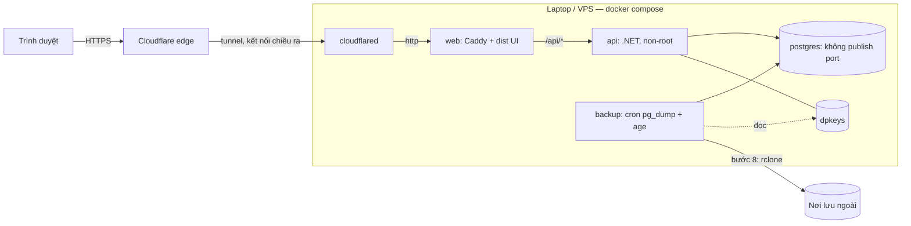

# M12 — Triển khai, backup & vận hành (Deployment & Ops)

> Theo khuôn [_TEMPLATE.md](_TEMPLATE.md). Mục nào là nghiệp vụ thuần (state machine, API, phân quyền…) ghi "Không áp dụng".
> Liên quan: [../guides/postgresql.md](../guides/postgresql.md) mục 10 (backup tay) và 12 (checklist production), [09-file-storage.md](09-file-storage.md) (thư mục upload),
> mẫu reverse proxy cũ của FE: `renting_room_ui/deploy/nginx.conf.example` (sẽ thay bằng `Caddyfile`).

> **Trạng thái (31/10/2026)**: mới có plan, **chưa làm bước nào**. Bước tiếp theo: **bước 1 (DO-01)**.
> Cách làm: **từng bước một**. Xong một bước (đạt tiêu chí "Đạt khi") thì dừng cho người dùng duyệt rồi mới sang bước sau.
> Bước có code thì theo quy trình [.claude/rules/common/change-process.md](../../.claude/rules/common/change-process.md): kịch bản test → test RED → code → docs → full test.
> Không commit khi người dùng chưa yêu cầu.

## 1. Mục tiêu & phạm vi

**Mục tiêu**: chạy thử production trên **một laptop Windows 11 Home** trước, sau này chuyển sang **VPS Linux**, sao cho:
1. **An toàn trước xâm nhập**: chỉ một cổng vào, DB không lộ ra ngoài, container không chạy root, secret không nằm trong git hay image.
2. **Sập rồi bật lại vẫn chạy như cũ**: API hoặc DB chết, cúp điện, khởi động lại máy thì hệ thống tự lên lại và không mất giao dịch đã lưu.
3. **Deploy không mất dữ liệu**: tự backup trước khi deploy, migration lỗi thì quay lại được.
4. **Có backup và khôi phục được**: backup tự động, mã hoá, cất ở nơi khác, có diễn tập restore.
5. **Chuyển laptop sang VPS mà người dùng không nhận ra**: giữ nguyên URL, giữ nguyên phiên đăng nhập, giữ nguyên dữ liệu, kể cả CCCD đã mã hoá.

**Quyết định đã chốt (31/10/2026)**
- Chạy bằng **Docker (Linux container)** trên cả laptop lẫn VPS, dùng **cùng một file compose**. Không chạy `dotnet` trực tiếp trên Windows để làm production: khoá DataProtection mặc định trên Windows bị mã hoá bằng DPAPI theo tài khoản Windows nên **không chuyển sang máy khác được** (xem mục 11).
- Reverse proxy dùng **Caddy**, không dùng nginx. Lý do: cấu hình ngắn, tự gửi `X-Forwarded-*`, và lên VPS có HTTPS tự động mà không cần certbot. Hiệu năng và `limit_req` của nginx không cần ở quy mô này, vì API đã tự giới hạn tốc độ.
- Chấp nhận **gián đoạn ngắn** thay vì "không gián đoạn tuyệt đối":
  - Deploy thường: khoảng 10–20 giây.
  - Chuyển laptop sang VPS: khoảng 5–10 phút bảo trì, làm lúc ít người dùng.
  - Lý do: chỉ có một DB ghi. Muốn không gián đoạn thật thì phải dựng replication, tốn nhiều ngày cấu hình và dễ sai.
- Ra internet (bước 8) dự kiến dùng **Cloudflare Tunnel**: laptop không cần IP tĩnh, không mở port router. Khi chuyển máy, chỉ cần chạy tunnel trên VPS, DNS và URL giữ nguyên. *Chưa chốt hẳn, xem mục 15 Q1.*

**Cam kết mất dữ liệu (RPO) theo tình huống**

| Tình huống | Mất dữ liệu | Nhờ đâu |
|---|---|---|
| API crash, `kill -9`, cúp điện, reboot | **0 giao dịch đã commit**, chỉ mất request đang chạy dở | WAL của PostgreSQL (`fsync`, `full_page_writes` để mặc định **on**), `restart: always` |
| Deploy bản mới | **0**, gián đoạn khoảng 10–20 giây | Backup trước deploy, migration tương thích ngược, `Idempotency-Key` cho phép gửi lại an toàn |
| Deploy hỏng hoặc migration lỗi | **0**, quay lại image cũ | Migration chạy trong transaction, giữ image cũ, có backup `pre-deploy` |
| Hỏng SSD, hỏng file đĩa ảo WSL, xoá nhầm volume, mất laptop | **Tối đa 1 giờ** | Backup mỗi giờ, mã hoá, có bản ở nơi khác (bước 8) |

Ví dụ: SSD hỏng lúc 10:59, bản backup gần nhất lúc 10:00. Mọi chỉ số và phiếu thu nhập trong 59 phút đó phải nhập lại từ sổ hoặc tin nhắn.
Muốn giảm xuống vài phút thì phải lưu WAL liên tục (pgBackRest hoặc WAL-G). Việc này **để sang lúc lên VPS** (Q4).
Trên laptop có thêm một rủi ro riêng: Docker Desktop chạy qua WSL2, mà mất điện đột ngột hiếm khi nhưng vẫn có thể làm hỏng file đĩa ảo `.vhdx`. Vì vậy bước 4 là bắt buộc.

**Trong phạm vi**: Dockerfile API và UI, compose production, Caddy, backup và restore, script deploy và rollback, gia cố laptop, ra internet, diễn tập sự cố, checklist chuyển sang VPS.

**Ngoài phạm vi**:
- Kubernetes, chạy nhiều máy, load balancer.
- Rolling deploy hoặc blue-green không gián đoạn.
- Lưu WAL liên tục (để sau, Q4).
- Hệ thống giám sát đầy đủ (Prometheus, Grafana).
- CD tự động từ GitHub Actions (để sau bước 9, Q6).

**Phase**: P1 (cần trước khi có người dùng thật).

## 2. Thuật ngữ

| Thuật ngữ | Định nghĩa |
|---|---|
| RPO | Lượng dữ liệu tối đa có thể mất, tính theo thời gian |
| Trạng thái bền | Những thứ **phải mang theo** khi chuyển máy, xem mục 4.1 |
| Diễn tập restore | Khôi phục backup lên một máy hoặc DB trống, rồi kiểm tra ứng dụng chạy và đọc được CCCD |
| Migration tương thích ngược | Migration mà **bản code cũ vẫn chạy được** trên schema mới, theo kiểu expand/contract. Xem [postgresql.md](../guides/postgresql.md) mục 8: "không xoá cột trong một bước" |

## 3. Nghiệp vụ

Không áp dụng, vì đây là hạ tầng. Không có use case nghiệp vụ hay state machine.

## 4. Dữ liệu

### 4.1 Trạng thái bền: 4 thứ không được mất

| # | Trạng thái | Nằm ở đâu | Nếu mất hoặc bị thay khác |
|---|---|---|---|
| 1 | **Dữ liệu PostgreSQL** | Named volume `pgdata` | Mất toàn bộ nghiệp vụ |
| 2 | **Khoá DataProtection** | Volume `dpkeys`, gắn vào `DataProtection:KeysPath` | **Mất vĩnh viễn số CCCD** ([PersonalDataProtector.cs](../../src/renting_room.Infrastructure/Identity/PersonalDataProtector.cs) mã hoá bằng DataProtection). Các response idempotency đang lưu ([IdempotencyStore.cs](../../src/renting_room.Infrastructure/Idempotency/IdempotencyStore.cs)) không đọc được nữa |
| 3 | **Secret** (`.env`, không commit) | Ngoài repo, có bản cất trong trình quản lý mật khẩu | Đổi `PersonalData__HashKey` thì tìm kiếm và chống trùng CCCD cũ hỏng. Đổi `Jwt__SigningKey` thì access token đang dùng hết hiệu lực. Refresh token lưu trong DB dạng SHA-256, không phụ thuộc khoá này |
| 4 | **File upload** (khi làm M09) | Volume `uploads` | Mất ảnh và bản scan hợp đồng |

Volume chứng chỉ của Caddy (`caddy_data`) **không** cần mang theo khi chuyển máy, Caddy tự xin lại. Nhưng phải là volume bền, nếu không Let's Encrypt sẽ khoá việc xin chứng chỉ vì vượt giới hạn 5 chứng chỉ giống nhau mỗi tuần.

**Hiện trạng (31/10/2026)**: `DataProtection:KeysPath` mặc định là rỗng ([ApiSetup.cs](../../src/renting_room.Api/ApiSetup.cs), đoạn `AddDataProtection`). Khi rỗng, app **vẫn chạy mà không báo gì**:
- Trên Windows: khoá nằm ở `%LOCALAPPDATA%\ASP.NET\DataProtection-Keys`, mã hoá DPAPI, không chuyển sang máy khác được.
- Trong container: khoá nằm ở `~/.aspnet/...`, mất khi tạo lại container. Nếu filesystem chỉ đọc thì khoá chỉ ở trong RAM, mất ngay khi restart.

Bước 1 sửa chỗ này.

### 4.2 Lịch giữ backup

| Loại | Tần suất | Giữ |
|---|---|---|
| Theo giờ | Mỗi giờ | 48 bản |
| Theo ngày | 02:00 | 14 bản |
| Theo tuần | Chủ nhật 02:00 | 8 bản |
| `pre-deploy-<version>` | Trước mỗi lần deploy | 10 bản gần nhất |

Mỗi bản gồm:
- `pg_dump -Fc` của DB `renting_room`;
- `pg_dumpall --globals-only` để giữ role và quyền;
- bản tar của `dpkeys`, và của `uploads` khi đã có M09;
- file `manifest` ghi version app, migration cuối và sha256.

Cả bản được **mã hoá bằng `age` với public key**. Private key cất **ngoài máy chạy**, nên kẻ chiếm được máy chủ cũng không giải mã được các bản backup cũ.

**Không để `.env` chung với backup.** Ai có cả dump, khoá DataProtection lẫn `HashKey` thì đọc được hết CCCD. `.env` cất riêng trong trình quản lý mật khẩu.

### 4.3 Dữ liệu dẫn xuất

Không áp dụng.

## 5. Kiến trúc triển khai

| Service | Image | Mạng | Port ra host | Volume |
|---|---|---|---|---|
| `postgres` | `postgres:16-alpine` (cố định digest) | `backend` | **Không có** | `pgdata` |
| `migrate` | Image có `psql` và `migrate.sql` idempotent | `backend` | Không có | Không có; chạy một lần khi deploy |
| `api` | Tự build, `aspnet:10.0` dạng chiseled hoặc non-root | `backend`, `frontend` | Không có | `dpkeys`, `uploads` |
| `web` | Tự build: Caddy cùng `dist` của UI | `frontend` | Bước 3–7: `127.0.0.1:8080:80`. Bước 8: không có (đi qua tunnel) | `caddy_data`, `caddy_config` |
| `backup` | Tự build: `postgres:16-alpine` cùng `age` và cron | `backend` | Không có | Đọc `dpkeys`, ghi `./backups` |
| `cloudflared` | `cloudflare/cloudflared` (bước 8) | `frontend` | Không có | Không có |

Ghi chú cho người làm:
- Docker Desktop publish port lên `0.0.0.0`, tức là **mở cho cả mạng LAN**, nên luôn ghi rõ `127.0.0.1:`.
- Postgres data phải để trong **named volume**, không bind mount ra ổ NTFS (`D:\...`). Bind mount ra NTFS vừa chậm vừa lỗi phân quyền.
- Thư mục `./backups` thì bind mount ra ổ Windows được.

## 6. Application — Commands / Queries

Không áp dụng. Code chỉ đổi ở phần khởi động: `DataProtection:KeysPath` (bước 1), và có thể có lệnh healthcheck cho image chiseled (bước 2).

## 7. API

Không thêm endpoint. Dùng hai endpoint đã có:
- `/health/live`: cho healthcheck của container;
- `/health/ready`: có kiểm tra DB, dùng cho script deploy.

Cả hai đều cho phép truy cập ẩn danh ([ApiSetup.cs](../../src/renting_room.Api/ApiSetup.cs), đoạn `MapHealthChecks`).

## 8. Validation cấu hình khi khởi động (fail-fast)

| Khoá | Quy tắc ngoài Development | Đã có? |
|---|---|---|
| `Jwt:SigningKey` | Bắt buộc, tối thiểu 32 byte | ✅ `JwtSigningKeyProvider` |
| `PersonalData:HashKey` | Bắt buộc, tối thiểu 32 ký tự | ✅ `PersonalDataOptions` |
| `DataProtection:KeysPath` | **Bắt buộc, thư mục tồn tại và ghi được** | ❌ **Bước 1** |
| `ReverseProxy:KnownProxies/KnownNetworks` | Rỗng thì chỉ cảnh báo | ✅ cảnh báo. Bước 8 xem lại |

Lưu ý: integration test chạy với environment **`Testing`**, không phải Development (`ApiFactory.UseEnvironment("Testing")`). Vì vậy `ApiFactory` phải đặt `DataProtection:KeysPath` trỏ tới một thư mục tạm, giống cách đang đặt `Jwt:SigningKey`.

## 9. Phân quyền

Không áp dụng cho người dùng ứng dụng. Phân quyền ở tầng hạ tầng:

| Đối tượng | Quyền |
|---|---|
| Role DB `renting_room_owner` | Sở hữu schema, **chỉ dùng cho `migrate`**. Mật khẩu chỉ nằm trong secret của migrate |
| Role DB `renting_room_app` | `SELECT/INSERT/UPDATE/DELETE` trên bảng, `USAGE` trên sequence (dùng `ALTER DEFAULT PRIVILEGES`). **Không** có `CREATE`, **không** phải superuser. API kết nối bằng role này |
| Superuser `postgres` | Chỉ dùng trong container, có mật khẩu mạnh, không có port nào ra ngoài |
| Tiến trình trong container | Không phải root, có `cap_drop: [ALL]` và `security_opt: no-new-privileges:true`. Filesystem chỉ đọc nếu được (`api`, `web`) |

## 10. Toàn vẹn dữ liệu khi sập và khi deploy

| Kịch bản | Cách chặn mất dữ liệu |
|---|---|
| Tắt êm (deploy, `docker compose stop`) | `stop_grace_period`: api 40 giây, vì `ShutdownTimeout` mặc định của .NET là 30 giây và `AuditLogWriter` cần ghi nốt hàng đợi. Postgres 60 giây để kịp checkpoint. Mặc định của Docker là 10 giây rồi SIGKILL, không đủ |
| Tắt đột ngột (cúp điện, `kill -9`) | Postgres phục hồi từ WAL. **Không bao giờ** tắt `fsync`, `full_page_writes` hay `synchronous_commit` để tăng tốc. Audit đọc đang nằm trong hàng đợi có thể mất vài giây, chấp nhận được |
| API lên trước khi DB sẵn sàng | `depends_on: postgres: condition: service_healthy` (healthcheck `pg_isready`, đã có trong compose dev) |
| Client gửi lại request trong lúc API khởi động lại | `Idempotency-Key` đã có sẵn, nên phiếu thu hay hoá đơn không bị ghi trùng |
| Migration lỗi giữa chừng | `psql -v ON_ERROR_STOP=1 --single-transaction -f migrate.sql`: lỗi thì rollback toàn bộ, API cũ vẫn chạy. Cẩn thận với migration có `CREATE INDEX CONCURRENTLY`, vì lệnh này không chạy được trong transaction |
| Bản mới lỗi sau khi đã migrate | Migration tương thích ngược, nên chỉ cần quay lại image cũ, không phải restore DB. Chỉ restore từ `pre-deploy` khi migration làm hỏng dữ liệu |
| Backup âm thầm hỏng hoặc không chạy | Mỗi bản backup chạy `pg_restore --list` để kiểm tra. Bước 8 thêm cảnh báo khi quá 2 giờ không có backup mới (healthchecks.io hoặc tương đương) |
| Đầy đĩa | Xoá backup theo lịch giữ ở 4.2. Xoay vòng log Docker (`json-file`, `max-size: 10m`, `max-file: 5`). Kiểm tra dung lượng trong checklist hằng tuần |

## 11. Bảo mật

Các lớp phòng thủ, theo thứ tự từ ngoài vào trong:
1. **Cổng vào**: chỉ có Cloudflare Tunnel, hoặc chỉ cổng 80/443 của Caddy trên VPS. Tường lửa Windows chặn chiều vào. Không publish port DB hay API.
2. **Caddy**: các header bảo mật chuyển từ `nginx.conf.example` sang (CSP, HSTS, `X-Frame-Options`, `nosniff`, `Referrer-Policy`, `Permissions-Policy`), cùng `try_files` cho SPA và cache dài cho `/assets/*`.
3. **API**: chạy non-root, filesystem chỉ đọc, `Swagger:Enabled=false`, rate limit theo **IP thật** (bước 8: `KnownNetworks` gồm subnet cố định của mạng `frontend`; `trusted_proxies` trên Caddy để giữ đúng `X-Forwarded-Proto: https` từ cloudflared; cách lấy IP từ `CF-Connecting-IP` phải kiểm chứng).
4. **DB**: không có port ra ngoài, app dùng role quyền tối thiểu, mật khẩu ngẫu nhiên.
5. **Secret**: chỉ nằm trong `.env` ngoài repo, có `.dockerignore` chặn chép vào image. Biến môi trường thì `docker inspect` xem được, nhưng ai có quyền docker thì cũng đã tương đương root, nên với laptop chấp nhận được. Có thể nâng lên Docker secrets cùng `KeyPerFile` sau (Q5).
6. **Image**: build nhiều tầng, cố định digest image gốc, quét lỗ hổng (`docker scout` hoặc `trivy`) trước khi deploy.
7. **Backup**: mã hoá `age`, private key cất ngoài máy, `.env` cất riêng.
8. **Máy chủ (laptop)**: Device Encryption (Windows Home không có BitLocker), cập nhật Windows, tài khoản Windows có mật khẩu mạnh.
9. **Tài khoản bootstrap admin**: đổi mật khẩu sau lần chạy đầu, rồi xoá `Bootstrap__Admin__Password` khỏi `.env`.

Khoá DataProtection lưu trên đĩa **không mã hoá** khi dùng `PersistKeysToFileSystem` trong Linux. **Có cân nhắc nhưng không làm** `ProtectKeysWithCertificate`, vì lại sinh thêm một certificate phải backup, và mất certificate cũng là mất CCCD. Thay vào đó: bảo vệ bằng quyền của volume (chỉ user của app đọc được) và mã hoá bản backup.

## 12. Kế hoạch test

### Bước 1 (code, có test tự động), mẫu theo `SecurityServicesTests` của `JwtSigningKeyProvider`

| # | Kịch bản | Mong đợi |
|---|---|---|
| T1 | Environment `Production`, `DataProtection:KeysPath` rỗng | Dừng khi khởi động, `InvalidOperationException` có chữ `DataProtection:KeysPath` |
| T2 | `Production`, `KeysPath` trỏ tới thư mục không tồn tại hoặc không ghi được | Dừng khi khởi động, thông báo nêu đường dẫn |
| T3 | Instance A với thư mục khoá X mã hoá `001234567890`. Dừng A, bật instance B cũng dùng X | B giải mã ra đúng `001234567890` |
| T4 | Như T3 nhưng B dùng thư mục khoá Y | Giải mã thất bại (`CryptographicException`). Test này chứng minh khoá là trạng thái bền |
| T5 | `Development` không cấu hình `KeysPath` | Chạy bình thường như hiện tại |
| T6 | Toàn bộ integration test (`Testing`) | Vẫn xanh sau khi `ApiFactory` đặt `KeysPath` vào thư mục tạm |

### Bước 2–9 (diễn tập có script hoặc làm tay, ghi kết quả vào mục 14)

| # | Kịch bản | Đạt khi |
|---|---|---|
| D1 | `docker run --rm --entrypoint id <api>` (hoặc kiểm tra `User` trong image) | Không phải uid 0 |
| D2 | Quét image tìm secret (`.env`, `appsettings.*.json` có giá trị, `secrets.json`) | Không có |
| D3 | Từ một máy khác trong LAN, quét port laptop (`5432`, `8080`, `5213`) | Đều đóng |
| D4 | `docker kill api`, `docker kill postgres` | Tự chạy lại, `/health/ready` trả 200 trong 60 giây |
| D5 | Tạo hợp đồng có CCCD, khởi động lại laptop, **không đăng nhập Windows** (hoặc chỉ đăng nhập tự động, tuỳ quyết định ở Q2) | Hệ thống tự lên, hợp đồng còn, in hợp đồng đọc được CCCD đầy đủ |
| D6 | Rút sạc và tắt cứng máy đúng lúc đang ghi phiếu thu | Sau khi bật: phiếu đã nhận 200 thì còn, phiếu chưa xong thì không có, không có dữ liệu nửa vời |
| D7 | Xoá cả 4 trạng thái bền (`docker compose down -v`, xoá `dpkeys`), rồi chạy `restore` từ bản backup gần nhất | Dữ liệu như lúc backup, CCCD đọc được, đăng nhập được |
| D8 | Deploy một bản cố ý lỗi khởi động | Script tự quay lại image cũ, không mất dữ liệu, gián đoạn dưới 1 phút |
| D9 | Deploy một migration cố ý lỗi | Rollback toàn bộ, DB không đổi, API cũ vẫn chạy |
| D10 | Kiểm tra header từ ngoài internet (securityheaders.com hoặc `curl -I`) | Có đủ CSP, HSTS, `X-Frame-Options`, `nosniff`. Không lộ `Server: Kestrel` |
| D11 | Gửi 21 lần đăng nhập sai từ IP A, rồi đăng nhập từ IP B | IP A bị 429, IP B vẫn đăng nhập được (rate limit theo IP thật, không chung IP proxy) |
| D12 | **Diễn tập tổng**: dựng lại toàn bộ trên một máy khác chỉ từ git, `.env` trong trình quản lý mật khẩu và backup ở nơi lưu ngoài | Chạy được, URL không đổi, người dùng đang đăng nhập không phải đăng nhập lại. Đây là tổng duyệt cho việc chuyển sang VPS |

## 13. Phụ thuộc

- Dùng: M01 (JWT, phiên đăng nhập), M03 (CCCD mã hoá), cơ chế idempotency.
- Bị dùng: M09 (thêm volume `uploads` vào backup). M11 Zalo dùng **polling** nên không cần cổng vào; khi bật thì thêm token vào `.env`.

## 14. Task breakdown: thứ tự làm, mỗi bước dừng để duyệt

| ID | Bước | Việc | Đạt khi | Ước lượng | Trạng thái |
|---|---|---|---|---|---|
| DO-01 | **1. Cố định trạng thái và secret** | Fail-fast cho `DataProtection:KeysPath` ngoài Development (nên chuyển phần cấu hình DataProtection vào Infrastructure cùng một options class, để unit test được như `JwtSigningKeyProvider`). Sửa `ApiFactory`. Thêm `.env.prod.example` (đủ mọi khoá ở mục 4.1 và mục 8). Thêm script sinh secret ngẫu nhiên (`scripts/new-secrets.ps1` và `.sh`). Bổ sung `appsettings.json` và [postgresql.md](../guides/postgresql.md) mục 12 | T1–T6 xanh, full test xanh | 0.5d | ⏳ Tiếp theo |
| DO-02 | **2. Đóng gói image** | `Dockerfile` cho API (build nhiều tầng, non-root, cố định digest, healthcheck không cần shell nếu dùng chiseled), `.dockerignore`. `Dockerfile` cho UI (build bằng node rồi đóng vào image Caddy cùng `dist`, `VITE_API_BASE_URL=/api/v1`). `Caddyfile` thay cho `nginx.conf.example` | D1, D2 | 0.5d | ☐ |
| DO-03 | **3. Compose production (chưa ra internet)** | `docker-compose.prod.yml` theo mục 5. Script khởi tạo role DB (`owner`/`app`). `restart: always`, healthcheck, `depends_on: service_healthy`, `stop_grace_period`, `read_only`, `cap_drop`, `no-new-privileges`, xoay vòng log, subnet cố định | D3, D4 | 1d | ☐ |
| DO-04 | **4. Backup và restore** | Service `backup` (cron, `pg_dump`, `pg_dumpall --globals-only`, tar `dpkeys`, mã hoá `age`, lịch giữ ở 4.2, kiểm tra bằng `pg_restore --list`). `scripts/backup` để chạy tay. `scripts/restore` dùng được cả cho máy trống. Hướng dẫn diễn tập | D7 | 1d | ☐ |
| DO-05 | **5. Quy trình deploy** | Build image có tag version, sinh `migrate.sql` idempotent (`dotnet ef migrations script --idempotent`). `scripts/deploy`: backup `pre-deploy`, chạy `migrate` (single transaction), đổi image `api`/`web`, chờ `/health/ready`; lỗi thì quay lại tag cũ. Thêm quy tắc migration tương thích ngược vào [postgresql.md](../guides/postgresql.md) mục 8 | D8, D9 | 1d | ☐ |
| DO-06 | **6. Caddy và header bảo mật** | Hoàn thiện `Caddyfile` (header, cache, SPA, ẩn header `Server`), chạy được trong LAN qua `127.0.0.1` | Header đúng (kiểm tra cục bộ phần không phụ thuộc HTTPS) | 0.5d | ☐ |
| DO-07 | **7. Gia cố laptop** | Checklist: tường lửa, Device Encryption, tắt chế độ ngủ, gập máy không làm gì, Docker tự chạy khi khởi động (Q2), active hours cho Windows Update, mật khẩu tài khoản. Hướng dẫn vào `docs/guides/deploy.md` | D5, D6 | 0.5d | ☐ |
| DO-08 | **8. Ra internet** *(cần người dùng chốt Q1, Q3)* | Tên miền, Cloudflare Tunnel (service `cloudflared`, bỏ port publish của `web`), `KnownNetworks` và `trusted_proxies`, IP thật. `rclone` đẩy backup lên nơi lưu ngoài. Cảnh báo khi backup trễ | D10, D11 | 1d | ☐ |
| DO-09 | **9. Diễn tập sự cố tổng** | Thực hiện D12, ghi lại thời gian từng bước và lỗi gặp phải, sửa tài liệu | D12 | 0.5d | ☐ |

Tài liệu đi kèm (viết dần qua từng bước): `docs/guides/deploy.md`, gồm cài đặt lần đầu, deploy, rollback, restore, diễn tập, checklist hằng tuần, và checklist chuyển sang VPS ở mục 14.2.

### 14.1 Chuyển máy DEV (làm code ở máy khác), không phải production

Git **không** mang theo những thứ sau:
- **User-secrets**: `%APPDATA%\Microsoft\UserSecrets\be2baafd-acf4-4916-84f6-2cbd77d86fe2\secrets.json` (chứa `Jwt:SigningKey`, `PersonalData:HashKey`…). Chép file sang máy mới, hoặc tạo secret mới nếu chỉ dùng dữ liệu demo.
- **DB dev** nằm trong Docker volume. Nếu chỉ có dữ liệu demo thì ở máy mới để seeder tạo lại (`Seed:DemoData:Enabled`). Nếu cần giữ dữ liệu thì dùng `pg_dump` (xem [postgresql.md](../guides/postgresql.md) mục 10). Nhưng **CCCD đã mã hoá sẽ không đọc được** ở máy mới, vì khoá dev là DPAPI. Đây chính là lỗi mà DO-01 chặn cho production.
- **Thay đổi chưa commit**: commit và push trước khi chuyển.

### 14.2 Checklist chuyển laptop sang VPS (làm sau DO-09)

1. Trước đó vài ngày: dựng VPS bằng cùng repo và cùng compose, chạy D12 trên VPS bằng backup thật, kiểm tra xong thì xoá dữ liệu thử.
2. Báo người dùng khung giờ bảo trì khoảng 10 phút.
3. Trên laptop: `docker compose stop api web`, để dừng mọi thao tác ghi.
4. Chạy `scripts/backup` lần cuối, rồi chép bản backup cùng `.env` sang VPS qua kênh mã hoá (`scp`).
5. Trên VPS: `scripts/restore`, rồi `docker compose up -d`, rồi kiểm tra `/health/ready` và CCCD.
6. Chuyển tunnel: dừng `cloudflared` trên laptop, bật trên VPS **cùng token tunnel**. DNS không đổi.
7. Kiểm tra từ ngoài. Người dùng đang đăng nhập vẫn dùng tiếp được, vì `Jwt__SigningKey` giữ nguyên và refresh token nằm trong DB.
8. Giữ laptop nguyên trạng (đã dừng) 7 ngày để có đường quay lại, rồi mới xoá.

## 15. Câu hỏi mở

| # | Câu hỏi | Đề xuất mặc định |
|---|---|---|
| Q1 | Đã có tên miền chưa? Có dùng Cloudflare (đổi nameserver về Cloudflare) được không? | Dùng tên miền ngay từ bước 8, không dùng IP hay `localhost`. Đổi URL nghĩa là mất token đã lưu trong trình duyệt, ai cũng phải đăng nhập lại |
| Q2 | Laptop bật lại mà chưa đăng nhập Windows thì Docker có chạy không? | Docker Desktop chỉ chạy **sau khi đăng nhập**. Phương án A: cho Windows tự đăng nhập. Cái giá: ai cầm laptop bật lên là vào thẳng desktop, nên phải có Device Encryption. Phương án B: chạy Docker Engine trong WSL2 dưới dạng service, bật bằng Task Scheduler "At startup". An toàn hơn nhưng dễ trục trặc hơn. **Đề xuất thử B ở DO-07, không ổn thì dùng A** |
| Q3 | Backup ngoài đẩy lên đâu? | Object storage đặt tại Việt Nam (Luật BVDLCN, xem M09 Q1) hoặc Google Drive/OneDrive qua `rclone`. Bản backup đã mã hoá `age` nên nhà cung cấp không đọc được |
| Q4 | Có cần mức mất dữ liệu dưới 1 giờ không? | Trên laptop: không cần. Lúc lên VPS thì cân nhắc pgBackRest/WAL-G (mất tối đa vài phút) hoặc thuê DB managed có PITR |
| Q5 | Secret qua biến môi trường hay Docker secrets? | Biến môi trường (`.env`) cho tới VPS. Sau đó xem xét `KeyPerFile` cùng `/run/secrets` |
| Q6 | Có làm CD tự động (GitHub Actions deploy) không? | Sau DO-09. Trước đó deploy bằng `scripts/deploy` chạy tay |
| Q7 | Máy dev hiện có dữ liệu hoặc CCCD **thật** không? | Nếu có: xuất `%LOCALAPPDATA%\ASP.NET\DataProtection-Keys` và dump DB **trước** khi làm bất cứ gì. Khoá DPAPI chỉ giải mã được trên đúng máy và đúng tài khoản Windows đó |

## 16. Checklist review

- [ ] Không có port DB hay API nào publish ra host. Port của `web` chỉ bind `127.0.0.1` cho tới khi có tunnel
- [ ] Mọi container non-root, có `no-new-privileges`, `cap_drop: ALL`
- [ ] Không có secret nào trong git, trong image, hay trong `appsettings.json`
- [ ] Đủ 4 trạng thái bền ở mục 4.1 đều nằm trên volume bền **và** có trong backup (`.env` cất riêng)
- [ ] Ngoài Development, thiếu `KeysPath`, `SigningKey` hoặc `HashKey` thì app dừng khi khởi động
- [ ] Backup được mã hoá, kiểm tra được, có bản ở nơi khác, và **đã diễn tập restore thành công** (D7, D12)
- [ ] Deploy luôn backup trước, migration chạy trong transaction, có đường quay lại
- [ ] `stop_grace_period` đủ dài cho api (≥ 40 giây) và postgres (≥ 60 giây)
- [ ] Rate limit tính theo IP thật của người dùng (D11)
